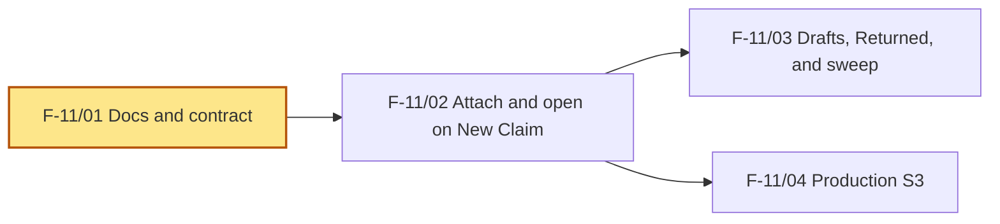

# F-11/01: Receipt File documents and engineering contract

## Objective

The project documents describe F-11 Receipt Files before any code lands: SRS, feature inventory, SDS, traceability matrix, and an F-11 engineering contract that the later tickets follow.

## Context

F-11 adds Receipt Files (photos or PDFs that prove payment, attached to line items). It supersedes #61 (F-EXTRA-01), which was planned but never built, and reverses SRS D-09 and the file-upload half of EX-05. It is part of Sprint 3. The decisions are in ADR 0002 (S3 through `aws-sdk-go-v2`, RustFS locally, AWS S3 in production, presigned URLs) and the **Receipt File** glossary entry, both written with this ticket. The spec is the local file `.scratch/f-11-receipt-files/spec.md`, removed once this ticket merges.

## Diagrams

### Ticket dependencies

F-11 tickets only. This ticket is highlighted.

## Scope

### In scope

- SRS: revise D-09 and EX-05 (file upload in, OCR out) and add the Receipt File requirements: upload, link per line item, view, freeze after submit, and sweep. Revise the line-item wording in FR-02 so the receipt reference stays required and Receipt Files are optional.
- Feature inventory: the F-11 row (depends on F-02, F-03, F-05, F-06), the dependency graph, the sprint summary, and the SDS references.
- SDS: the storage component and its seam, the `receipt_files` table and states (`UPLOADING`, `READY`), the endpoints, the `receipt:create` Route Permission, the Visible Claim rule for downloads, configuration (`S3_*`, `AWS_*`), compose services, and production provisioning.
- F-11 engineering contract, in the same shape as the Sprint 3 contracts: feature SDS, UI spec, API spec, data spec, numbered acceptance criteria (F11-AC-NN), Software Test Specification (F11-TEST-NN), feature DoD, and revision history. It assigns each AC and test to F-11/02, F-11/03, or F-11/04.
- `traceability.md`: F-11 rows and the change-log entry for the D-09 reversal.
- ADR 0002 and the glossary entry, already drafted on this branch.

### Out of scope

- Any code, schema, or infrastructure change.
- OCR, thumbnails, resizing, HEIC, virus scanning, file versions, multipart uploads, browser checksums, keyless GCP-to-AWS federation, and sweep scheduling.

## Implementation notes

- Use the glossary terms: Receipt File, Line Item, Visible Claim, Route Permission, Draft, Return. Never "attachment" or "upload" for the file itself.
- Record in the contract why downloads answer 302 to a presigned GET, and why the API signs for `S3_PUBLIC_ENDPOINT` rather than `S3_ENDPOINT`.
- The contract states that CI has no Playwright job (#96), so the RustFS presign and CORS path is proven by the local E2E run before release.

## Dependencies and risks

- Dependencies: none (can start immediately).
- Risks: the contract becomes the source of truth for F-11/02 to F-11/04. A gap found later is a contract revision row in the implementation PR.
- Rollback or follow-up plan: revert the squash commit on `sprint-3`. A follow-up PR removes `.scratch/f-11-receipt-files/` once the tickets are published.

## Acceptance criteria

- [ ] SRS D-09 and EX-05 are revised, and the new Receipt File requirements have IDs.
- [ ] `features.md` has the F-11 row, graph edges, and SDS references.
- [ ] The SDS covers the storage component, `receipt_files`, the endpoints, `receipt:create`, configuration, and provisioning.
- [ ] The F-11 contract has numbered ACs and tests, each assigned to one implementation ticket.
- [ ] `traceability.md` maps every new requirement to its ACs and tests, and logs the change.
- [ ] ADR 0002 and the **Receipt File** glossary entry are merged.

## Validation

- `bun run check` at the root.
- Every new requirement ID appears in `traceability.md`, and every contract AC traces to a requirement.

## Related work

- Supersedes #61 (F-EXTRA-01)
- ADR 0002: Receipt Files live in S3, and browsers move the bytes with presigned URLs
- Spec (local): `.scratch/f-11-receipt-files/spec.md`
- Product DoD: `docs/sprints/sprint-3/definition-of-done.md`
