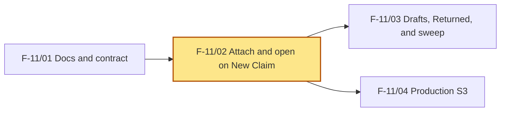
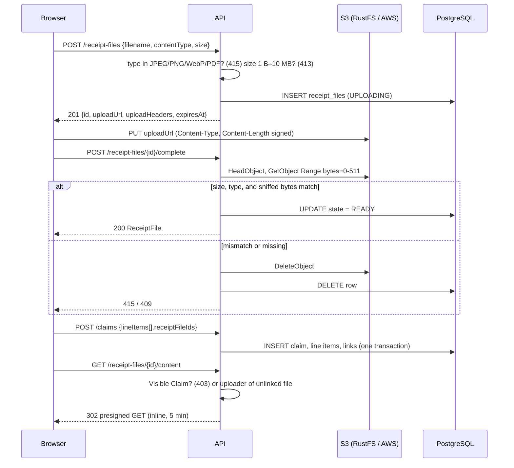

# F-11/02: Attach Receipt Files on New Claim and open them from Claim Detail

## Objective

A requester picks photos or PDFs on each line item of New Claim. They upload straight to the bucket with a progress bar, and are sent with the claim. Anyone who can see the claim opens them from Claim Detail in a new tab. `bun run deps:up` and `docker compose up` run RustFS, so this works locally from one command.

## Context

F-11 ticket 2, the tracer bullet through storage, API, and web. The F-11 engineering contract from F-11/01 is the source of truth: if this issue and the contract differ, the contract wins. Decisions: ADR 0002.

## Diagrams

### Ticket dependencies

F-11 tickets only. This ticket is highlighted.

### Workflow

## Scope

### In scope

- **Storage stack:**
  - Compose services `rustfs` (`rustfs/rustfs:1.0.7`, named volume, `/health` healthcheck, loopback port) and a one-shot `rustfs-init` (`amazon/aws-cli`). The init creates the bucket and sets CORS for `localhost:3000` and `localhost:8080`. `app` waits for the init.
  - `bun run db:up` is renamed `bun run deps:up` and starts `db`, `rustfs`, and `rustfs-init`. There is no alias, and every reference is updated.
  - Config: `S3_BUCKET`, `S3_REGION`, `S3_ENDPOINT`, `S3_PUBLIC_ENDPOINT` (defaults to `S3_ENDPOINT`), `AWS_ACCESS_KEY_ID`, and `AWS_SECRET_ACCESS_KEY` (sensitive), in `.env.schema` and `.env.example`.
- **Storage seam:** one narrow interface (presign put, presign get, head object, read the first bytes, delete, list, head bucket). It has one `aws-sdk-go-v2` adapter, with checksum calculation and validation set to `WhenRequired` and path-style only when an endpoint is set. Readiness also runs head bucket.
- **Data:** the `receipt_files` table: key `receipts/<uuidv7>`, uploader, original filename, content type, size, state `UPLOADING`/`READY`, nullable line item, and created time.
- **Endpoints and access:**
  - `POST /receipt-files`, `POST /receipt-files/{id}/complete`, `DELETE /receipt-files/{id}` (unlinked only in this ticket), and `GET /receipt-files/{id}/content`.
  - The new Route Permission `receipt:create` for requester and reviewer.
  - Downloads follow Visible Claim, and an unlinked file only its uploader.
- **Linking on New Claim:** `receiptFileIds` on line items of create and submit. Each ID must exist, belong to the actor, be `READY`, and be unused, with at most 5 per line item. Failures are field errors, and nothing is saved. Links are written in the claim's transaction. Claim detail line items return `receiptFiles`.
- **Web:**
  - A Receipt File picker per line-item row on New Claim: file button or drop zone, camera capture, XHR upload with progress, and cancel or remove.
  - Client-side type and size checks. Only `READY` IDs go into the body, and files survive a server rule error.
  - Claim Detail lists Receipt Files per line item. Each one opens in a new tab.
- **E2E:** `f11-receipt-files.spec.ts` on the seeded compose stack. A requester attaches a PNG and a PDF and submits, the assigned reviewer opens both, and an unrelated reviewer is refused.

### Out of scope

- Behavior owned by other tickets: F-11/03 (Receipt Files on Draft and Returned edits, freezing after submit, Draft delete, and the sweep) and F-11/04 (production bucket and deploy).
- Anything the contract does not list in its AC.

## Implementation notes

- Branch from `sprint-3` as `feat/<short-kebab-name>`; PR into `sprint-3` with a squash merge.
- Work test-first for business rules: commit the failing test, then the code. Record both commit IDs in the PR.
- Router integration tests use a real Postgres from `pgtest` and the real S3 adapter against an in-process `gofakes3` (pinned). It does not check signatures, so tests check the issued URL, headers, and expiry, then write the object directly to stand in for the browser PUT.
- The route inventory test gains the four endpoints and `receipt:create`.
- `feature/s3/manager` is deprecated, and `transfermanager` is 0.x. Use `s3.Client` and `s3.PresignClient` only.
- The seed creates no Receipt Files.

## Dependencies and risks

- Dependencies: Blocked by F-11/01 (documents and engineering contract).
- Risks: RustFS CORS or presign behavior differs from AWS S3. The E2E run on RustFS and the F-11/04 check on AWS catch it, and RustFS stays pinned. The ticket is large, so split the PR at the storage seam if review needs it.
- Rollback or follow-up plan: revert the squash commit on `sprint-3`. If the contract must change, add a revision row to the contract in the same PR.

## Acceptance criteria

From the F-11 contract, the ACs assigned to F-11/02. The contract text is the full criterion.

- [ ] `bun run deps:up` and `docker compose up --build` start RustFS with the bucket and CORS ready; `/ready` fails when the bucket is unreachable.
- [ ] Create rejects a wrong type (415) or a size outside 1 B–10 MB (413) with a field message, and returns a presigned PUT with type and size signed and a 5-minute expiry.
- [ ] Complete marks the file `READY` only when the stored size, type, and first bytes match. Otherwise it deletes the object and the row.
- [ ] Object keys are `receipts/<uuidv7>`, with no user input.
- [ ] Create and submit link `READY` Receipt Files per line item in one transaction. A wrong owner, an unknown, used, or not-`READY` ID, or more than 5 files gives a field error, and nothing is saved. A line item with no files is valid.
- [ ] The uploader can delete an unlinked Receipt File.
- [ ] The download answers 302 to an inline presigned GET with the stored type and original filename, following Visible Claim. Anyone else gets 403, and an unknown ID gets 404. The matrix covers requester, assigned reviewer, unrelated reviewer, and Finance Officer.
- [ ] Web: the picker with progress, cancel, remove, and client checks. IDs go in the submit body, files survive a rule error, and Claim Detail lists and opens them.
- [ ] E2E `f11-receipt-files.spec.ts` passes on the seeded compose stack.
- [ ] Product DoD (`docs/sprints/sprint-3/definition-of-done.md`) is met, with evidence linked in the PR.
- [ ] `docs/traceability.md` has the actual test name and result for each AC above.

## Validation

- `bun run check` at the root.
- In `apps/api`: `bun run format`, `bun run lint:fix`, `bun run test:coverage` (100%), `bun run vuln`, and `bun run tidy` after dependency changes.
- Every planned test runs and passes at its stated level; manual tests are recorded with the commit ID.
- `bun run e2e` in `apps/web` against the seeded compose stack.

## Related work

- Contract: F-11 engineering contract (F-11/01)
- ADR 0002: Receipt Files live in S3, and browsers move the bytes with presigned URLs
- Supersedes #61 (F-EXTRA-01)
- Product DoD: `docs/sprints/sprint-3/definition-of-done.md`
