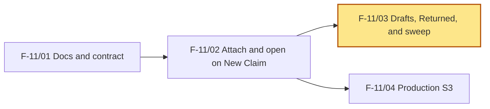

# F-11/03: Receipt Files on Drafts and Returned claims, and the sweep

## Objective

A requester adds and removes Receipt Files whenever line items are editable, which means a Draft or a Returned claim. Once a claim is submitted onward, its Receipt Files are frozen. Deleting a Draft deletes its files. A `sweep` subcommand clears orphaned uploads and objects.

## Context

F-11 ticket 3. The F-11 engineering contract from F-11/01 is the source of truth. It reuses the storage seam, table, and endpoints from F-11/02, and the shared claim editor from F-05 and F-06.

## Diagrams

### Ticket dependencies

F-11 tickets only. This ticket is highlighted.

## Scope

### In scope

- `receiptFileIds` on line items of save-draft, update, and resubmit, with the same link rules as F-11/02. Files dropped from a line item are unlinked and deleted.
- A Receipt File is editable only while it is unlinked or linked to a `DRAFT` or `RETURNED` claim. Delete or relink on any other claim is 409 BR-03.
- Deleting a Draft deletes its Receipt File rows in the transaction, and their objects after commit. A failed object delete is left for the sweep.
- Removing a Receipt File from a Returned claim writes no history entry of its own. Withdraw, Reject, and Approve keep Receipt Files.
- Draft visibility: only the requester can open a Draft's Receipt Files. Finance gets 403.
- **Web:** the picker on Edit Claim for Draft and Returned, prefilled with the linked files.
- **`sweep` subcommand** next to `migrate` and `seed`. It deletes Receipt Files unlinked for more than 24 h, objects with no row, and rows whose object is missing. It is safe to run again and is run by hand.

### Out of scope

- Behavior owned by other tickets: F-11/02 (New Claim linking, download, storage stack) and F-11/04 (production).
- Scheduling the sweep.
- Anything the contract does not list in its AC.

## Implementation notes

- Branch from `sprint-3` as `feat/<short-kebab-name>`; PR into `sprint-3` with a squash merge.
- Work test-first for business rules: commit the failing test, then the code. Record both commit IDs in the PR.
- Every edit path re-runs the five-per-line-item cap together with the existing line-item rules (BR-05, BR-06, BR-08, BR-12).
- Sweep tests seed rows and objects in `gofakes3` directly and set created times in the past.

## Dependencies and risks

- Dependencies: Blocked by F-11/02 (attach and open on New Claim).
- Risks: the object delete after commit can fail silently. The sweep is the safety net, so its test must cover a row-less object.
- Rollback or follow-up plan: revert the squash commit on `sprint-3`. If the contract must change, add a revision row to the contract in the same PR.

## Acceptance criteria

From the F-11 contract, the ACs assigned to F-11/03. The contract text is the full criterion.

- [ ] Save-draft, update, and resubmit link and unlink Receipt Files with the F-11/02 rules. A Draft or Returned claim can add or remove files.
- [ ] Delete or relink on a `SUBMITTED`, `PENDING_FINANCE`, `APPROVED`, `REJECTED`, or `WITHDRAWN` claim gets 409 BR-03.
- [ ] Deleting a Draft removes its Receipt Files and objects.
- [ ] A Draft's Receipt Files are visible only to the requester.
- [ ] Web: Edit Claim shows linked files and lets the requester add or remove them on a Draft or Returned claim.
- [ ] `sweep` deletes unlinked files older than 24 h, row-less objects, and object-less rows, and a second run changes nothing.
- [ ] Product DoD (`docs/sprints/sprint-3/definition-of-done.md`) is met, with evidence linked in the PR.
- [ ] `docs/traceability.md` has the actual test name and result for each AC above.

## Validation

- `bun run check` at the root.
- In `apps/api`: `bun run format`, `bun run lint:fix`, `bun run test:coverage` (100%), `bun run vuln`, and `bun run tidy` after dependency changes.
- Every planned test runs and passes at its stated level; manual tests are recorded with the commit ID.

## Related work

- Contract: F-11 engineering contract (F-11/01)
- F-05 Drafts and F-06 Return and resubmit contracts (the shared claim editor)
- ADR 0002
