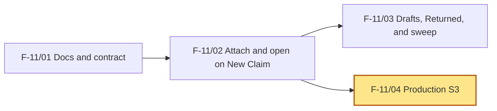

# F-11/04: Production S3 bucket and deploy wiring

## Objective

The deployed app stores Receipt Files in a private AWS S3 bucket. The bucket and its bucket-scoped access key come from one idempotent script, the key pair lives only in Secret Manager, and the production image has no storage server.

## Context

F-11 ticket 4. The F-11 engineering contract from F-11/01 is the source of truth. Production runs on Cloud Run (Lab 5, `deploy/setup.sh`, the Deploy demo workflow). ADR 0002 chose an AWS bucket reached with a bucket-scoped IAM access key, rather than keyless federation.

## Diagrams

### Ticket dependencies

F-11 tickets only. This ticket is highlighted.

## Scope

### In scope

- A new idempotent aws-cli script under `deploy/`, with `DRY_RUN=1` like `setup.sh`. It creates or reuses:
  - the bucket in `ap-southeast-1`, with Block Public Access, SSE-S3, and versioning off
  - CORS for the Cloud Run URL (PUT, GET, `content-type`, expose `ETag`)
  - a lifecycle rule that aborts incomplete multipart uploads after 1 day
  - an IAM user whose policy allows only `s3:GetObject`, `s3:PutObject`, `s3:DeleteObject`, and `s3:ListBucket` on that bucket
- `deploy/setup.sh` adds the key pair to Secret Manager without printing or replacing it, and grants the runtime service account access.
- The deploy workflow passes `S3_BUCKET`, `S3_REGION`, and the two secrets to the service and the migrate job. `S3_ENDPOINT` and `S3_PUBLIC_ENDPOINT` stay unset.
- The deployment doc gets the resource names, the key rotation steps, and the manual `sweep` run.

### Out of scope

- Keyless GCP-to-AWS federation, sweep scheduling, and a storage server in the image.
- Anything the contract does not list in its AC.

## Implementation notes

- Branch from `sprint-3` as `feat/<short-kebab-name>`; PR into `sprint-3` with a squash merge.
- The access key is created once and written straight to Secret Manager. It never reaches a terminal or a log.
- The smoke test already hits readiness, so a wrong bucket or key fails the deploy.

## Dependencies and risks

- Dependencies: Blocked by F-11/02 (attach and open on New Claim). The final check needs its upload and download.
- Risks: AWS costs and a long-lived key. The policy is scoped to one bucket, and the doc records rotation. Cross-cloud latency from `asia-southeast1` to `ap-southeast-1` is small for files up to 10 MB.
- Rollback or follow-up plan: redeploy the previous image. The bucket and secrets can stay, because the old image ignores them.

## Acceptance criteria

From the F-11 contract, the ACs assigned to F-11/04. The contract text is the full criterion.

- [ ] The script creates the bucket, CORS, lifecycle rule, and scoped IAM user, and a second run changes nothing. `DRY_RUN=1` prints the plan only.
- [ ] The key pair is in Secret Manager only, and nothing secret is in Git (SR-02).
- [ ] The deploy passes the env to the service and the migrate job, and readiness passes on the deployed URL.
- [ ] Checked by hand on the deployed URL: a requester uploads a Receipt File, and the assigned reviewer opens it. The commit ID is recorded.
- [ ] Product DoD (`docs/sprints/sprint-3/definition-of-done.md`) is met, with evidence linked in the PR.

## Validation

- `bun run check` at the root.
- `DRY_RUN=1` run of the new script and of `deploy/setup.sh`, with the output attached to the PR.
- The deploy workflow's smoke test passes, plus the manual check above.

## Related work

- Contract: F-11 engineering contract (F-11/01)
- ADR 0002
- Lab 5 deployment: `docs/labs/lab-05/deployment.md`, #54
