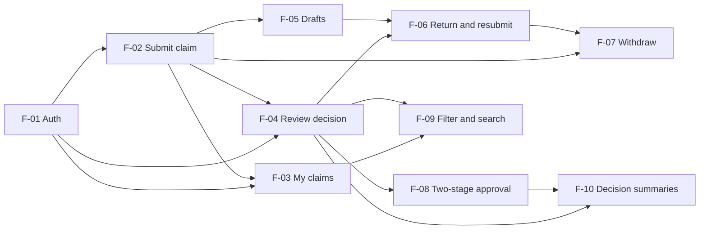

# Feature Inventory

- **Product:** ClaimFlow — Department Expense Reimbursement System
- **Baseline:** `docs/srs.md` v0.2
- **Version:** 1.0 (IDs frozen on merge; later changes go in the change log in `docs/traceability.md`)
- **Last updated:** 2026-11-01

This document splits the SRS into **features**, which are user-visible slices delivered in one sprint, and **system responsibilities**, which are cross-cutting qualities that no single feature owns. Requirement IDs are the SRS IDs, unchanged. The requirement-by-requirement view is in `docs/traceability.md`.

---

## 1. Features

| ID | Feature | Description | Requirements | Depends on | Sprint |
| --- | --- | --- | --- | --- | --- |
| F-01 | Authentication and session | Log in, log out, and get the current user and role, using a server-side session. Seeded accounts only. | FR-01, NFR-01, NFR-03 | — | 1 |
| F-02 | Submit claim | Create and submit a claim with 1–20 line items. The server calculates the total, validates amounts, dates, and categories, and records the assigned reviewer at first submission. | FR-02, FR-03, BR-05, BR-06, BR-07, BR-08, BR-12, BR-15, BR-17, NFR-08 | F-01 | 1 |
| F-03 | My claims | The requester lists their own claims and opens one to see its line items, total, status, and history. | FR-04 | F-01, F-02 | 1 |
| F-04 | Review decision | A Reviewer or Finance Officer sees their queue of assigned `Submitted` claims and approves or rejects each one, with a history entry written in the same transaction. Self-approval, unrelated reviewers, and concurrent decisions are rejected. | FR-05, FR-06, FR-07, BR-01, BR-02, BR-03, BR-04, BR-11, BR-13, NFR-06 | F-01, F-02 | 1 |
| F-05 | Drafts | Save a claim as a draft, edit it, submit it later, or delete it. Only the owner sees a draft. | FR-08, BR-10, BR-15, BR-03, NFR-08 | F-02 | 2 |
| F-06 | Return and resubmit | The assigned reviewer returns a `Submitted` claim with a reason, at most 3 times. The requester edits it and resubmits it to the same reviewer. The 90-day window counts from the first submission. | FR-09, FR-10, FR-07, BR-14, BR-01, BR-02, BR-03, BR-04, BR-07, BR-10, BR-17, NFR-08 | F-04, F-05 | 2 |
| F-07 | Withdraw | The requester withdraws their own claim while it is `Submitted` or `Returned`. | FR-11, FR-07, BR-16, BR-03 | F-02, F-06 | 2 |
| F-08 | Two-stage high-value approval | A claim over 10,000.00 THB approved by a non-Finance reviewer moves to `PendingFinance`. A Finance Officer then makes the final approve or reject decision. If the assigned reviewer is a Finance Officer, their approval is final. | FR-12, FR-07, BR-09, BR-01, BR-02, BR-03, BR-04 | F-04 | 3 |
| F-09 | Filter and search | Filter the claims a user may see by status, category, and date range, and search them by title. | FR-13 | F-03, F-04 | 3 |
| F-10 | Decision summaries | Counts by status, approved total by category and month, and average decision time. Reviewers see their assigned claims; Finance sees the whole department. | FR-14 | F-04, F-08 | 3 |

### 1.1 Dependency graph

Every dependency points to the same sprint or an earlier one, so each sprint can be built in order.

### 1.2 Notes on the split

- **F-04 includes Finance Officers.** In Sprint 1 the Finance Officer is the Department Head's assigned reviewer (ADR-0001) and uses the same queue and decisions as a Reviewer. F-08 only adds the final-decision stage.
- **F-05 and F-06 share the claim editor.** F-05 builds editing for `Draft`; F-06 reuses it for `Returned` claims. That is why F-06 depends on F-05.
- **F-07 depends on F-06** because withdrawing from `Returned` needs the `Returned` state to exist. Withdrawing from `Submitted` could ship without it, but F-07 is planned as one feature in Sprint 2.
- **Rules that span sprints** (BR-01, BR-02, BR-03, BR-04, BR-07, BR-10) are listed under every feature that adds a new path where the rule applies. Each of those features must test the rule on its own paths.

## 2. System responsibilities

These are cross-cutting requirements. Each lists the sprint that **establishes** it and the sprint(s) that **verify** it.

| ID | Responsibility | Requirements | Applies to | Established | Verified |
| --- | --- | --- | --- | --- | --- |
| SR-01 | Authorization enforcement: 401 for anonymous requests, 403 for wrong role or no ownership/assignment, enforced on the server | NFR-02 | Every feature that adds an endpoint: F-01–F-10 | Sprint 1 | Sprint 1, 2, 3 (each sprint's new endpoints) |
| SR-02 | Secrets and configuration: varlock schema, no secrets in Git, `.env.example` | NFR-04 | All | Sprint 1 (local) | Sprint 1 (repository scan); Lab 5 (Secret Manager on GCP) |
| SR-03 | Persistence and durability: data survives restart and redeploy | NFR-05 | All | Sprint 1 (PostgreSQL + migrations) | Sprint 1 (local restart); Lab 5 (GCP redeploy) |
| SR-04 | Lifecycle integrity: valid transitions only, append-only history, one transaction per change, optimistic locking | BR-03, BR-11, BR-13, NFR-06 | F-04, F-05, F-06, F-07, F-08 | Sprint 1 (F-04) | Sprint 1, 2, 3 (every new transition) |
| SR-05 | Performance with realistic data volume | NFR-07 | F-03, F-04, F-09, F-10 | Sprint 3 (`seed:load` dataset) | Sprint 3 (timed API run on the deployed instance) |
| SR-06 | Automated tests and CI gate: every BR tested, 100% Go coverage, required checks on PRs | NFR-09 | All | Sprint 1 (existing CI) | Sprint 1, 2, 3 |
| SR-07 | Containerized delivery: one-command local run with Docker | NFR-10 | All | Lab 5 | Lab 5 |

## 3. Sprint summary

| Sprint | Features | Responsibilities established |
| --- | --- | --- |
| 1 (due 8 Nov) | F-01, F-02, F-03, F-04 | SR-01, SR-02 (local), SR-03 (local), SR-04, SR-06 |
| Lab 5 (due 15 Nov) | — | SR-02 (cloud), SR-03 (GCP), SR-07 |
| 2 (due 29 Nov) | F-05, F-06, F-07 | — (SR-01, SR-04, SR-06 re-verified) |
| 3 (due 13 Dec) | F-08, F-09, F-10 | SR-05 (SR-01, SR-04, SR-06 re-verified) |

Sprint goals and sequencing are detailed in the three-sprint plan (#5).
