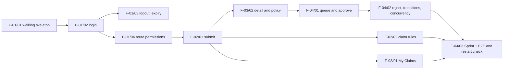
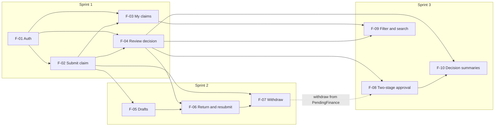

# Three-Sprint Plan

- **Product:** ClaimFlow – Department Expense Reimbursement System
- **Baseline:** `docs/srs.md` v0.2 · Features: `docs/features.md` v1.0 · Design: `docs/system-sds.md` v0.8
- **Issue:** #5 · **Version:** 0.1 (draft) · **Last updated:** 2026-11-05

This plan orders the features in `docs/features.md` into three sprints. It shows the dependencies, fits the work around the labs and the exam period, and explains the Sprint 1 scope. Feature IDs and requirement IDs are unchanged from those documents. Work items for each feature are in `.scratch/<feature>/issues/` (see `docs/agents/issue-tracker.md`).

---

## 1. Overview

| Sprint | Goal | Features | Checkpoint |
| --- | --- | --- | --- |
| 1 | Small working slice: authentication, permissions, persistence, submit → approve or reject with history | F-01, F-02, F-03, F-04 | D1, 8 Nov |
| 2 | Core expansion: drafts, return and resubmit, withdraw | F-05, F-06, F-07 | D2, 29 Nov – must be complete |
| 3 | Two-stage approval, filter and search, decision summaries, hardening | F-08, F-09, F-10 | F-08 working by 29 Nov (D2); all done by 13 Dec (Final) |

Each feature is in exactly one sprint. Every dependency points to the same sprint or an earlier one (section 3).

## 2. Sprints

### 2.1 Sprint 1 – Working slice (3 Nov → 8 Nov, D1)

- **Goal:** a requester logs in, submits a claim, and sees its status. The assigned reviewer logs in, approves or rejects it, and the decision is in the claim's history. Invalid transitions, self-approval, unrelated reviewers, and concurrent decisions are refused.
- **Features:** F-01 Authentication and session · F-02 Submit claim · F-03 My claims · F-04 Review decision
- **Responsibilities established:** SR-01 (authorization), SR-02 (local secrets), SR-03 (local persistence), SR-04 (lifecycle integrity), SR-06 (tests and CI gate)
- **Dependencies:** F-01 → F-02 → F-03 and F-04. Contracts in `docs/sprints/sprint-1/` (#6) merge before implementation.
- **Completion outcome:** every AC in the four contracts passes its planned test (`docs/traceability.md`). The Product DoD (`docs/sprints/sprint-1/definition-of-done.md`) is met. `staging-1` is released to `main` and the release tag is the accepted Sprint 1 release.
- **Work order (critical path):**



After F-02/01, the work splits into three paths (rules, My Claims, detail → decisions), so both students can work at the same time with separate write scopes.

### 2.2 Sprint 2 – Core expansion (9 Nov → 22 Nov)

- **Goal:** the requester can keep drafts, the reviewer can return a claim with a reason, the requester can fix and resubmit it, and the requester can withdraw a claim.
- **Features:** F-05 Drafts · F-06 Return and resubmit · F-07 Withdraw
- **Responsibilities re-verified:** SR-01, SR-04, SR-06 on every new endpoint and transition
- **Dependencies:** F-02 → F-05 → F-06 (F-06 also needs F-04) → F-07. F-05 builds the claim editor that F-06 reuses for `Returned` claims.
- **Completion outcome:** all Sprint 2 contracts written and merged before their code (by 11 Nov). All Sprint 2 AC pass. `staging-2` is released to `main` by 22 Nov, one week before D2, so the week of 23 Nov is free for Sprint 3 and Lab 7.
- **Work order:** F-05/01 save and view → F-05/02 edit → F-05/03 submit draft → F-05/04 delete → F-06/01 return → F-06/02 edit and resubmit → F-07/01 withdraw.

### 2.3 Sprint 3 – Completion and hardening (19 Nov → 13 Dec)

- **Goal:** high-value claims need a final Finance decision; users can filter and search; reviewers and Finance see decision summaries; the product meets NFR-07 with realistic data.
- **Features:** F-08 Two-stage high-value approval · F-09 Filter and search · F-10 Decision summaries
- **Responsibilities established:** SR-05 (performance, NFR-07). SR-01, SR-04, SR-06 re-verified.
- **Dependencies:** F-04 → F-08 → F-10. F-03 and F-04 → F-09. F-07 → F-08/01 (withdrawing a `PendingFinance` claim is tested in F-08).
- **Completion outcome:**
  - **By 29 Nov (D2):** all Sprint 3 contracts written; F-08 implemented, tested, and on `main` in the D2 candidate. This is the "at least one Sprint 3 workflow" that D2 asks for.
  - **By 30 Nov:** F-09 and F-10 implemented and tested, so no main workflow is left for the exam period.
  - **1–11 Dec:** defect fixes, UAT re-tests, NFR-07 timed run on the deployed release, final regression, and the demo video only.
  - **By 13 Dec (Final):** final release on `main`, deployed on GCP.
- **Work order:** Sprint 3 contracts (19–23 Nov, next to the end of Sprint 2; `docs:` PRs go to `staging-2` until `staging-3` exists) → F-08/01 Pending finance → F-08/02 Finance Queue and final decisions → F-09/01 filters and search → F-10/01 decision summary → F-10/02 load dataset and NFR-07 run.

## 3. Feature dependency graph



The dashed edge is a work-item dependency, not a feature dependency in `docs/features.md`: F-08/01 tests withdrawal from `PendingFinance`, which needs F-07.

## 4. Calendar

| Date | Sprint work | Lab and deliverable work |
| --- | --- | --- |
| 3–5 Nov | Sprint 1 contracts (#6); F-01/01 walking skeleton | Workshop: SRS, SDS, Sprint 1 contract; Lab 5 starts |
| 6–8 Nov | F-01 → F-04 implementation; Sprint 1 release to `main` | **8 Nov: D1 due** (baseline + working Sprint 1) |
| 9–11 Nov | Sprint 2 contracts; F-05 | Lab 5: Dockerfile, Docker Compose, CI/CD to GCP; 10, 12 Nov Lab 6 workshop |
| 12–15 Nov | F-05, F-06/01 | Lab 5: deploy the Sprint 1 release on GCP; Secret Manager (NFR-04); redeploy check (NFR-05); one-command run (NFR-10). **15 Nov: Lab 5 due** |
| 16–19 Nov | F-06/02, F-07 | Lab 6: cross-team UAT on the deployed release; log defects; fix as `fix/` PRs into `staging-2`. 17, 19 Nov Lab 7 workshop |
| 19–22 Nov | Sprint 2 release to `main` (22 Nov); Sprint 3 contracts | **22 Nov: Lab 6 due** |
| 23–28 Nov | F-08; D2 candidate released to `main` and deployed (28 Nov) | Lab 7: maintenance change, regression run, metrics, release readiness. 24, 26 Nov Final Exam Review |
| 29 Nov | D2 report | **29 Nov: D2 and Lab 7 due** |
| 29–30 Nov | F-09, F-10 | – |
| 1–11 Dec | Fixes, UAT re-tests, NFR-07 run, regression, video – no new workflows | **Final examination period** |
| 12–13 Dec | Final release to `main`, deploy, report | **13 Dec: Final product, report, video due** |

How the labs fit next to sprint work:

- **Lab 5** (Docker, CI/CD, GCP) runs in the first week of Sprint 2. It deploys the Sprint 1 release and closes the cloud parts of NFR-04, NFR-05, and NFR-10. Sprint 2 keeps only F-05 in that week to leave time for it.
- **Lab 6** (independent UAT) tests the deployed release. Defects go in the change and defect register (D2 Part A) and are fixed in `staging-2` with `fix:` PRs.
- **Lab 7** (maintenance change, regression, release readiness) runs in the week after the Sprint 2 release, so the regression run covers Sprint 1 and Sprint 2 together.

## 5. Sprint 1 scope

### 5.1 Comparison with the Theme 5 Sprint 1 example

| Theme 5 Sprint 1 example (`group-work-specification.md` §6) | ClaimFlow Sprint 1 | Proof |
| --- | --- | --- |
| A requester logs in, submits a request, and views its status | F-01 login; F-02 submit claim; F-03 My Claims and Claim Detail | F01-AC-01, F02-AC-01, F03-AC-01, F03-AC-05 |
| An assigned reviewer logs in, reviews it, and approves or rejects it | F-04 Review Queue, approve, reject with reason | F04-AC-01, F04-AC-04, F04-AC-05 |
| … with a recorded decision / history entry | History entry in the same transaction (FR-07, NFR-06) | F04-AC-04, F04-AC-14 |
| Reject an invalid transition | Decision on an `Approved` or `Rejected` claim → 409, no history (BR-03) | F04-AC-11 |
| Enforce the chosen rule preventing self-approval | Owner can never decide their own claim, also with wrong assignment data (BR-01) | F04-AC-07 |
| Requester and Reviewer roles | Requester, Reviewer, Finance Officer roles; seeded accounts; permissions per role | F01-AC-06, F01-AC-12, F01-AC-20 |
| Test unrelated reviewer access and requester use of review operations | 403 for unrelated reviewer (BR-02) and for requester calling approve | F04-AC-08, F04-AC-09 |
| Real authentication, password hashing, 401/403 on the server (§5.2) | Server-side session, bcrypt, every protected route checked | F01-AC-09, F01-AC-11, F01-AC-12 |

ClaimFlow adds three items to the example: server-calculated totals and line-item limits (BR-05 to BR-08, BR-12), optimistic locking for concurrent decisions (BR-13), and append-only history (BR-11). These are SRS Sprint 1 rows, and they protect the same submit → decide journey.

### 5.2 Why it is feasible

- **Only the SRS Sprint 1 rows.** No draft, return, withdraw, two-stage approval, filter, or summary work is in Sprint 1. The Finance Officer uses the same queue as a Reviewer (ADR-0001), so no extra screen is needed.
- **Foundation already exists.** The Go API (config, server, Dockerfile), the React web app, and CI with the four required checks are already in the repository. F-01/01 adds the contract, database, and code generation on top.
- **Contracts are done first.** The AC and tests for all four features are written (#6), so implementation follows a fixed list and no design decisions remain open.
- **Parallel work.** After F-02/01 the critical path splits into three paths (section 2.1), so both students can work at the same time.
- **Small, testable slices.** 11 work items, each a thin end-to-end slice with its own tests.

**Risk:** D1 leaves 3 days after the contracts. F-01/01 is the main risk because every item depends on it. If time runs out, the team keeps the scope and reports the unfinished AC under Product DoD item 10. Features are not moved to Sprint 2 without a change log entry.

## 6. Coverage check

### 6.1 Features

| Feature | Sprint | SRS sprint of its own requirements |
| --- | --- | --- |
| F-01, F-02, F-03, F-04 | 1 | FR-01 to FR-07, BR-01, BR-03, BR-05 to BR-08, BR-11 to BR-13, BR-15, BR-17: Sprint 1 |
| F-05, F-06, F-07 | 2 | FR-08 to FR-11, BR-10, BR-14, BR-16: Sprint 2 |
| F-08, F-09, F-10 | 3 | FR-12 to FR-14, BR-09: Sprint 3 |

All 10 features in `docs/features.md` are in exactly one sprint. Every FR and BR is planned in the sprint the SRS gives it. Rules that span sprints (BR-02, BR-04, NFR-08) are tested again by every later feature that adds a path where they apply (`docs/features.md` §1.2).

### 6.2 Non-functional requirements

| NFR | Verified in |
| --- | --- |
| NFR-01 Password hashes | Sprint 1 |
| NFR-02 401 / 403 on every protected endpoint | Sprint 1, 2, 3 (each sprint's new endpoints) |
| NFR-03 Session ≤ 8 h; logout | Sprint 1 |
| NFR-04 No secrets in Git; config from env | Sprint 1 (repository); Lab 5 (cloud secrets) |
| NFR-05 Data survives restart and redeploy | Sprint 1 (local restart); Lab 5 (GCP redeploy) |
| NFR-06 Status and history in one transaction | Sprint 1, 2, 3 (each new transition) |
| NFR-07 95% of requests < 1 s with ≥ 200 claims | Sprint 3 (F-10/02 timed run) |
| NFR-08 Field-level validation messages | Sprint 1, 2, 3 (each new form) |
| NFR-09 Every BR tested; 100% Go coverage; CI | Sprint 1, 2, 3 |
| NFR-10 One-command Docker run | Lab 5 |

Every NFR has a verification sprint. The requirement-level view is in `docs/traceability.md`.

## 7. Branch strategy

```text
feat/<name> ──squash──▶ staging-N ──merge commit──▶ main ──▶ semantic-release tag ──▶ GCP deploy (from Lab 5)
```

- Each sprint has one staging branch: `staging-1`, `staging-2`, `staging-3` (`CONTRIBUTING.md`).
- Feature and fix branches start from the current `staging-N` and merge back with a squash merge. A contract PR (`docs:`) merges before its implementation PR.
- At the end of a sprint, one release PR goes from `staging-N` to `main` with a merge commit. `staging-N+1` is created from `main` after the release.
- **Interim releases.** Two checkpoints need work on `main` before a sprint ends:
  - Lab 5 deployment work and Lab 6 fixes are in `staging-2`. A release PR to `main` by 14 Nov deploys them, together with any Sprint 2 feature that already meets the DoD.
  - The D2 candidate on 28 Nov is a release PR from `staging-3` with F-08.

  Each release has its own tag, so the accepted Sprint 1 and Sprint 2 releases stay identifiable (D2 Part A and Part B).

## 8. Change log

Record every scope or date change here with its reason. Do not rewrite earlier entries.

| Date | Change | Reason | Approved by |
| --- | --- | --- | --- |
| 2026-11-05 | Staging branches are named `staging-N`, not `sprint-N` as #5 and #7 say. | `CONTRIBUTING.md`, the GitHub rulesets, and the system SDS already use `staging-N`. | Pending review |
