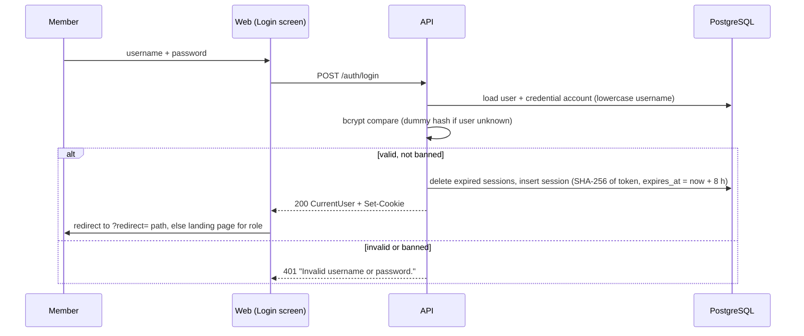

# F-01 Authentication and session – Engineering Contract

- **Feature:** F-01 Authentication and session (`docs/features.md`)
- **Sprint:** 1 · **Issue:** #6
- **Requirements:** FR-01, NFR-01, NFR-03
- **Responsibilities established here:** SR-01 (NFR-02), SR-02 (NFR-04, local), SR-06 (NFR-09)
- **Design baseline:** `docs/system-sds.md` v0.8 §2.2 `user`, `account`, `session`; §4.1–4.2; §5.1; §6; §7.1 Login; §8
- **Version:** 0.5 (draft) · **Last updated:** 2026-11-13

This feature also lays the foundation that every other feature uses: the OpenAPI contract file, the problem error format, the database and migrations, code generation, and the health checks. Those parts have their own acceptance criteria below because later features depend on them.

---

## 1. Feature SDS

### 1.1 Behavior

- A member logs in with username and password. The server creates a session and sets it in an HttpOnly cookie.
- Every protected operation reads the actor (`id`, `role`, `reviewer_id`) from the session only. A request never chooses its own user or role.
- `GET /auth/me` returns the current member, their role, and the route permissions of the role. The web uses it to guard pages and to choose header links.
- A member logs out, and the session ends at once. A session also ends 8 hours after login.
- A banned member cannot log in and has no valid sessions.

### 1.2 Workflow



### 1.3 Dependencies

- None inside the product. This is the first feature.
- Tools added in this feature (SDS §1.2): PostgreSQL 17, `goose`, `sqlc`, `pgx/v5`, `oapi-codegen`, `testcontainers-go`, `@hey-api/openapi-ts`, TanStack Query, Playwright.

### 1.4 Rules and validation

| Rule | Detail |
| --- | --- |
| Username | 1–50 characters. Lowercased before lookup. |
| Password | 1–72 characters (bcrypt input limit). Compared with `bcrypt.CompareHashAndPassword`. |
| Unknown username | Compared against a fixed dummy hash, so the response time does not show that the account does not exist. |
| Ban | `banned = true` and `ban_expires` NULL or in the future. A ban with `ban_expires` in the past counts as no ban. |
| Session token | 32 bytes from `crypto/rand`, base64url. Only its SHA-256 is stored. |
| Session lifetime | 8 hours, fixed, no renewal (NFR-03). A constant, not configuration. A session is invalid when `expires_at <= now`. |
| Password hash | bcrypt, cost from `BCRYPT_COST`, default 12, never below 10 (NFR-01). |
| Identity | Taken only from the session. No user ID or role in any request. |

### 1.5 Failure and boundary cases

| Case | Result |
| --- | --- |
| Wrong password, unknown username, banned user | 401, same body: "Invalid username or password." No cookie is set. |
| Empty username or password | 400 `BAD_REQUEST` with the field. The web blocks it before sending. |
| Session at 7 h 59 min | Valid. |
| Session at exactly 8 h | Invalid → 401. |
| Old cookie after logout | 401. |
| Session created before a ban | 401. |
| State-changing request from a foreign origin | 403. |
| Database down | `/health` 200, `/ready` 503. Other operations → 500 problem. |
| Unexpected server error | 500 problem with `requestId`. No stack trace, SQL, or Go error string. |

### 1.6 Permissions

| Operation | Anonymous | `requester` | `reviewer` | `finance` |
| --- | --- | --- | --- | --- |
| `POST /auth/login` | ✓ | ✓ | ✓ | ✓ |
| `POST /auth/logout`, `GET /auth/me` | 401 | ✓ | ✓ | ✓ |
| `GET /health`, `GET /ready` | ✓ | ✓ | ✓ | ✓ |

Route permissions by role (SDS §5.1), returned by `/auth/me`:

| Role | `permissions` |
| --- | --- |
| `requester` | `{ "claim": ["create", "list"] }` |
| `reviewer` | `{ "claim": ["create", "list"], "review": ["list"], "report": ["read"] }` |
| `finance` | `{ "review": ["list"], "finance": ["list"], "report": ["read"] }` |

`auth.RequirePermission(resource, action)` returns 403 when the role does not grant the action. Code checks permissions, never role names.

## 2. UI spec

### 2.1 Screens

| Screen | Route | Content |
| --- | --- | --- |
| Login | `/login` (`login.tsx`) | Username, password, **Log in** button, form error area. |
| Protected layout | `_auth` (`_auth.tsx`) | Header and the protected page. `beforeLoad` loads `/auth/me` and redirects anonymous members to `/login?redirect=<path>`. |
| Landing pages | `/claims`, `/reviews` | Placeholders until F-03 and F-04. |

### 2.2 Header

- Display name and role label (`Requester`, `Reviewer`, `Finance Officer`).
- Links from `permissions`:

| Link         | Shown when     | Requester | Reviewer | Finance |
| ------------ | -------------- | --------- | -------- | ------- |
| My Claims    | `claim:list`   | ✓         | ✓        | –       |
| New Claim    | `claim:create` | ✓         | ✓        | –       |
| Review Queue | `review:list`  | –         | ✓        | ✓       |

- **Log out** button.
- Sprint 3 links (Finance Queue, Summary) are added by F-08 and F-10.

### 2.3 Fields and messages

| Field      | Client check | Message                         |
| ---------- | ------------ | ------------------------------- |
| Username   | required     | "Enter your username."          |
| Password   | required     | "Enter your password."          |
| Form (401) | –            | "Invalid username or password." |

### 2.4 States

| State | Behavior |
| --- | --- |
| Sending | **Log in** disabled with a spinner. |
| 401 at login | Form message. Username kept, password cleared. |
| Success | Go to the `redirect` path if present and safe (same-origin path). Otherwise requester → `/claims`; reviewer and finance → `/reviews`. |
| 401 on any later call | Clear the query cache and go to `/login?redirect=<current path>`. |
| 5xx / network | Inline error with **Try again** and the `requestId` in small text. |

## 3. API spec

All paths are under `/api/v1`. Shapes are defined in `apps/api/openapi.yaml`.

### 3.1 Shared schemas

**`Problem`** (RFC 9457, `application/problem+json`):

```json
{
  "type": "about:blank",
  "title": "Invalid username or password.",
  "status": 401,
  "code": "UNAUTHENTICATED",
  "instance": "/api/v1/auth/login",
  "requestId": "019a5e2c-7b3d-7c41-9f2e-4b8d1a6c3e70",
  "errors": [
    {
      "field": "username",
      "rule": "required",
      "message": "Enter your username."
    }
  ]
}
```

- `code` is one of the codes in SDS §4.2, plus `UNAVAILABLE` for `/ready` (503).
- `errors` is present only when a field can be named.

**`CurrentUser`**:

```json
{
  "id": "0192f1c4-...",
  "username": "req.anan",
  "name": "Anan K.",
  "role": "requester",
  "permissions": { "claim": ["create", "list"] }
}
```

### 3.2 Operations

| Method | Path | Request | Success | Errors | Auth |
| --- | --- | --- | --- | --- | --- |
| POST | `/auth/login` | `{ "username": string 1–50, "password": string 1–72 }` | 200 `{ "data": CurrentUser }` + `Set-Cookie` | 400, 401, 403 (cross-origin) | none |
| POST | `/auth/logout` | – | 204 + `Set-Cookie` that clears the cookie | 401, 403 (cross-origin) | session |
| GET | `/auth/me` | – | 200 `{ "data": CurrentUser }` | 401 | session |
| GET | `/health` | – | 200 `{ "status": "ok", "version": string }` | – | none |
| GET | `/ready` | – | 200 `{ "status": "ok" }` | 503 `UNAVAILABLE` | none |

### 3.3 Cookie

| Setting | `COOKIE_SECURE=true` (default) | `COOKIE_SECURE=false` (local HTTP) |
| --- | --- | --- |
| Name | `__Host-sid` | `sid` |
| Attributes | `HttpOnly; Secure; SameSite=Lax; Path=/; Max-Age=28800` | `HttpOnly; SameSite=Lax; Path=/; Max-Age=28800` |
| On logout | Same name, `Max-Age=0` | Same name, `Max-Age=0` |

### 3.4 Middleware order

1. Request ID and `slog` request log.
2. `http.CrossOriginProtection` → 403.
3. Session → actor, or 401 for protected operations.
4. OpenAPI request validation → 400.
5. `RequirePermission` → 403 where the operation needs one.

## 4. Data spec

### 4.1 Migration `00001_auth.sql`

Creates `"user"`, `account`, and `session` exactly as SDS §2.2:

| Table | Key constraints |
| --- | --- |
| `"user"` | PK UUIDv7; `username` UNIQUE, lowercase; `email` UNIQUE; `role` CHECK in (`requester`, `reviewer`, `finance`); `reviewer_id` FK → `"user".id`, CHECK `reviewer_id <> id`; `banned` default false |
| `account` | FK `user_id` ON DELETE CASCADE; UNIQUE (`provider_id`, `account_id`); CHECK `provider_id <> 'credential' OR password IS NOT NULL` |
| `session` | FK `user_id` ON DELETE CASCADE; `token` BYTEA UNIQUE; `expires_at` NOT NULL |

Trigger `user_ban_deletes_sessions` runs after an update of `banned` or `ban_expires`. If the ban is active (`banned` and `ban_expires` null or in the future), it deletes all of the user's `session` rows. So a ban that seed data or a migration sets with a plain `UPDATE` also ends the sessions (F01-AC-05).

The migration has a `-- +goose Down` section that drops the trigger, its function, and the three tables.

### 4.2 Seed

`bun run seed` upserts the 7 users from SDS §2.5 by username, each with one `credential` account. The password comes from `SEED_USER_PASSWORD` and is hashed at seed time. No password is committed.

### 4.3 Configuration

Adds to `apps/api/.env.schema` and to a new committed `apps/api/.env.example`: `DATABASE_URL` (sensitive), `COOKIE_SECURE`, `BCRYPT_COST`, `LOG_LEVEL`, `SEED_USER_PASSWORD` (sensitive), `APP_VERSION`. The API refuses to start if a required value is missing or invalid.

## 5. Acceptance criteria

| ID | Requirement | Acceptance criterion |
| --- | --- | --- |
| F01-AC-01 | FR-01 | `req.anan` logs in with the correct password → 200, body is `req.anan`'s `CurrentUser`, and the cookie has the name and attributes in §3.3 for the current `COOKIE_SECURE` value. |
| F01-AC-02 | FR-01 | The username works in any letter case: `REQ.Anan` logs in as `req.anan`. |
| F01-AC-03 | FR-01, NFR-02 | A wrong password and an unknown username both return 401 `UNAUTHENTICATED` with the title "Invalid username or password.". The two bodies are the same except `requestId`. No cookie is set. |
| F01-AC-04 | FR-01 | A banned user (`ban_expires` NULL or in the future) gets the same 401 as F01-AC-03. A user whose `ban_expires` is in the past logs in → 200. |
| F01-AC-05 | NFR-03 | Banning a user deletes all of their sessions. A request with a cookie created before the ban → 401. |
| F01-AC-06 | FR-01 | `GET /auth/me` returns `id`, `username`, `name`, `role`, and the exact `permissions` map for the role (§1.6). The body has no password, hash, or token. |
| F01-AC-07 | FR-01, NFR-03 | Logout → 204, the cookie is cleared, and the session row is deleted. The old cookie on `GET /auth/me` → 401. |
| F01-AC-08 | NFR-03 | A session is valid at 7 h 59 min after login and returns 401 at 8 h. Expired session rows are deleted at the next login. |
| F01-AC-09 | NFR-01 | Every `account.password` is a bcrypt hash with cost ≥ 10. The seed password does not appear in the database, in logs written during login, or in any response body. |
| F01-AC-10 | NFR-01 | `session.token` holds the SHA-256 of the cookie value, never the value itself. |
| F01-AC-11 | NFR-02 | Every operation in `openapi.yaml` except `/auth/login`, `/health`, and `/ready` returns 401 without a cookie and with an unknown token. |
| F01-AC-12 | NFR-02 | An operation that requires a route permission returns 403 `FORBIDDEN` to a role without that permission, and the handler does not run. |
| F01-AC-13 | NFR-02 | A state-changing request with `Sec-Fetch-Site: cross-site`, or with a foreign `Origin` when `Sec-Fetch-Site` is absent, returns 403. The same request from the same origin succeeds. |
| F01-AC-14 | NFR-02 | Every 4xx and 5xx response is `application/problem+json` with `type`, `title`, `status`, `code`, `instance`, and `requestId`. A 500 body contains no internal error text, and the matching log line has the same `requestId`. |
| F01-AC-15 | SDS §4.3 | `GET /health` returns 200 `{ status, version }` even when the database is down. `GET /ready` returns 200 when the database is reachable and 503 when it is not. |
| F01-AC-16 | NFR-04 | The API exits with an error that names the variable when `DATABASE_URL` is missing or `BCRYPT_COST` is below 10. `apps/api/.env.example` lists every API variable with a safe value. Git contains no `.env` file and no real secret. |
| F01-AC-17 | NFR-09 | A PR to `sprint-1` runs the `code_quality`, `test`, `api`, and `build` checks. The `api` check fails below 100% Go coverage (generated code excluded), and CI fails when regenerated code differs from the committed code. |
| F01-AC-18 | FR-01 | An anonymous visit to `/claims` goes to `/login?redirect=%2Fclaims`, and after login the member returns to `/claims`. With no `redirect`, a requester lands on `/claims` and a reviewer or Finance Officer on `/reviews`. |
| F01-AC-19 | FR-01 | Submitting the login form with an empty field shows the field message from §2.3 and sends no request. A 401 shows "Invalid username or password.", keeps the username, and clears the password. |
| F01-AC-20 | FR-01, BR-15 | The header shows the display name, the role label, and only the links in §2.2. A Finance Officer sees no My Claims or New Claim link. **Log out** ends the session and shows the Login screen. |
| F01-AC-21 | NFR-03 | When any API call returns 401, the web clears the query cache and goes to `/login?redirect=<current path>`. |

## 6. Software Test Specification

Levels: **Unit** (Go or web, no database) · **Integration** (Go `httptest` + full router + `pgtest` PostgreSQL) · **Component** (Vitest + Testing Library + MSW) · **E2E** (Playwright) · **Manual/CI** (recorded check).

Integration tests use the seed users and a fixed clock.

| Test | AC | Level | Precondition / input | Action | Expected result |
| --- | --- | --- | --- | --- | --- |
| F01-TEST-01 | F01-AC-01 | Integration | Seeded `req.anan`; `COOKIE_SECURE=true` | `POST /auth/login` with the correct password | 200; body `data.username = "req.anan"`; `Set-Cookie: __Host-sid=…; HttpOnly; Secure; SameSite=Lax; Path=/; Max-Age=28800` |
| F01-TEST-02 | F01-AC-01 | Integration | `COOKIE_SECURE=false` | Same login | Cookie named `sid` with no `Secure` attribute |
| F01-TEST-03 | F01-AC-02 | Integration | Seeded `req.anan` | Log in as `REQ.Anan` | 200; `data.id` equals `req.anan`'s ID |
| F01-TEST-04 | F01-AC-03 | Integration | Seeded users | Log in with a wrong password; then as `nobody` | Both 401 `UNAUTHENTICATED`, title "Invalid username or password."; bodies equal except `requestId`; no `Set-Cookie` |
| F01-TEST-05 | F01-AC-04 | Integration | Three users: banned with NULL expiry, banned until tomorrow, banned until yesterday | Log in as each | 401, 401, 200 |
| F01-TEST-06 | F01-AC-05 | Integration | `req.anan` logged in | Ban `req.anan` with a direct SQL `UPDATE`; call `GET /auth/me` with the old cookie | 401; `req.anan` has 0 session rows |
| F01-TEST-07 | F01-AC-06 | Integration | Sessions for `req.anan`, `rev.malee`, `fin.wanida` | `GET /auth/me` for each | Each `permissions` equals the §1.6 map; JSON has no `password`, `hash`, or `token` key |
| F01-TEST-08 | F01-AC-07 | Integration | `req.anan` logged in | `POST /auth/logout`; then `GET /auth/me` with the old cookie | 204 with `Max-Age=0` cookie; then 401; session row deleted |
| F01-TEST-09 | F01-AC-08 | Integration | Fixed clock at `t0`; login at `t0` | `GET /auth/me` at `t0 + 7h59m`, then at `t0 + 8h`; then log in again | 200, then 401; after the new login the expired row is gone |
| F01-TEST-10 | F01-AC-09 | Integration | Seed run with a known `SEED_USER_PASSWORD`; log capture on | Read every `account.password`; log in once right and once wrong | Each hash starts with `$2a$` or `$2b$` and `bcrypt.Cost ≥ 10`; no hash equals the password; the password string is not in the captured logs or any response body |
| F01-TEST-11 | F01-AC-10 | Integration | – | Log in; read the `session` row | `token = sha256(cookie value)` and `token ≠ cookie value` |
| F01-TEST-12 | F01-AC-11 | Integration | Router built from `openapi.yaml` | For every operation except login, health, ready: call with no cookie, then with a random token | 401 `UNAUTHENTICATED` for each call |
| F01-TEST-13 | F01-AC-12 | Unit | Test route behind `RequirePermission("review", "list")` | Call as `requester`, then as `reviewer` | 403 `FORBIDDEN` and the handler is not called; then the handler runs |
| F01-TEST-14 | F01-AC-13 | Integration | `req.anan` logged in | `POST /auth/logout` with `Sec-Fetch-Site: cross-site`; with only `Origin: https://evil.test`; with `Sec-Fetch-Site: same-origin` | 403, 403, 204 |
| F01-TEST-15 | F01-AC-14 | Integration | Test handler that returns an internal error; log capture on | Call it; call an unknown path | 500 and 404 problem bodies with all required members; the 500 body does not contain the error text; a log line has the same `requestId` and the error text |
| F01-TEST-16 | F01-AC-15 | Integration | Database container running, then stopped | `GET /health` and `GET /ready` in both states | Running: 200 and 200. Stopped: `/health` 200, `/ready` 503 `UNAVAILABLE` |
| F01-TEST-17 | F01-AC-16 | Unit | Config without `DATABASE_URL`; config with `BCRYPT_COST=9` | Load the config | Both return an error that names the variable |
| F01-TEST-18 | F01-AC-16 | Manual/CI | Tested release commit | `git ls-files` for `.env` files; secret scan of the commit; compare `.env.example` with `.env.schema` | No `.env` file tracked; no secret found; every schema variable is in `.env.example` |
| F01-TEST-19 | F01-AC-17 | Manual/CI | Any feature PR to `sprint-1` | Read the PR's checks and the `api` coverage report | The four required checks ran and passed; Go coverage is 100%; the generate check is part of the run |
| F01-TEST-20 | F01-AC-18 | Component | MSW: `/auth/me` 401, then 200 per role | Open `/claims` anonymously; log in; repeat with no `redirect` for each role | Redirect to `/login?redirect=%2Fclaims`, then back to `/claims`; landing pages `/claims`, `/reviews`, `/reviews` |
| F01-TEST-21 | F01-AC-19 | Component | MSW: login returns 401 | Submit empty form; then submit `req.anan` with a wrong password | Field messages and no request; then form message, username kept, password empty |
| F01-TEST-22 | F01-AC-20 | Component | MSW `/auth/me` for each role | Render the protected layout | Links match §2.2 for each role; finance has no My Claims or New Claim |
| F01-TEST-23 | F01-AC-21 | Component | Logged in; MSW returns 401 for the next query | Trigger the query | Query cache is empty; location is `/login?redirect=<path>` |
| F01-TEST-24 | F01-AC-01, F01-AC-07, F01-AC-18 | E2E | Seeded database, API and web running | Open `/claims`; log in as `req.anan`; log out; open `/claims` again | Lands on `/claims` with the header name; after logout the Login screen; the second visit redirects to login |

## 7. Feature Definition of Done

The Product DoD (`definition-of-done.md`) applies. For F-01 the evidence is:

- [ ] All F01-TEST rows run; automated ones pass in CI on the merge commit; manual ones are recorded with the commit.
- [ ] The route inventory test (F01-TEST-12) is in the suite, so later features are covered without new tests.
- [ ] `openapi.yaml`, the generated server, and the generated web client are committed, and the generate check is green.
- [ ] `apps/api/.env.example` exists, and the README explains database setup, migration, seed, and how to set `SEED_USER_PASSWORD`.
- [ ] `docs/traceability.md` lists the actual test names and results for F-01 rows.

## 8. Revision history

| Version | Date | Change | Author |
| --- | --- | --- | --- |
| 0.1 | 2026-11-05 | Initial contract | 1005, 1045 |
| 0.2 | 2026-11-06 | Review fix (PR #23): session check runs before OpenAPI validation, so an anonymous request gets 401, not 400 (SDS §1.3) | 1005, 1045 |
| 0.3 | 2026-11-07 | Ticket 01 (#24): problem `type` is `about:blank`, `requestId` is a server-made UUIDv7 also sent in `X-Request-Id` (SDS §4.2); migration `00001_auth.sql` (4.1) ships in ticket 01, because goose needs at least one migration; UI components are HeroUI v3 (SDS §1.2); PRs target `sprint-1` | 1005, 1045 |
| 0.4 | 2026-11-11 | Review fix (PR #36): migration `00001_auth.sql` adds a trigger that deletes a user's sessions when a ban starts (4.1); F01-TEST-06 bans with a direct SQL `UPDATE` | 1005, 1045 |
| 0.5 | 2026-11-13 | Ticket 02 (#25, PR #56): UI components are Astryx with the Neutral theme, replacing HeroUI v3 and Tailwind (SDS 0.11 §1.2); forms use TanStack Form through `#/lib/form` | 1005, 1045 |
