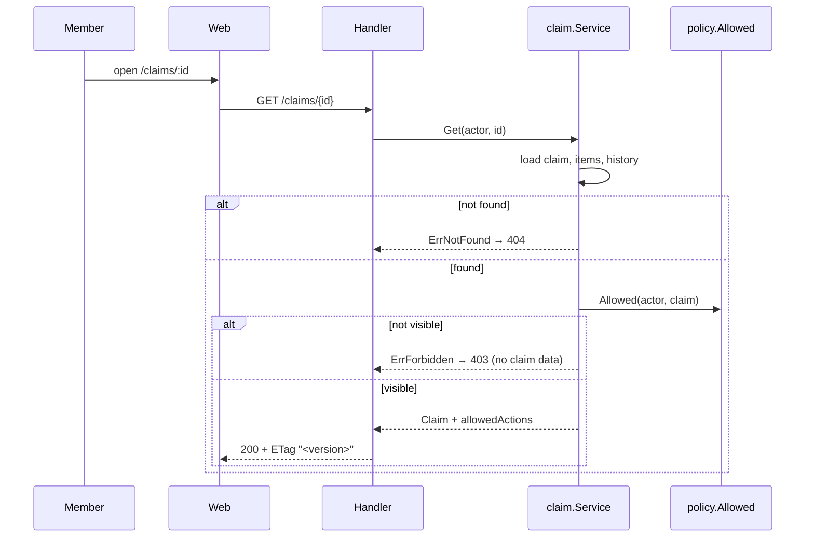

# F-03 My claims – Engineering Contract

- **Feature:** F-03 My claims (`docs/features.md`)
- **Sprint:** 1 · **Issue:** #6
- **Requirements:** FR-04 (including history display), NFR-02
- **Depends on:** F-01, F-02
- **Design baseline:** `docs/system-sds.md` v0.8 §4.1 lists; §4.3 `GET /claims?scope=mine`, `GET /claims/{id}`; §5.2 claim policy; §5.3 list scopes; §7.1 My Claims, Claim Detail; §7.2
- **Version:** 0.1 (draft) · **Last updated:** 2026-11-05

---

## 1. Feature SDS

### 1.1 Behavior

- A requester lists their own claims, newest first, with status and total.
- Any member opens a **visible claim** and sees its line items, total, status, assigned reviewer, and history.
- One pure function, the claim policy `Allowed(actor, claim) → (visible, actions)`, decides who may see a claim and which actions they may take. `Get` returns the actions as `allowedActions`, so the web never re-derives rules.
- A member who may not see a claim gets 403 with no claim data. A claim that does not exist gives 404.

### 1.2 Workflow



### 1.3 Claim policy (Sprint 1 part)

"Own" means `requester_id = actor.id`. "Assigned" means `assigned_reviewer_id = actor.id`.

**Visible** when own, or assigned and status is not `DRAFT`.

| Action | Allowed when | Added by |
| --- | --- | --- |
| `approve`, `reject` | assigned **and not own**, status `SUBMITTED` | F-04 |

In Sprint 1 the owner has no allowed actions: edit, submit, delete, and withdraw come in Sprint 2. Later features add rows to this table; they do not change the visibility rule until F-08 adds the Finance department-wide view.

### 1.4 List scope `mine`

- Claims where `requester_id = actor.id`, every status.
- Order: `createdAt` descending, then `id` descending.
- Pagination: `page` ≥ 1 (default 1), `pageSize` 1–100 (default 20).

### 1.5 Failure and boundary cases

| Case | Result |
| --- | --- |
| `req.ploy` opens `req.anan`'s claim | 403 `FORBIDDEN`, body has no claim fields |
| `rev.somchai` opens `req.anan`'s claim (assigned to `rev.malee`) | 403 |
| `rev.malee` opens `req.anan`'s `SUBMITTED` claim | 200 |
| Unknown UUID | 404 `NOT_FOUND` |
| Malformed ID (`abc`) | 400 `BAD_REQUEST` |
| `fin.wanida` lists `scope=mine` | 403 (no `claim:list`) |
| `scope` missing or unknown | 400 |
| `pageSize=101`, `page=0` | 400 |
| Page past the last one | 200, `data: []`, correct `total` |

### 1.6 Permissions

| Operation | Anonymous | `requester` | `reviewer` | `finance` |
| --- | --- | --- | --- | --- |
| `GET /claims?scope=mine` | 401 | own claims | own claims | 403 |
| `GET /claims/{id}` | 401 | own | own or assigned | assigned |

## 2. UI spec

### 2.1 My Claims (`/claims`, `_auth/claims/index.tsx`)

| Element | Behavior |
| --- | --- |
| Table | Columns: Claim no., Title, Total (`฿1,250.00`), Status badge, Submitted (`5 Nov 2026`, Asia/Bangkok). A row opens the claim. |
| Pagination | Previous / Next and "Page 1 of 3". Page in the URL search params (`?page=2`). |
| **New claim** | Button shown when `claim:create` is in `permissions`. |

### 2.2 Claim Detail (`/claims/:id`, `_auth/claims/$claimId.tsx`)

| Section | Content |
| --- | --- |
| Header | Claim number, title, status badge, total. |
| Summary | Purpose, requester, assigned reviewer, submitted date. |
| Line items | Table: #, Category, Description, Expense date, Amount, Receipt ref. |
| History | Timeline, oldest first: action label, from → to status, actor name, date and time (Asia/Bangkok), comment if any. |
| Actions | Buttons from `allowedActions` only. None for the owner in Sprint 1. F-04 adds the decision panel. |

### 2.3 States (SDS §7.2)

| State | My Claims | Claim Detail |
| --- | --- | --- |
| Loading | 5 skeleton rows | Skeleton header and table |
| Empty | "No claims yet – Create claim" with a link to `/claims/new` | – |
| 403 | "You don't have access to this page." (Finance) | "You don't have access to this claim." No claim data. |
| 404 | – | "Claim not found." |
| 5xx / network | Inline error with **Try again** and `requestId` | Same |

Status badge colors: Submitted blue, Approved green, Rejected red (SDS §7.2). `StatusBadge`, `Money`, and `DateText` live in shared `components/`.

## 3. API spec

### 3.1 Schemas

**`ClaimSummary`** (list item):

```json
{
  "id": "0192f1c4-...",
  "claimNo": "CLM-2026-000123",
  "title": "Bangkok workshop travel",
  "status": "SUBMITTED",
  "total": "1250.00",
  "requester": {
    "id": "...",
    "name": "Anan K.",
    "position": "Staff, Section A"
  },
  "submittedAt": "2026-11-05T03:00:00Z",
  "createdAt": "2026-11-05T03:00:00Z"
}
```

**`ClaimPage`**: `{ "data": ClaimSummary[], "page": 1, "pageSize": 20, "total": 57 }`.

**`Claim`**: as defined in F-02 §3.1, including `items` (by `lineNo`), `history` (by `id`, oldest first), `version`, and `allowedActions`.

### 3.2 Operations

| Method | Path | Request | Success | Errors | Auth |
| --- | --- | --- | --- | --- | --- |
| GET | `/claims` | `scope=mine` (required), `page`, `pageSize` | 200 `ClaimPage` | 400, 401, 403 | `claim:list` for `mine` |
| GET | `/claims/{id}` | `id` UUID | 200 `{ "data": Claim }`, `ETag: "<version>"` | 400, 401, 403, 404 | session; policy |

`scope` is an enum. In Sprint 1 it holds `mine` and `review` (F-04). The route permission depends on the scope, so the handler checks it after reading `scope`.

## 4. Data spec

No change. F-03 reads the F-02 tables. The index `(requester_id, status)` from F-02 serves `scope=mine`.

## 5. Acceptance criteria

| ID | Requirement | Acceptance criterion |
| --- | --- | --- |
| F03-AC-01 | FR-04 | `req.anan` lists `scope=mine` → 200 with only claims where `req.anan` is the requester, in every status, newest first, with `page`, `pageSize`, and `total`. |
| F03-AC-02 | FR-04, NFR-02 | `req.ploy`'s `scope=mine` list never contains a claim of `req.anan`. |
| F03-AC-03 | FR-04 | Defaults are `page = 1` and `pageSize = 20`. `pageSize = 100` is accepted; `pageSize = 101`, `page = 0`, and a missing or unknown `scope` → 400. A page past the last returns an empty `data` and the correct `total`. |
| F03-AC-04 | NFR-02 | `fin.wanida` lists `scope=mine` → 403. |
| F03-AC-05 | FR-04 | The requester opens their claim → 200 with line items in `lineNo` order, server total, status, assigned reviewer, every history entry oldest first, `version`, `allowedActions`, and header `ETag: "<version>"`. |
| F03-AC-06 | NFR-02 | `req.ploy` opens `req.anan`'s claim → 403. `rev.somchai` opens `req.anan`'s claim → 403. Neither body contains `data`, `claimNo`, `title`, or any line item. |
| F03-AC-07 | FR-04 | `rev.malee` (assigned) opens `req.anan`'s `SUBMITTED` claim → 200. |
| F03-AC-08 | FR-04 | An unknown UUID → 404 `NOT_FOUND`. A malformed ID → 400. |
| F03-AC-09 | NFR-02 | The claim policy returns visible = own, or assigned and not `DRAFT`, for every role, relation (own, assigned, unrelated), and status. In Sprint 1 the owner's `allowedActions` is empty. |
| F03-AC-10 | FR-04 | My Claims shows the columns in §2.1 with money as `฿1,250.00` and dates in Asia/Bangkok, skeleton rows while loading, "No claims yet – Create claim" when empty, and an inline error with **Try again** on failure. Pagination changes `?page=` in the URL. |
| F03-AC-11 | FR-04 | Claim Detail shows the sections in §2.2 and the history timeline. On 403 it shows "You don't have access to this claim." and on 404 "Claim not found.", with no claim data in either case. |

## 6. Software Test Specification

Levels as in F-01 §6.

| Test | AC | Level | Precondition / input | Action | Expected result |
| --- | --- | --- | --- | --- | --- |
| F03-TEST-01 | F03-AC-01 | Integration | `req.anan` has 3 claims created at t1 < t2 < t3, in statuses `SUBMITTED`, `APPROVED`, `REJECTED`; `req.ploy` has 1 | `GET /claims?scope=mine` as `req.anan` | 200; `data` is the 3 claims in order t3, t2, t1; `total = 3` |
| F03-TEST-02 | F03-AC-02 | Integration | Same data | Same request as `req.ploy` | Only `req.ploy`'s claim; no `requester.id` of `req.anan` |
| F03-TEST-03 | F03-AC-03 | Integration | `req.anan` has 25 claims | Request with no params but `scope`; `page=2`; `pageSize=100`; `pageSize=101`; `page=0`; `page=9`; no `scope`; `scope=bogus` | 20 items; 5 items; 25 items; 400; 400; empty `data` with `total = 25`; 400; 400 |
| F03-TEST-04 | F03-AC-04 | Integration | `fin.wanida` logged in | `GET /claims?scope=mine` | 403 `FORBIDDEN` |
| F03-TEST-05 | F03-AC-05 | Integration | `req.anan`'s claim with 3 items and 1 history row | `GET /claims/{id}` as `req.anan` | 200; items `lineNo` 1, 2, 3; history length 1; `ETag` equals `"<version>"`; `allowedActions = []` |
| F03-TEST-06 | F03-AC-06 | Integration | `req.anan`'s claim assigned to `rev.malee` | `GET /claims/{id}` as `req.ploy`, then as `rev.somchai` | 403 for both; body has no `data`, `claimNo`, `title`, or `items` |
| F03-TEST-07 | F03-AC-07 | Integration | Same claim | `GET /claims/{id}` as `rev.malee` | 200 |
| F03-TEST-08 | F03-AC-08 | Integration | – | `GET /claims/<new UUIDv7>`; `GET /claims/abc` | 404 `NOT_FOUND`; 400 `BAD_REQUEST` |
| F03-TEST-09 | F03-AC-09 | Unit | Table: roles `requester`, `reviewer`, `finance` × relation own, assigned, unrelated × status `DRAFT`, `SUBMITTED`, `APPROVED`, `REJECTED` | Call `Allowed` for each row | `visible` matches §1.3 for each row; owner `actions` empty |
| F03-TEST-10 | F03-AC-10 | Component | MSW: list with 2 claims; empty list; 500; 3 pages | Render My Claims in each case; click Next | Columns and formats; skeleton while pending; empty message and link; error with **Try again** that refetches; URL `?page=2` |
| F03-TEST-11 | F03-AC-11 | Component | MSW: claim with 2 history entries; 403; 404 | Render Claim Detail in each case | Sections and timeline in order; 403 and 404 messages with no claim fields rendered |
| F03-TEST-12 | F03-AC-01, F03-AC-05 | E2E | `req.anan` has just submitted a claim (F02-TEST-21) | Open My Claims, open the new claim | The claim is first in the list; detail shows the items and the `SUBMIT` history entry |

## 7. Feature Definition of Done

The Product DoD applies. For F-03 the evidence is:

- [ ] All F03-TEST rows pass in CI on the merge commit.
- [ ] The policy matrix test (F03-TEST-09) exists and later features extend it instead of adding a second policy test.
- [ ] `docs/traceability.md` lists the actual test names and results for F-03 rows.

## 8. Revision history

| Version | Date       | Change           | Author     |
| ------- | ---------- | ---------------- | ---------- |
| 0.1     | 2026-11-05 | Initial contract | 1005, 1045 |
