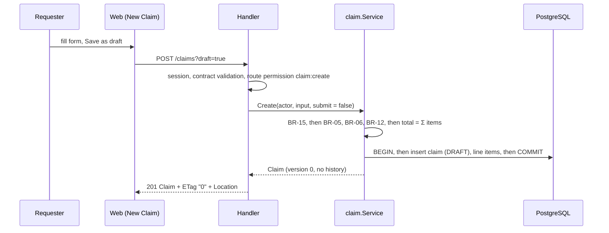
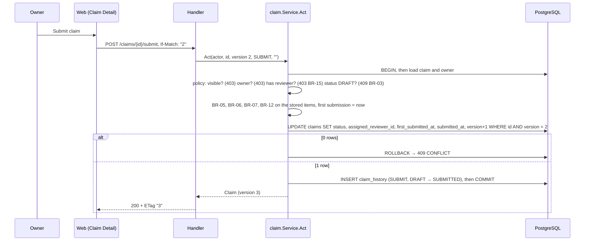

# F-05 Drafts – Engineering Contract

- **Feature:** F-05 Drafts (`docs/features.md`)
- **Sprint:** 2 · **Issues:** #39 (F-05/01), #40 (F-05/02), #41 (F-05/03), #42 (F-05/04)
- **Requirements:** FR-03, FR-07, FR-08, BR-03, BR-05, BR-06, BR-07, BR-08, BR-10, BR-12, BR-13, BR-15, BR-17, NFR-02, NFR-06, NFR-08
- **Responsibilities verified here:** SR-01 (new endpoints), SR-04 (`SUBMIT` from `DRAFT`, edit and delete with the version check), SR-06
- **Depends on:** F-02 (claim rules, `ClaimInput`, New Claim form), F-03 (claim policy, Claim Detail), F-04 (`If-Match` handling)
- **Design baseline:** `docs/system-sds.md` v0.8 §2.2 `claims`, `line_items`; §2.4 time; §3.1; §3.2 `SAVE_DRAFT`, `SUBMIT`, `DELETE`; §3.3; §4.1 versions; §4.3 `POST /claims?draft=true`, `PUT /claims/{id}`, `DELETE /claims/{id}`, `POST /claims/{id}/submit`; §5.2; §7.1 Edit Claim
- **Version:** 0.3 · **Last updated:** 2026-11-25

---

## 1. Feature SDS

### 1.1 Behavior

- On the New Claim form a requester can choose **Save as draft** instead of **Submit**. The claim is stored with status `DRAFT`. It has no assigned reviewer, no submission time, and no history.
- Only the owner can see a draft. It is in their My Claims list with a grey Draft badge.
- The owner edits a draft with the same form and the same line-item rules as New Claim. The server recalculates the total on every save.
- The owner submits a draft when it is ready. This is the claim's **first submission**: the server records the assigned reviewer, sets `firstSubmittedAt` and `submittedAt`, checks the expense date window, and writes the first history entry, all in one transaction.
- The owner deletes a draft they no longer need. The claim and its line items are removed. Only a draft can be deleted, so a claim with history is never removed.
- A member with no assigned reviewer cannot save a draft (BR-15), the same as submitting.
- The edit path accepts `RETURNED` claims too. F-06 uses it; this contract tests it only for `DRAFT`.

### 1.2 Workflow

Save a draft:

Submit a draft:

Edit and delete follow SDS §3.3 in the same way: one transaction, policy first, then the field rules (edit only), then the conditional `UPDATE` or `DELETE` on the client's version.

### 1.3 Lifecycle (added by F-05)

| From | Action | To | Who | History |
| --- | --- | --- | --- | --- |
| (new) | `SAVE_DRAFT` | `DRAFT` | Owner with an assigned reviewer (BR-15) | none |
| `DRAFT` | edit | `DRAFT` | Owner | none (no status change) |
| `DRAFT` | `SUBMIT` | `SUBMITTED` | Owner with an assigned reviewer (BR-15) | `SUBMIT`, `DRAFT` → `SUBMITTED`, actor = owner, comment `null` |
| `DRAFT` | delete | (row removed with its line items) | Owner | none |

Edit is not a status change, so it writes no history (FR-07 covers status changes only). Every successful edit increments `version`.

### 1.4 Order of checks for Sprint 2 operations

This order applies to every Sprint 2 operation on an existing claim: `PUT`, `DELETE`, `submit` (F-05, F-06), `return` (F-06), and `withdraw` (F-07). It is the F-04 §1.4 order with the rule of each action.

| Step | Failure | Response |
| --- | --- | --- |
| 1. `If-Match` header | missing / malformed | 428 `PRECONDITION_REQUIRED` / 400 |
| 2. Claim exists | no | 404 `NOT_FOUND` |
| 3. Claim visible to actor | no | 403 `FORBIDDEN`, no claim data |
| 4. Actor relation allows the action | owner action by a non-owner; reviewer action by the owner (BR-01) or an unassigned member (BR-02); `submit` of a `DRAFT` by an owner with no assigned reviewer (BR-15; a `RETURNED` claim keeps its assigned reviewer, so BR-15 is not checked there, F-06 §1.7) | 403 `FORBIDDEN` |
| 5. Status allows the action | §1.5 | 409 `INVALID_TRANSITION` with the rule in `errors[0].rule`; 409 `CONFLICT` instead when the `If-Match` version is not the current one (BR-13, F-04 revision 0.4) |
| 6. Field rules | edit: BR-05, BR-06, BR-12; submit: BR-05, BR-06, BR-07, BR-12; return: BR-04 | 422 `VALIDATION_FAILED`, one `errors[]` entry per field |
| 7. Conditional `UPDATE` / `DELETE` | version changed (BR-13) | 409 `CONFLICT` |
| 8. History insert, commit | database error (NFR-06) | 500; whole transaction rolled back |

Contract shape errors (missing fields, bad money format, unknown category) are 400 before step 2, as for `POST /claims` (F-02 §1.3).

### 1.5 Invalid-transition rules and messages

`errors[0]` of a 409 `INVALID_TRANSITION` has `field = "status"`, the rule, and this message:

| Action | Allowed from | Rule | Message |
| --- | --- | --- | --- |
| edit (`PUT`) | `DRAFT`, `RETURNED` | BR-10 | "Only a draft or a returned claim can be edited." |
| delete (`DELETE`) | `DRAFT` | BR-10 | "Only a draft can be deleted." |
| `submit` | `DRAFT`, `RETURNED` | BR-03 | "Only a draft or a returned claim can be submitted." |

F-06 and F-07 add the rows for `return` and `withdraw`. The F-04 message for `approve` and `reject` is unchanged.

### 1.6 Business rules on the new paths

| Rule | Save draft | Edit | Submit a draft | Where |
| --- | --- | --- | --- | --- |
| BR-05 item count and amounts | ✓ | ✓ | ✓ (stored items) | `claim/rules.go` (422) |
| BR-06 total ≤ 50,000.00 | ✓ | ✓ | ✓ | `claim/rules.go` (422) |
| BR-07 expense date window | – | – | ✓, first submission = now | `claim/rules.go` with the clock (422) |
| BR-08 server total; client total ignored | ✓ | ✓ | – (total already stored) | `claim/service.go` |
| BR-10 owner only; edit in `DRAFT`/`RETURNED`; delete in `DRAFT` | – | ✓ | – | policy (403 / 409) |
| BR-12 categories, Meals ≤ 1,500.00 | ✓ | ✓ | ✓ | contract enum (400) + `claim/rules.go` (422) |
| BR-15 assigned reviewer required | ✓ | – | ✓ | `claim:create` + `claim.Service` (403) |
| BR-17 reviewer recorded at first submission | – | – | ✓, from the owner's `reviewer_id` now | `claim.Service` |

BR-07 is not checked when a draft is saved or edited, because the window counts from the first submission, which has not happened yet. The field messages are those of F-02 §1.4.

Why submit re-runs BR-05, BR-06, and BR-12: the stored items already passed them, but the check is cheap and keeps one rule function for every submission path. It never fails on data written by this version of the code.

### 1.7 Failure and boundary cases

Fixed clock: `2026-11-25T10:00:00+07:00` unless stated.

| Case | Result |
| --- | --- |
| `fin.wanida` saves a draft | 403; no claim stored |
| Draft save with 0 / 21 items, an amount of `"20000.01"`, a total of 50,000.01, or `MEALS` 1,500.01 | 422 with the F-02 field and rule |
| Draft save with an expense date of 2026-11-26 (future) or 2026-08-01 (116 days old) | 201 (BR-07 not checked yet) |
| Draft save with `"total": "1.00"` and items summing 1,250.00 | 201, `total = "1250.00"` |
| `req.ploy` or `rev.malee` opens `req.anan`'s draft | 403, no claim data |
| `req.ploy` edits, submits, or deletes `req.anan`'s draft | 403 |
| Edit a `SUBMITTED` claim (owner, current version) | 409 `INVALID_TRANSITION`, BR-10 |
| Edit with a stale version | 409 `CONFLICT` |
| Edit without `If-Match` / with `If-Match: abc` | 428 / 400 |
| Submit a draft whose item date is 2026-11-26 | 422 `items[0].expenseDate`, BR-07, "Expense date cannot be in the future."; claim stays `DRAFT`, no history |
| Submit a draft whose item date is 2026-08-27 (90 days) / 2026-08-26 (91 days) | 200 / 422 BR-07 window message |
| Submit a draft after the owner's `reviewer_id` changed from `rev.malee` to `rev.somchai` | 200, `assignedReviewer` = `rev.somchai` (the reviewer at first submission, BR-17) |
| Submit a draft whose owner now has `reviewer_id` NULL | 403 (BR-15); claim stays `DRAFT` |
| Submit a `SUBMITTED` claim with the current version | 409 `INVALID_TRANSITION`, BR-03 |
| Two submits of the same draft with the same version | One 200, one 409 `CONFLICT`; one history row |
| Delete a `SUBMITTED` or `RETURNED` claim (owner, current version) | 409 `INVALID_TRANSITION`, BR-10; claim unchanged |
| Delete a draft | 204; claim and its line items gone; `GET` → 404 |
| `DELETE FROM claims` on a claim that has history (direct SQL) | Database error (FK from `claim_history` and the BR-11 trigger) |
| History insert fails during submit | 500; claim still `DRAFT`, no reviewer, `version` unchanged |

### 1.8 Permissions

| Operation | Anonymous | Owner (`requester`, `reviewer`) | Other requester | Assigned or other reviewer | `finance` |
| --- | --- | --- | --- | --- | --- |
| `POST /claims?draft=true` | 401 | 201 | – | – | 403 (no `claim:create`) |
| `GET /claims/{id}` (draft) | 401 | 200 | 403 | 403 (drafts have no reviewer) | 403 |
| `PUT /claims/{id}` | 401 | `DRAFT`/`RETURNED` | 403 | 403 | 403 |
| `DELETE /claims/{id}` | 401 | `DRAFT` | 403 | 403 | 403 |
| `POST /claims/{id}/submit` | 401 | `DRAFT` with an assigned reviewer, or `RETURNED` | 403 | 403 | 403 |

The route inventory test (F01-TEST-12, SDS §5.3) covers 401 for the three new operations without new code.

### 1.9 Claim policy additions

| Action | Allowed when | Rule |
| --- | --- | --- |
| `edit` | own, status `DRAFT` or `RETURNED` | BR-08, BR-10 |
| `delete` | own, status `DRAFT` | BR-10 |
| `submit` | own, status `DRAFT` with an owner who has an assigned reviewer, or status `RETURNED` | BR-15, BR-17 |

Visibility does not change: a draft is visible only to its owner, because it has no assigned reviewer (F-03 §1.3).

### 1.10 Code

- `claim.Subject` gains `OwnerHasReviewer bool` (the owner's `reviewer_id` is not NULL now) and `ReturnCount int` (used by F-06). `Allowed` stays a pure function.
- `transitions` gains `ActionSubmit` with two source statuses: `DRAFT` (history `SUBMIT`) and `RETURNED` (history `RESUBMIT`, F-06). The transition table becomes keyed by action and source status.
- `Create(ctx, actor, in, submit bool)` replaces the Sprint 1 `Create(ctx, actor, in)` (SDS §3.1). `submit = false` saves a draft.
- `Edit(ctx, actor, id, version, in)` replaces the line items (delete and insert in the same transaction, `line_no` from 1 in request order), recalculates `total_satang`, sets `updated_at`, and increments `version`.
- `Delete(ctx, actor, id, version)` runs `DELETE FROM claims WHERE id = $1 AND version = $2`; line items go with `ON DELETE CASCADE`.
- `Act(SUBMIT)` on a `DRAFT` sets `assigned_reviewer_id` from the owner's current `reviewer_id`, `first_submitted_at = submitted_at = now`, runs `checkRules` with `now` as the first submission, and inserts the history row.

## 2. UI spec

### 2.1 New Claim (`/claims/new`)

| Element | Behavior |
| --- | --- |
| **Save as draft** | Secondary button next to **Submit**. Runs the same shape checks, then sends `POST /claims?draft=true`. Both buttons are disabled with a spinner while either request is sending. |
| Draft saved | Opens the draft's Claim Detail with the toast "Draft saved." |
| 422 / 400 | Messages under the fields, values kept (F-02 §2.2). |

### 2.2 Claim Detail for the owner (`_auth/claims/$claimId.tsx`)

An owner action bar from `features/claims` shows these buttons, each only when its action is in `allowedActions`:

| Button | Behavior |
| --- | --- |
| **Edit** | Opens `/claims/:id/edit`. |
| **Submit claim** | Sends `POST …/submit` with `If-Match`. Disabled with a spinner while sending. Success: toast "Claim submitted.", the claim is refetched, and the badge turns blue. |
| **Delete draft** | Opens a dialog "Delete draft CLM-…? This cannot be undone." with **Delete** and **Cancel**. Success: go to `/claims` with the toast "Draft deleted." |

| Response | Behavior |
| --- | --- |
| 422 on submit | An alert above the line items lists each error as "Line n: <message>" (from `items[n-1].…`) with an **Edit** link. The claim stays a draft. |
| 409 `CONFLICT` | Toast "This claim was changed by someone else – reloaded", then refetch (SDS §7.2). |
| 409 `INVALID_TRANSITION` | Toast with `errors[0].message`, then refetch. |
| 403 | "You don't have access to this claim." page. |

The summary shows "Not submitted yet" for the submitted date and "Assigned when submitted" for the reviewer while the claim is a draft. The history section shows "No history yet – history starts when the claim is submitted."

### 2.3 Edit Claim (`/claims/:id/edit`, `_auth/claims/$claimId.edit.tsx`)

| Element | Behavior |
| --- | --- |
| Form | The New Claim form (`claim-form.tsx`) filled with the claim's title, purpose, and items. Same rows, limits, running total, and shape checks (F-02 §2.1). |
| **Save changes** | `PUT /claims/{id}` with `If-Match` from the loaded claim. Success: Claim Detail with the toast "Changes saved." |
| **Cancel** | Back to Claim Detail with no request. |
| 422 / 400 | Messages under the fields, values kept. |
| 409 `CONFLICT` | Toast "This claim was changed by someone else – reloaded"; the form reloads with the server values. |
| 409 `INVALID_TRANSITION` | Toast with `errors[0].message`; go to Claim Detail. |
| Not allowed | If `edit` is not in `allowedActions` when the route loads, show "This claim can't be edited." with a link back to the claim. 403 → access page; 404 → "Claim not found." |

### 2.4 My Claims

Drafts are listed with the grey **Draft** badge. Their Submitted column shows "–". Sorting is unchanged (`createdAt` descending, F-03 §1.4).

## 3. API spec

| Method | Path | Request | Success | Errors | Auth |
| --- | --- | --- | --- | --- | --- |
| POST | `/claims?draft=true` | `ClaimInput` (F-02 §3.1) | 201 `{ "data": Claim }` with `status = "DRAFT"`, `assignedReviewer`, `firstSubmittedAt`, `submittedAt` `null`, `history = []`; `ETag: "0"`; `Location` | 400, 401, 403, 422 | `claim:create` |
| PUT | `/claims/{id}` | Header `If-Match`; body `ClaimInput` | 200 `{ "data": Claim }`, new `ETag` | 400, 401, 403, 404, 409 `INVALID_TRANSITION` / `CONFLICT`, 422, 428 | session; policy `edit` |
| DELETE | `/claims/{id}` | Header `If-Match` | 204, no body | 400, 401, 403, 404, 409, 428 | session; policy `delete` |
| POST | `/claims/{id}/submit` | Header `If-Match`; no body | 200 `{ "data": Claim }`, new `ETag` | 400, 401, 403, 404, 409, 422, 428 | session; policy `submit` |

- `draft` is an optional boolean query parameter of `createClaim`. Missing or `false` submits, as in Sprint 1.
- Operation IDs: `updateClaim`, `deleteClaim`, `submitClaim`. They reuse the `ClaimId` and `IfMatch` parameters of `approveClaim`.
- `allowedActions` for the owner of a draft is `["edit", "delete", "submit"]` when the owner has an assigned reviewer.
- A 422 lists every broken rule, one `errors[]` entry per field, as in F-02 §3.2.

## 4. Data spec

- **Schema:** no migration. `00002_claims.sql` already has the `DRAFT` status, nullable `assigned_reviewer_id`, `first_submitted_at`, `submitted_at`, the CHECK `status = 'DRAFT' OR assigned_reviewer_id IS NOT NULL`, `line_items … ON DELETE CASCADE`, and the `claim_history` FK without cascade.
- **Queries (sqlc):** `InsertDraftClaim`, `UpdateClaimContent` (title, purpose, total, version, `updated_at` `WHERE id AND version`), `DeleteClaimLineItems`, `DeleteDraftClaim` (`WHERE id AND version AND status = 'DRAFT'`), `SubmitDraftClaim`.
- **Seed:** `bun run seed` adds one `DRAFT` claim for `req.anan` ("Office supplies – draft", 2 items, no history). It stays idempotent by `claim_no`. It is a row of F-04 §4 (v0.9); the PR that adds it updates the F04-TEST-22 counts.

## 5. Acceptance criteria

| ID | Requirement | Acceptance criterion |
| --- | --- | --- |
| F05-AC-01 | FR-08, FR-03, BR-08 | `req.anan` saves a valid claim with `?draft=true` → 201 with status `DRAFT`, a claim number, the server total (a client `total` is ignored), `version` 0, `assignedReviewer`, `firstSubmittedAt`, `submittedAt` all `null`, and no history rows. |
| F05-AC-02 | BR-05, BR-06, BR-12, NFR-08 | Saving a draft runs BR-05, BR-06, and BR-12 with the F-02 boundaries and messages (0 and 21 items, `"20000.01"`, a 50,000.01 total, `MEALS` 1,500.01 → 422). An expense date in the future or older than 90 days does not block the save (BR-07 is checked at submission). |
| F05-AC-03 | BR-15 | `fin.wanida` saves a draft → 403. `claim.Service.Create(…, submit = false)` for an actor whose `reviewer_id` is NULL → `ErrForbidden`. No claim is stored. |
| F05-AC-04 | FR-08, NFR-02 | A draft is visible only to its owner: `req.ploy`, `rev.malee` (the owner's reviewer), and `fin.wanida` get 403 with no claim data. The owner gets `allowedActions = ["edit", "delete", "submit"]`. |
| F05-AC-05 | FR-08, FR-03, BR-05, BR-06, BR-08, BR-12 | The owner edits a draft with the current `If-Match` → 200: title, purpose, and items replaced (`lineNo` from 1 in request order), total recalculated (client total ignored), `version` + 1, new `ETag`, no history row. An edit that breaks BR-05, BR-06, or BR-12 → 422 and the stored claim is unchanged. |
| F05-AC-06 | BR-10, NFR-02 | A non-owner edits a draft → 403. The owner edits a `SUBMITTED` claim with the current version → 409 `INVALID_TRANSITION` with `rule = "BR-10"` and the §1.5 message. |
| F05-AC-07 | BR-13 | Edit, delete, or submit with a stale version → 409 `CONFLICT`; without `If-Match` → 428; with a malformed `If-Match` → 400. The claim is unchanged. |
| F05-AC-08 | FR-08, FR-07, BR-17, NFR-06 | The owner submits a draft → 200: status `SUBMITTED`, `assignedReviewer` = the owner's reviewer now, `firstSubmittedAt` = `submittedAt` = now, `version` + 1, and exactly one history row (`SUBMIT`, `DRAFT` → `SUBMITTED`, actor = owner). The claim appears in the reviewer's queue. |
| F05-AC-09 | BR-07 | Submitting a draft checks BR-07 with the submission time as the first submission: with the clock at 25 Nov 2026 10:00 Bangkok, an item dated 26 Nov → 422 future message; 27 Aug (90 days) → 200; 26 Aug (91 days) → 422 window message. After a 422 the claim is still `DRAFT` with no history. |
| F05-AC-10 | BR-17 | A draft saved while `req.anan.reviewer_id = rev.malee`, then submitted after it changed to `rev.somchai`, gets `assignedReviewer = rev.somchai`. |
| F05-AC-11 | BR-15 | Submitting a draft whose owner now has `reviewer_id` NULL → 403, and the policy gives no `submit`. The claim stays `DRAFT`. |
| F05-AC-12 | BR-03, BR-13 | Submit on a `SUBMITTED`, `APPROVED`, or `REJECTED` claim with the current version → 409 `INVALID_TRANSITION` with `rule = "BR-03"`. Two submits of one draft with the same version → one 200, one 409 `CONFLICT`, one history row. |
| F05-AC-13 | NFR-06 | If the history insert fails during a draft submission, the response is 500 and the claim is still `DRAFT` with no reviewer, no submission times, and the same `version`. |
| F05-AC-14 | FR-08, BR-10 | The owner deletes a draft with the current version → 204; the claim and its line items are gone and `GET` → 404. A non-owner → 403. The owner deletes a `SUBMITTED` claim → 409 `INVALID_TRANSITION` with `rule = "BR-10"`. |
| F05-AC-15 | BR-10, BR-11 | A claim with history cannot be deleted, even with direct SQL: `DELETE FROM claims` on it fails and its rows are unchanged. |
| F05-AC-16 | FR-08, NFR-08 | New Claim has **Save as draft**; both buttons are disabled while sending; success opens the draft with "Draft saved."; server errors show under their fields. |
| F05-AC-17 | FR-08, NFR-08 | Claim Detail shows **Edit**, **Submit claim**, and **Delete draft** only from `allowedActions`. Submit success refetches and shows "Claim submitted."; a 422 lists "Line n: <message>"; Delete asks for confirmation and returns to My Claims with "Draft deleted."; 409 shows the reload toast and refetches. A draft shows "Not submitted yet", "Assigned when submitted", and the no-history message. |
| F05-AC-18 | FR-08, NFR-08 | Edit Claim opens with the claim's values, uses the New Claim rules and messages, sends `PUT` with `If-Match`, and returns to the claim with "Changes saved."; 409 `CONFLICT` reloads the form with the server values; a claim without `edit` shows "This claim can't be edited." |
| F05-AC-19 | FR-08 | My Claims lists drafts with the grey Draft badge and "–" in the Submitted column. |
| F05-AC-20 | FR-08, FR-07 | End to end: `req.anan` saves a draft, edits it, submits it; `rev.malee` sees it in the Review Queue; the claim's history has one `SUBMIT` entry from `DRAFT`. A second draft is deleted and no longer appears in My Claims. |

## 6. Software Test Specification

Levels as in F-01 §6. Module tests call `claim.Service` against `pgtest` PostgreSQL with a fixed clock (`2026-11-25T10:00:00+07:00` unless stated). HTTP tests go through the router with seeded sessions.

| Test | AC | Level | Precondition / input | Action | Expected result |
| --- | --- | --- | --- | --- | --- |
| F05-TEST-01 | F05-AC-01 | Integration | `req.anan`; items 250.00 + 1,000.00; body has `"total": "1.00"` | `POST /claims?draft=true` | 201; `ETag: "0"`; `status = DRAFT`; `total = "1250.00"`; reviewer and both submission times `null`; `history = []`; 0 `claim_history` rows for the claim |
| F05-TEST-02 | F05-AC-02 | Integration (module) | One input per case: 0 items, 21 items, `20000.01`, total 50,000.01, `MEALS` 1,500.01; then dates 2026-11-26 and 2026-08-01 | `Create(…, submit = false)` | F-02 `ValidationError` for each limit case; both date cases succeed |
| F05-TEST-03 | F05-AC-03 | Integration | `fin.wanida` | `POST /claims?draft=true` | 403; claim count unchanged |
| F05-TEST-04 | F05-AC-03 | Integration (module) | Test requester with `reviewer_id` NULL | `Create(…, submit = false)` | `ErrForbidden`; no rows |
| F05-TEST-05 | F05-AC-04 | Integration | `req.anan`'s draft | `GET /claims/{id}` as `req.anan`, `req.ploy`, `rev.malee`, `fin.wanida` | 200 with `allowedActions = ["edit", "delete", "submit"]`; 403 ×3 with no claim fields |
| F05-TEST-06 | F05-AC-04, F05-AC-06, F05-AC-11 | Unit | In-memory subjects: own `DRAFT` with reviewer; own `DRAFT` without reviewer; own `SUBMITTED`; own `RETURNED`; other's `DRAFT` | `Allowed(actor, subject)` | `[edit, delete, submit]`; `[edit, delete]`; `[]` for F-05 actions; `[edit, submit]`; not visible, `[]` |
| F05-TEST-07 | F05-AC-05 | Integration | `req.anan`'s draft at version `v` with 2 items | `PUT` with `If-Match: "v"`, new title, 3 items (100.00, 200.00, 300.00), `"total": "1.00"` | 200; `ETag: "v+1"`; title changed; 3 items `lineNo` 1–3; `total = "600.00"`; 0 history rows |
| F05-TEST-08 | F05-AC-05 | Integration (module) | Draft at version `v` | `Edit` with 21 items; with `MEALS` 1,500.01; with total 50,000.01 | `ValidationError` BR-05, BR-12, BR-06; stored title, items, total, `version` unchanged |
| F05-TEST-09 | F05-AC-06 | Integration | `req.anan`'s draft; `req.anan`'s `SUBMITTED` claim | `PUT` as `req.ploy` on the draft; `PUT` as `req.anan` on the submitted claim with its current version | 403; 409 `INVALID_TRANSITION`, `errors[0]` = `status`, BR-10, "Only a draft or a returned claim can be edited." |
| F05-TEST-10 | F05-AC-07 | Integration | Draft at version `v` | `PUT`, `DELETE`, `submit` each with `If-Match: "v+1"`; with no header; with `If-Match: abc` | 409 `CONFLICT` ×3; 428 ×3; 400 ×3; claim unchanged |
| F05-TEST-11 | F05-AC-08 | Integration | `req.anan`'s valid draft at version `v`, reviewer `rev.malee` | `POST …/submit` with `If-Match: "v"` | 200; `SUBMITTED`; `assignedReviewer = rev.malee`; `firstSubmittedAt = submittedAt =` clock; `version = v + 1`; 1 history row `SUBMIT`, `fromStatus = DRAFT`; claim in `rev.malee`'s `scope=review` |
| F05-TEST-12 | F05-AC-09 | Integration (module) | Drafts with one item dated 2026-11-26, 2026-08-27, 2026-08-26 | `Act(SUBMIT)` | BR-07 future error on `items[0].expenseDate`; ok; BR-07 window error; failed claims still `DRAFT`, 0 history rows |
| F05-TEST-13 | F05-AC-09 | Integration | Draft with an item dated 2026-11-26 | `POST …/submit` | 422; `errors[0]` = `items[0].expenseDate`, BR-07, "Expense date cannot be in the future." |
| F05-TEST-14 | F05-AC-10 | Integration (module) | Draft saved by `req.anan`; then `req.anan.reviewer_id = rev.somchai` | `Act(SUBMIT)` | `assignedReviewer = rev.somchai` |
| F05-TEST-15 | F05-AC-11 | Integration (module) | Draft of a test requester; then the requester's `reviewer_id` set to NULL | `Get`; `Act(SUBMIT)` | `submit` not in `allowedActions`; `ErrForbidden`; claim still `DRAFT` |
| F05-TEST-16 | F05-AC-12 | Integration | `SUBMITTED`, `APPROVED`, `REJECTED` claims of `req.anan` | `POST …/submit` with each current version | 409 `INVALID_TRANSITION`, BR-03, "Only a draft or a returned claim can be submitted."; history unchanged |
| F05-TEST-17 | F05-AC-12 | Integration (module) | Draft at version `v` | Two goroutines start together: `Act(SUBMIT, v)` twice | One success, one `ErrConflict`; 1 history row |
| F05-TEST-18 | F05-AC-13 | Integration (module) | Test-only trigger that raises on `INSERT` into `claim_history` | `Act(SUBMIT)` on a draft | Error; claim `DRAFT`, `assigned_reviewer_id`, `first_submitted_at`, `submitted_at` NULL, `version` unchanged |
| F05-TEST-19 | F05-AC-14 | Integration | `req.anan`'s draft with 2 items at version `v`; `req.anan`'s `SUBMITTED` claim | `DELETE` as `req.ploy`; `DELETE` as `req.anan` with `If-Match: "v"`; `GET`; `DELETE` on the submitted claim with its current version | 403; 204; 404 and 0 `line_items` rows for the id; 409 `INVALID_TRANSITION`, BR-10, "Only a draft can be deleted." |
| F05-TEST-20 | F05-AC-15 | Integration | Claim with a `SUBMIT` history row | `DELETE FROM claims WHERE id = …` as the app's database role | Error; claim, items, and history unchanged |
| F05-TEST-21 | F05-AC-16 | Component | MSW `POST /claims?draft=true` → 201, then 422 | Fill the form, **Save as draft**; then save with a server error | Both buttons disabled while pending; navigates to the draft with "Draft saved."; server messages under the fields, values kept |
| F05-TEST-22 | F05-AC-17 | Component | MSW draft with `allowedActions` `[]` and `["edit", "delete", "submit"]`; submit 200, 422 (BR-07 on `items[0].expenseDate`), 409; delete 204 | Render; click each button | No buttons for `[]`; "Claim submitted." and refetch; "Line 1: Expense date cannot be in the future." with an Edit link; reload toast on 409; delete dialog, then `/claims` with "Draft deleted."; draft placeholders shown |
| F05-TEST-23 | F05-AC-18 | Component | MSW claim with `edit`; `PUT` 200, 422, 409; a claim without `edit` | Open `/claims/:id/edit`; change a field; save | Form has the claim's values; `PUT` sends `If-Match`; "Changes saved."; field messages on 422; 409 reloads server values; "This claim can't be edited." without `edit` |
| F05-TEST-24 | F05-AC-19 | Component | MSW list with one `DRAFT` (no `submittedAt`) | Render My Claims | Grey Draft badge; "–" in Submitted |
| F05-TEST-25 | F05-AC-20 | E2E | Seeded database | `req.anan`: save a draft, edit its title, submit; `rev.malee`: open Review Queue; `req.anan`: save a second draft and delete it | Queue lists the claim; its history shows one `SUBMIT` from Draft; the deleted draft is not in My Claims |
| F05-TEST-26 | F04-AC-19 (seed) | Integration | Empty database | Run seed twice | The F-05 draft exists once with 2 items and no history; counts equal after the second run |

## 7. Feature Definition of Done

The Sprint 2 Product DoD (`docs/sprints/sprint-2/definition-of-done.md`) applies. For F-05 the evidence is:

- [x] All F05-TEST rows run: unit, integration, and component tests pass in CI on the merge commit; F05-TEST-25 passes on a local seeded stack with the tested commit recorded. Evidence: CI [run 45443149848](https://github.com/beambeambeam/claimflow/actions/runs/45443149848) on the #104 head `b3cecd1`, whose tree equals the squash `35052ae`; F05-TEST-25 passes on a local seeded stack on `45bf736`.
- [x] TDD evidence for BR-10 (F05-TEST-09 or 19) and BR-07 at draft submission (F05-TEST-12): commit IDs of the failing test and the passing implementation. Evidence: BR-10 red `ec2179d`, green `dd31979`; BR-07 red `4dcf8d4`, green `06c5fa0`.
- [x] `openapi.yaml` has `draft`, `updateClaim`, `deleteClaim`, and `submitClaim`; both apps regenerate with no diff in CI. Evidence: `generate` leaves no diff on a clean clone of `45bf736`; CI [run 45443149848](https://github.com/beambeambeam/claimflow/actions/runs/45443149848) on the #104 head `b3cecd1`, whose tree equals the squash `35052ae`.
- [x] `docs/traceability.md` lists the actual test names and results for the F-05 rows. Evidence: `docs/traceability.md`, F-05 test results.

## 8. Revision history

| Version | Date | Change | Author |
| --- | --- | --- | --- |
| 0.1 | 2026-11-23 | Initial contract, from the F-05 feature spec (#23) and tickets #39–#42 | beambeambeam |
| 0.2 | 2026-11-24 | Review fixes (PR #100): §1.4 step 4 and §1.8 check BR-15 on `submit` only for a `DRAFT`; a `RETURNED` claim keeps its assigned reviewer (F06-TEST-17) | beambeambeam |
| 0.3 | 2026-11-25 | Sprint 2 release checks: Feature DoD ticked with its evidence. No rule, AC, or test changed | Kiatisakk |
