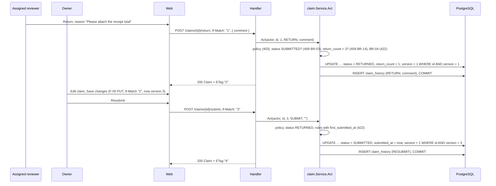

# F-06 Return and Resubmit – Engineering Contract

- **Feature:** F-06 Return and resubmit (`docs/features.md`)
- **Sprint:** 2 · **Issues:** #43 (F-06/01), #44 (F-06/02)
- **Requirements:** FR-09, FR-10, FR-07, BR-01, BR-02, BR-03, BR-04, BR-05, BR-06, BR-07, BR-10, BR-12, BR-13, BR-14, BR-17, NFR-02, NFR-06, NFR-08
- **Responsibilities verified here:** SR-01 (new endpoint), SR-04 (`RETURN`, `RESUBMIT` with the version check), SR-06
- **Depends on:** F-04 (decision flow, reason rule, Decision Panel), F-05 (edit path, `submit` endpoint, owner action bar)
- **Design baseline:** `docs/system-sds.md` v0.8 §2.2 `claims.return_count`; §3.2 `RETURN`, `RESUBMIT`; §3.3; §4.1 versions; §4.3 `POST /claims/{id}/return`, `POST /claims/{id}/submit`; §5.2 `return`; §7.2 badges and "Returned n / 3"
- **Version:** 0.2 · **Last updated:** 2026-11-24

---

## 1. Feature SDS

### 1.1 Behavior

- The assigned reviewer can return a `SUBMITTED` claim to the requester with a reason. The claim becomes `RETURNED`, its return count goes up by one, and it leaves the review queue.
- A claim can be returned at most 3 times (BR-14). After the third return the reviewer can only approve or reject it.
- The requester sees the latest return reason on Claim Detail, edits the claim with the F-05 edit path, and resubmits it.
- Resubmission sends the claim back to the **same** reviewer (BR-17). The 90-day window still counts from the first submission (BR-07, D-13), so editing and resubmitting does not move it.
- Each return and each resubmission is one history entry, written in the same transaction as the status change.

### 1.2 Workflow

### 1.3 Lifecycle (added by F-06)

| From | Action | To | Who | Data changed | History |
| --- | --- | --- | --- | --- | --- |
| `SUBMITTED` | `RETURN` | `RETURNED` | Assigned reviewer, not the owner, `return_count < 3` | `return_count + 1`, `version + 1`; `decided_at` stays NULL | `RETURN`, comment = reason |
| `RETURNED` | edit | `RETURNED` | Owner | F-05 edit | none |
| `RETURNED` | `SUBMIT` | `SUBMITTED` | Owner | `submitted_at = now`, `version + 1`; reviewer and `first_submitted_at` unchanged | `RESUBMIT`, comment `null` |

A returned claim can also be withdrawn (F-07). `RETURN` is a step in the review, not a decision, so `decided_at` stays NULL and the claim does not count as decided.

### 1.4 Order of checks

F-05 §1.4. For `return`, step 4 is the F-04 reviewer check (BR-01, BR-02), step 5 checks the status and then the return count, and step 6 is BR-04 on the reason. For a resubmission, step 6 runs BR-05, BR-06, BR-07, and BR-12 on the stored items with the stored `first_submitted_at`.

### 1.5 Invalid-transition rules and messages

Added to F-05 §1.5:

| Action | Allowed from | Rule | Message |
| --- | --- | --- | --- |
| `return` | `SUBMITTED` | BR-03 | "Only a submitted claim can be returned." |
| `return` with `return_count = 3` | – | BR-14 | "This claim has already been returned 3 times." |

Both are 409 `INVALID_TRANSITION` with `field = "status"`; BR-14 uses `field = "returnCount"`. As for every action, a stale `If-Match` turns them into 409 `CONFLICT`.

### 1.6 Return reason

The reason uses the reject rule of F-04 §1.5 with the same constants: required, trimmed length from `MinReasonLength` to `MaxCommentLength` (BR-04), stored trimmed. Go tests use the constants, not literal numbers, so the Lab 7 change L7/01 (#99, minimum 5 → 10) changes no Go test here. The field error is on `comment` with rule BR-04 and the F-04 messages. The web has no copy of the limits: the Return dialog behaves like the Reject dialog and reads the same `ClaimDecision.comment` schema (§2.1).

### 1.7 Resubmission rules

| Rule | Check |
| --- | --- |
| BR-05, BR-06, BR-12 | On the stored items, as at first submission |
| BR-07 | Each `expenseDate` ≤ today and within 90 days of the stored `first_submitted_at`, not of now |
| BR-17 | `assigned_reviewer_id` is not changed, even if the owner's `reviewer_id` changed since |
| BR-15 | Not checked: the claim already has an assigned reviewer |

### 1.8 Failure and boundary cases

Fixed clock `2026-11-25T10:00:00+07:00`. `req.anan`'s claim is assigned to `rev.malee` unless stated.

| Case | Result |
| --- | --- |
| `rev.malee` returns with a reason of `MinReasonLength` characters after trimming | 200, `RETURNED`, `returnCount` 1 |
| Reason empty, whitespace only, `MinReasonLength − 1`, or `MaxCommentLength + 1` characters | 422 `comment`, BR-04; claim unchanged |
| `req.anan` returns her own claim | 403 (BR-01) |
| `rev.somchai` (not assigned) returns it | 403 (BR-02) |
| Return an `APPROVED`, `REJECTED`, `RETURNED`, or `DRAFT` claim with the current version | 409 `INVALID_TRANSITION`, BR-03 (403 for a draft, which the reviewer cannot see) |
| Return a claim with `returnCount` 3 | 409 `INVALID_TRANSITION`, BR-14; approve and reject still allowed |
| Return with a stale version | 409 `CONFLICT` |
| Resubmit when `first_submitted_at` is 2026-11-20 and an item is dated 2026-08-22 (90 days before) | 200 |
| Resubmit when `first_submitted_at` is 2026-11-20 and an item is dated 2026-08-21 (91 days before) | 422 `items[n].expenseDate`, BR-07; claim stays `RETURNED` |
| Resubmit after the owner's `reviewer_id` changed to `rev.somchai` | 200; `assignedReviewer` still `rev.malee` |
| `rev.malee` resubmits the claim | 403 |
| `fin.wanida` is the assigned reviewer of `rev.prasert`'s claim and returns it | 200 (finance acts as a reviewer here, BR-15) |
| History insert fails during return or resubmit | 500; status, `return_count`, `submitted_at`, and `version` unchanged |

### 1.9 Permissions and policy

| Action | Allowed when | Rule |
| --- | --- | --- |
| `return` | assigned reviewer, not the owner, status `SUBMITTED`, `return_count < 3` | BR-01, BR-02, BR-03, BR-14 |
| `submit` from `RETURNED` | owner | BR-10, BR-17 |
| `edit` in `RETURNED` | owner | BR-10 (F-05) |

`allowedActions` for the assigned reviewer of a `SUBMITTED` claim is `["approve", "reject", "return"]`, or `["approve", "reject"]` when `returnCount` is 3. For the owner of a `RETURNED` claim it is `["edit", "submit", "withdraw"]` (`withdraw` from F-07).

### 1.10 Code

- `transitions` gains `ActionReturn` (`SUBMITTED` → `RETURNED`, history `RETURN`) and the `RETURNED` source of `ActionSubmit` (history `RESUBMIT`).
- `Subject.ReturnCount` (F-05 §1.10) feeds the BR-14 check in `Allowed` and in `checkAct`.
- The return update sets `return_count = return_count + 1`; the database CHECK (0–3) is the last guard.
- `Act(SUBMIT)` on a `RETURNED` claim runs `checkRules` with the stored `first_submitted_at` and sets only `submitted_at`.

## 2. UI spec

### 2.1 Decision Panel (reviewer)

| Element | Behavior |
| --- | --- |
| **Return** | Third button next to **Approve** and **Reject**, shown only when `return` is in `allowedActions`. Label "Return (n / 3)", where n is `returnCount`. |
| Return dialog | The Reject dialog of F-04 §2.2 with the title "Return claim", the field "Reason for return", and **Return** and **Cancel**. It has the same counter, client checks, and 422 handling as Reject, from the same `ClaimDecision.comment` schema. As of F-04 0.7 that is the `0/500` counter and the API's 422 message under the field; the button is disabled only while sending. If L7/01 (#101) adds `x-min-length` and disables **Reject** below it, **Return** follows in the same way, with no change to this contract. |
| No returns left | When `returnCount` is 3 the panel shows "Returned 3 / 3 – approve or reject." instead of the Return button. |
| Success | Toast "Claim returned.", then back to the Review Queue (the claim left the queue). |
| Errors | As F-04 §2.2: 422 under the field, 409 reload toast and refetch, 409 `INVALID_TRANSITION` toast with the message. |

### 2.2 Claim Detail (owner of a `RETURNED` claim)

| Element | Behavior |
| --- | --- |
| Return banner | Amber alert above the summary: "Returned by <reviewer> on <date>" and the reason from the latest `RETURN` history entry. |
| Return count | Summary shows "Returned n / 3". |
| **Edit** | Opens Edit Claim (F-05 §2.3). |
| **Resubmit** | The F-05 **Submit claim** button labelled "Resubmit" for a `RETURNED` claim. Success: toast "Claim resubmitted." and refetch. 422: the F-05 "Line n: <message>" list. |

### 2.3 Lists

The amber **Returned** badge shows in My Claims. The Review Queue does not list `RETURNED` claims (only `SUBMITTED`, F-04). After a resubmission the claim appears in the queue again with its new `submittedAt`.

## 3. API spec

| Method | Path | Request | Success | Errors | Auth |
| --- | --- | --- | --- | --- | --- |
| POST | `/claims/{id}/return` | Header `If-Match`; body `ClaimDecision` `{ "comment": "…" }` | 200 `{ "data": Claim }` with `status = "RETURNED"` and `returnCount` + 1; new `ETag` | 400, 401, 403, 404, 409 `INVALID_TRANSITION` / `CONFLICT`, 422, 428 | session; policy `return` |
| POST | `/claims/{id}/submit` | F-05 §3 | 200 with `status = "SUBMITTED"` and history `RESUBMIT` | F-05 §3 | session; policy `submit` |

- Operation ID `returnClaim`. It reuses the `ClaimId` and `IfMatch` parameters, the `ClaimDecision` body, and the `Decided` response of `rejectClaim`. A missing `comment` is a 422 BR-04, not a 400, as for reject.
- `Claim.returnCount` (integer 0–3) is in the response schema already. History entries for `RETURN` carry the comment.

## 4. Data spec

- **Schema:** no migration. `claims.return_count` with CHECK 0–3 and the `RETURN` and `RESUBMIT` history actions are in `00002_claims.sql`.
- **Queries (sqlc):** `ReturnClaim` (`status`, `return_count + 1`, `version + 1`, `updated_at` `WHERE id AND version`), `ResubmitClaim` (`status`, `submitted_at`, `version + 1` `WHERE id AND version`).
- **Seed:** `bun run seed` adds one `RETURNED` claim for `req.anan` assigned to `rev.malee`, `returnCount` 1, with history `SUBMIT` then `RETURN` ("Please attach the taxi receipt."). Idempotent by `claim_no`. F04-TEST-22 counts this row.

## 5. Acceptance criteria

| ID | Requirement | Acceptance criterion |
| --- | --- | --- |
| F06-AC-01 | FR-09, FR-07, NFR-06 | The assigned reviewer returns a `SUBMITTED` claim with a valid reason and the current `If-Match` → 200: status `RETURNED`, `returnCount` + 1, `version` + 1, new `ETag`, `decidedAt` `null`, and one `RETURN` history row with the reviewer as actor and the trimmed reason. |
| F06-AC-02 | BR-04 | The return reason uses the reject rule: missing, empty, whitespace only, `MinReasonLength − 1`, or `MaxCommentLength + 1` trimmed characters → 422 `comment`, BR-04; `MinReasonLength` and `MaxCommentLength` → 200. Tests use the constants. |
| F06-AC-03 | BR-01, BR-02 | The owner returning their claim → 403. A reviewer who is not assigned → 403. The claim is unchanged. |
| F06-AC-04 | BR-03, BR-13 | Return on an `APPROVED`, `REJECTED`, or `RETURNED` claim with the current version → 409 `INVALID_TRANSITION`, BR-03; with a stale version → 409 `CONFLICT`. |
| F06-AC-05 | BR-14 | A claim with `returnCount` 3 cannot be returned: the policy gives no `return`, and the endpoint → 409 `INVALID_TRANSITION`, BR-14. The reviewer can still approve or reject it. |
| F06-AC-06 | FR-09, FR-10 | A returned claim is not in the reviewer's `scope=review` list and is in the owner's `scope=mine` list as `RETURNED`. The assigned reviewer can still open it (200, no `allowedActions`). After a resubmission it is back in `scope=review`, ordered by its new `submittedAt`. |
| F06-AC-07 | FR-10, FR-07, BR-17, NFR-06 | The owner resubmits a `RETURNED` claim with the current version → 200: status `SUBMITTED`, `submittedAt` = now, `firstSubmittedAt` and `assignedReviewer` unchanged (even if the owner's `reviewer_id` changed), `version` + 1, and one `RESUBMIT` history row. |
| F06-AC-08 | BR-07 | Resubmission checks the 90-day window from `firstSubmittedAt`: with `firstSubmittedAt` 2026-11-20, an item dated 2026-08-22 → 200, 2026-08-21 → 422 BR-07; after a 422 the claim stays `RETURNED` with no new history. |
| F06-AC-09 | FR-10, BR-10 | The owner edits a `RETURNED` claim with the F-05 edit path → 200; a non-owner → 403; the reviewer cannot resubmit → 403. |
| F06-AC-10 | NFR-06 | If the history insert fails during a return or a resubmission, the response is 500 and status, `returnCount`, `submittedAt`, and `version` are unchanged. |
| F06-AC-11 | FR-09, NFR-08 | The Decision Panel shows "Return (n / 3)" only when `return` is allowed, opens a reason dialog that behaves like the Reject dialog (same counter, client checks, and 422 message under the field), and on success returns to the queue with "Claim returned."; with `returnCount` 3 it shows "Returned 3 / 3 – approve or reject." |
| F06-AC-12 | FR-10, NFR-08 | The owner's Claim Detail for a `RETURNED` claim shows the amber banner with the reviewer, date, and latest return reason, "Returned n / 3", **Edit**, and **Resubmit**; resubmit success shows "Claim resubmitted." |
| F06-AC-13 | FR-09, FR-10 | End to end: `req.anan` submits; `rev.malee` returns with a reason; `req.anan` sees the reason, edits an item, and resubmits; `rev.malee` approves. History shows `SUBMIT`, `RETURN`, `RESUBMIT`, `APPROVE` in order. |

## 6. Software Test Specification

| Test | AC | Level | Precondition / input | Action | Expected result |
| --- | --- | --- | --- | --- | --- |
| F06-TEST-01 | F06-AC-01 | Integration | `req.anan`'s `SUBMITTED` claim at version `v`, `returnCount` 0 | `POST …/return` as `rev.malee`, `If-Match: "v"`, comment `"  Please attach the receipt.  "` | 200; `RETURNED`; `returnCount` 1; `ETag: "v+1"`; `decidedAt` null; 1 new history row `RETURN`, actor `rev.malee`, comment trimmed |
| F06-TEST-02 | F06-AC-02 | Integration (module) | `SUBMITTED` claim | `Act(RETURN)` with comments: `""`, spaces only, `MinReasonLength − 1`, `MinReasonLength`, `MaxCommentLength`, `MaxCommentLength + 1` characters after trimming | `ValidationError` `comment` BR-04 for the first, second, third, and sixth; success for the fourth and fifth (fresh claim each) |
| F06-TEST-03 | F06-AC-02 | Integration | `SUBMITTED` claim | `POST …/return` with body `{}` | 422, `errors[0]` = `comment`, BR-04 |
| F06-TEST-04 | F06-AC-03 | Integration | `req.anan`'s `SUBMITTED` claim; `rev.malee`'s own `SUBMITTED` claim (reviewer `rev.prasert`) | Return as `rev.somchai` on the first; as `rev.malee` on the second | 403; 403; both claims unchanged |
| F06-TEST-05 | F06-AC-04 | Integration | `APPROVED`, `REJECTED`, `RETURNED` claims assigned to `rev.malee` | `POST …/return` with each current version; then the `APPROVED` one with a stale version | 409 `INVALID_TRANSITION`, BR-03, "Only a submitted claim can be returned." ×3; 409 `CONFLICT` |
| F06-TEST-06 | F06-AC-05 | Unit | Subjects: assigned reviewer, `SUBMITTED`, `ReturnCount` 0, 2, 3 | `Allowed` | `[approve, reject, return]`; `[approve, reject, return]`; `[approve, reject]` |
| F06-TEST-07 | F06-AC-05 | Integration (module) | Claim returned and resubmitted 3 times (`returnCount` 3, `SUBMITTED`) | `Act(RETURN)`; then `Act(APPROVE)` | `ErrInvalidTransition` BR-14, `field` `returnCount`, "This claim has already been returned 3 times."; approve succeeds |
| F06-TEST-08 | F06-AC-06 | Integration | `req.anan`'s `SUBMITTED` claim | `GET /claims?scope=review` as `rev.malee` before return, after return, after resubmit; after return also `GET /claims/{id}` as `rev.malee` and `scope=mine` as `req.anan` | Listed; not listed; listed with the new `submittedAt`; detail 200 with `allowedActions = []`; listed as `RETURNED` |
| F06-TEST-09 | F06-AC-07 | Integration | `RETURNED` claim at version `v`, `firstSubmittedAt` 2026-11-20, reviewer `rev.malee`; then `req.anan.reviewer_id = rev.somchai` | `POST …/submit` as `req.anan`, `If-Match: "v"` | 200; `SUBMITTED`; `submittedAt` = clock; `firstSubmittedAt` 2026-11-20; `assignedReviewer` `rev.malee`; `ETag: "v+1"`; 1 new history row `RESUBMIT`, `fromStatus` `RETURNED` |
| F06-TEST-10 | F06-AC-08 | Integration (module) | `RETURNED` claims with `first_submitted_at` 2026-11-20T09:00+07:00 and one item dated 2026-08-22 / 2026-08-21 | `Act(SUBMIT)` | Success; `ValidationError` BR-07 on `items[0].expenseDate`, claim `RETURNED`, no new history |
| F06-TEST-11 | F06-AC-09 | Integration | `req.anan`'s `RETURNED` claim at version `v` | `PUT` as `req.anan` with new items; `PUT` as `req.ploy`; `POST …/submit` as `rev.malee` | 200 with the new total; 403; 403 |
| F06-TEST-12 | F06-AC-10 | Integration (module) | Test-only trigger raising on `INSERT` into `claim_history` | `Act(RETURN)` on a `SUBMITTED` claim; `Act(SUBMIT)` on a `RETURNED` claim | Error each time; status, `return_count`, `submitted_at`, `version` unchanged |
| F06-TEST-13 | F06-AC-11 | Component | MSW claim with `allowedActions` `[approve, reject, return]`, `returnCount` 1; return 200, 422, 409; a claim with `returnCount` 3 and `[approve, reject]` | Render the Decision Panel; return with short and valid reasons | Button "Return (1 / 3)"; the dialog matches the Reject case of F04-TEST-21 (counter, client checks, button disabled while sending); "Claim returned." and navigation to the queue; field error on 422; reload toast on 409; "Returned 3 / 3 – approve or reject." for the second claim |
| F06-TEST-14 | F06-AC-12 | Component | MSW `RETURNED` claim with a `RETURN` history entry, `returnCount` 2, `allowedActions` `[edit, submit, withdraw]`; submit 200 | Render Claim Detail as the owner; click **Resubmit** | Banner with reviewer, date, and reason; "Returned 2 / 3"; Edit and Resubmit buttons; "Claim resubmitted." |
| F06-TEST-15 | F06-AC-13 | E2E | Seeded database | Full return-and-resubmit flow in §5 | History in order `SUBMIT`, `RETURN`, `RESUBMIT`, `APPROVE`; final status Approved |
| F06-TEST-16 | F04-AC-19 (seed) | Integration | Empty database | Run seed twice | The F-06 returned claim exists once with `returnCount` 1 and 2 history rows |

## 7. Feature Definition of Done

The Sprint 2 Product DoD applies. For F-06 the evidence is:

- [ ] All F06-TEST rows run: unit, integration, and component tests pass in CI on the merge commit; F06-TEST-15 passes on a local seeded stack with the tested commit recorded.
- [ ] TDD evidence for BR-14 (F06-TEST-07) and BR-07 from the first submission (F06-TEST-10).
- [ ] `openapi.yaml` has `returnClaim`; both apps regenerate with no diff in CI.
- [ ] `docs/traceability.md` lists the actual test names and results for the F-06 rows.

## 8. Revision history

| Version | Date | Change | Author |
| --- | --- | --- | --- |
| 0.1 | 2026-11-23 | Initial contract, from the F-06 feature spec and tickets #43–#44 | beambeambeam |
| 0.2 | 2026-11-24 | Review fixes (PR #100): the Return dialog behaves like the Reject dialog and reads the same schema, so it adds no client minimum of its own (§1.6, §2.1, F06-AC-11, F06-TEST-13) | beambeambeam |
