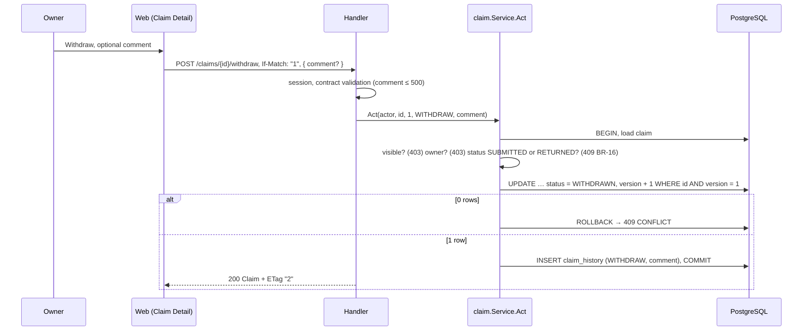

# F-07 Withdraw – Engineering Contract

- **Feature:** F-07 Withdraw (`docs/features.md`)
- **Sprint:** 2 · **Issue:** #45 (F-07/01)
- **Requirements:** FR-11, FR-07, BR-03, BR-13, BR-16, NFR-02, NFR-06, NFR-08
- **Responsibilities verified here:** SR-01 (new endpoint), SR-04 (`WITHDRAW` with the version check)
- **Depends on:** F-04 (decision flow), F-05 (owner action bar), F-06 (`RETURNED` state)
- **Design baseline:** `docs/system-sds.md` v0.8 §3.2 `WITHDRAW`; §3.3; §4.1 versions; §4.3 `POST /claims/{id}/withdraw`; §5.2 `withdraw`; §7.2 Withdrawn badge
- **Version:** 0.1 · **Last updated:** 2026-11-23

---

## 1. Feature SDS

### 1.1 Behavior

- The owner can withdraw their claim while it is `SUBMITTED` or `RETURNED`, with an optional comment. The claim becomes `WITHDRAWN`. That status is final: nobody can edit, submit, or decide it again.
- A withdrawn claim leaves the reviewer's queue. The owner and the assigned reviewer can still open it and read its history.
- A claim cannot be withdrawn once it is approved, rejected, or waiting for finance (BR-16, D-11). The `PENDING_FINANCE` case is tested in F-08, when that state can be reached.
- If the reviewer decides a claim at the same time as the owner withdraws it, the version check lets only one of them succeed (BR-13).

### 1.2 Workflow

### 1.3 Lifecycle (added by F-07)

| From | Action | To | Who | Data changed | History |
| --- | --- | --- | --- | --- | --- |
| `SUBMITTED` | `WITHDRAW` | `WITHDRAWN` | Owner | `version + 1`, `decided_at` stays NULL | `WITHDRAW`, comment or `null` |
| `RETURNED` | `WITHDRAW` | `WITHDRAWN` | Owner | same | same |

`WITHDRAWN` is terminal. No action of any feature starts from it.

### 1.4 Order of checks

F-05 §1.4. For `withdraw`, step 4 checks that the actor is the owner, step 5 checks the status, and step 6 has no field rules (the comment length is checked by the contract, before step 2).

### 1.5 Invalid-transition rule and message

Added to F-05 §1.5 and F-06 §1.5:

| Action | Allowed from | Rule | Message |
| --- | --- | --- | --- |
| `withdraw` | `SUBMITTED`, `RETURNED` | BR-16 | "Only a submitted or returned claim can be withdrawn." |

A decision (`approve`, `reject`, `return`) or a `submit` on a `WITHDRAWN` claim gets the F-04, F-05, or F-06 message with BR-03, or 409 `CONFLICT` when the client's version is stale.

### 1.6 Comment

The comment is optional. It is trimmed and stored, or `null` when empty after trimming. `openapi.yaml` gives it `maxLength: 500`, so a longer comment is a 400 from the validator, not a 422. This differs from `ClaimDecision`, where BR-04 decides the response (F-04 §3).

### 1.7 Failure and boundary cases

| Case | Result |
| --- | --- |
| `req.anan` withdraws her `SUBMITTED` claim with no body | 200, `WITHDRAWN`, history comment `null` |
| Withdraw a `RETURNED` claim with comment "No longer needed" | 200, `WITHDRAWN`, history comment stored |
| Comment of 500 / 501 characters | 200 / 400 |
| Withdraw a `DRAFT` | 409 `INVALID_TRANSITION`, BR-16 (delete the draft instead) |
| Withdraw an `APPROVED`, `REJECTED`, or `WITHDRAWN` claim with the current version | 409 `INVALID_TRANSITION`, BR-16 |
| `rev.malee` (assigned reviewer) withdraws `req.anan`'s claim | 403 |
| `req.ploy` withdraws `req.anan`'s claim | 403, no claim data |
| Withdraw with a stale version, without `If-Match`, with `If-Match: abc` | 409 `CONFLICT`, 428, 400 |
| Reviewer approves after the withdrawal, with the version read before it | 409 `CONFLICT` |
| Reviewer approves after the withdrawal, with the current version | 409 `INVALID_TRANSITION`, BR-03 |
| Owner withdraws and reviewer approves at the same time with the same version | One 200, one 409 `CONFLICT`; one new history row |
| History insert fails | 500; status and `version` unchanged |

### 1.8 Permissions and policy

| Action     | Allowed when                          | Rule  |
| ---------- | ------------------------------------- | ----- |
| `withdraw` | own, status `SUBMITTED` or `RETURNED` | BR-16 |

`allowedActions` for the owner of a `SUBMITTED` claim is `["withdraw"]`; of a `RETURNED` claim, `["edit", "submit", "withdraw"]`; of a `WITHDRAWN` claim, `[]`. The assigned reviewer of a `WITHDRAWN` claim gets `[]`.

### 1.9 Code

- `transitions` gains `ActionWithdraw` with two sources (`SUBMITTED`, `RETURNED`) and history `WITHDRAW`.
- The policy checks ownership for `withdraw`, not the reviewer relation used by the decisions.

## 2. UI spec

### 2.1 Claim Detail (owner)

| Element | Behavior |
| --- | --- |
| **Withdraw** | Shown in the owner action bar (F-05 §2.2) only when `withdraw` is in `allowedActions`. |
| Withdraw dialog | Title "Withdraw CLM-…?", text "You can't edit or resubmit a withdrawn claim.", optional "Comment" with a counter `0/500` that blocks input after 500 characters, **Withdraw claim** and **Cancel**. **Withdraw claim** is disabled with a spinner while sending. |
| Success | Toast "Claim withdrawn.", refetch; the badge is the grey struck-through **Withdrawn**, and the action bar is empty. |
| 409 `CONFLICT` | Toast "This claim was changed by someone else – reloaded", then refetch. |
| 409 `INVALID_TRANSITION` | Toast with `errors[0].message`, then refetch. |

### 2.2 Lists and reviewer view

My Claims shows the **Withdrawn** badge. The Review Queue no longer lists the claim. A reviewer with the claim open who tries to decide it gets the F-04 409 handling.

## 3. API spec

| Method | Path | Request | Success | Errors | Auth |
| --- | --- | --- | --- | --- | --- |
| POST | `/claims/{id}/withdraw` | Header `If-Match`; body `ClaimWithdrawal` `{ "comment"?: string }`, `maxLength: 500` | 200 `{ "data": Claim }` with `status = "WITHDRAWN"`; new `ETag` | 400, 401, 403, 404, 409 `INVALID_TRANSITION` / `CONFLICT`, 428 | session; policy `withdraw` |

Operation ID `withdrawClaim`. It reuses the `ClaimId` and `IfMatch` parameters and the `Decided` response. The body is optional; an empty body equals `{}`.

## 4. Data spec

- **Schema:** no migration. `WITHDRAWN` and the `WITHDRAW` history action are in `00002_claims.sql`.
- **Queries (sqlc):** `WithdrawClaim` (`status`, `version + 1`, `updated_at` `WHERE id AND version`).
- **Seed:** `bun run seed` adds one `WITHDRAWN` claim for `req.ploy` assigned to `rev.malee`, with history `SUBMIT` then `WITHDRAW` ("Booked by the company instead."). Idempotent by `claim_no`. F04-TEST-22 counts this row.

## 5. Acceptance criteria

| ID | Requirement | Acceptance criterion |
| --- | --- | --- |
| F07-AC-01 | FR-11, FR-07, NFR-06 | The owner withdraws a `SUBMITTED` or a `RETURNED` claim with the current `If-Match` → 200: status `WITHDRAWN`, `version` + 1, new `ETag`, `decidedAt` `null`, and one `WITHDRAW` history row with the owner as actor and the trimmed comment or `null`. |
| F07-AC-02 | FR-11 | The comment is optional: no body and `{}` → 200 with comment `null`; 500 characters → 200; 501 → 400. |
| F07-AC-03 | BR-16 | Withdraw from `DRAFT`, `APPROVED`, `REJECTED`, or `WITHDRAWN` with the current version → 409 `INVALID_TRANSITION`, BR-16, with the §1.5 message; the claim is unchanged. |
| F07-AC-04 | FR-11, NFR-02 | Only the owner can withdraw: the assigned reviewer → 403; another requester → 403 with no claim data. |
| F07-AC-05 | BR-13 | Withdraw with a stale version → 409 `CONFLICT`; without `If-Match` → 428; malformed → 400. |
| F07-AC-06 | BR-03, BR-13 | `WITHDRAWN` is terminal: approve, reject, return, submit, edit, and delete on it get 409 (`INVALID_TRANSITION` with the current version, `CONFLICT` with a stale one), and the policy gives `[]` to everyone. A concurrent withdraw and approve with the same version → one 200, one 409 `CONFLICT`, one new history row. |
| F07-AC-07 | NFR-06 | If the history insert fails during a withdrawal, the response is 500 and status and `version` are unchanged. |
| F07-AC-08 | FR-11 | A withdrawn claim is not in the reviewer's `scope=review` list. The owner and the assigned reviewer can still open it and see the `WITHDRAW` entry. |
| F07-AC-09 | FR-11, NFR-08 | Claim Detail shows **Withdraw** only from `allowedActions`; the dialog has the optional comment with a `0/500` counter; success shows "Claim withdrawn.", the Withdrawn badge, and no actions; 409 shows the toast and refetches. |
| F07-AC-10 | FR-11 | End to end: `req.anan` submits a claim and withdraws it with a comment; it shows Withdrawn in My Claims; `rev.malee`'s Review Queue does not list it. |

## 6. Software Test Specification

| Test | AC | Level | Precondition / input | Action | Expected result |
| --- | --- | --- | --- | --- | --- |
| F07-TEST-01 | F07-AC-01 | Integration | `req.anan`'s `SUBMITTED` claim at version `v`; her `RETURNED` claim at version `w` | `POST …/withdraw` as `req.anan` with `If-Match: "v"` and no body; with `If-Match: "w"` and `{ "comment": "  No longer needed  " }` | 200 `WITHDRAWN`, `ETag: "v+1"`, history `WITHDRAW` comment `null`; 200, `ETag: "w+1"`, comment "No longer needed", `fromStatus` `RETURNED` |
| F07-TEST-02 | F07-AC-02 | Integration | `SUBMITTED` claims | Withdraw with `{}`; with a 500-character comment; with a 501-character comment | 200 comment `null`; 200; 400, claim unchanged |
| F07-TEST-03 | F07-AC-03 | Integration | `req.anan`'s `DRAFT`, `APPROVED`, `REJECTED`, `WITHDRAWN` claims | Withdraw each with its current version | 409 `INVALID_TRANSITION`, BR-16, "Only a submitted or returned claim can be withdrawn." ×4; unchanged |
| F07-TEST-04 | F07-AC-04 | Integration | `req.anan`'s `SUBMITTED` claim | Withdraw as `rev.malee`; as `req.ploy` | 403; 403 with no claim fields |
| F07-TEST-05 | F07-AC-04, F07-AC-06 | Unit | Subjects: owner `SUBMITTED`, owner `RETURNED`, owner `WITHDRAWN`, reviewer `WITHDRAWN`, reviewer `SUBMITTED` | `Allowed` | `[withdraw]`; `[edit, submit, withdraw]`; `[]`; `[]`; no `withdraw` |
| F07-TEST-06 | F07-AC-05 | Integration | `SUBMITTED` claim at version `v` | Withdraw with `If-Match: "v+1"`; with no header; with `If-Match: abc` | 409 `CONFLICT`; 428; 400 |
| F07-TEST-07 | F07-AC-06 | Integration | Claim withdrawn from version `v` (now `v + 1`) | As `rev.malee`: approve, reject, return with `If-Match: "v"`, then with `"v+1"`; as `req.anan`: submit, `PUT`, `DELETE` with `"v+1"` | 409 `CONFLICT` ×3; 409 `INVALID_TRANSITION` BR-03 ×3; 409 `INVALID_TRANSITION` BR-03, BR-10, BR-10 |
| F07-TEST-08 | F07-AC-06 | Integration (module) | `SUBMITTED` claim at version `v` | Two goroutines start together: `Act(WITHDRAW, v)` as owner and `Act(APPROVE, v)` as reviewer | One success, one `ErrConflict`; one new history row matching the final status |
| F07-TEST-09 | F07-AC-07 | Integration (module) | Test-only trigger raising on `INSERT` into `claim_history` | `Act(WITHDRAW)` | Error; status and `version` unchanged |
| F07-TEST-10 | F07-AC-08 | Integration | Withdrawn claim of `req.anan` | `GET /claims?scope=review` as `rev.malee`; `GET /claims/{id}` as `req.anan` and `rev.malee` | Not listed; 200 ×2 with the `WITHDRAW` history entry and `allowedActions = []` |
| F07-TEST-11 | F07-AC-09 | Component | MSW claim with `allowedActions` `[withdraw]`; withdraw 200, 409 `CONFLICT`, 409 `INVALID_TRANSITION`; a claim with `[]` | Render Claim Detail; open the dialog; type 500 characters; confirm | No button for `[]`; counter `500/500` and no more input; button disabled while pending; "Claim withdrawn." and Withdrawn badge after refetch; reload toast; message toast |
| F07-TEST-12 | F07-AC-10 | E2E | Seeded database | §5 flow | Withdrawn in My Claims; not in `rev.malee`'s Review Queue; history shows the comment |
| F07-TEST-13 | F04-AC-19 (seed) | Integration | Empty database | Run seed twice | The F-07 withdrawn claim exists once with 2 history rows |

## 7. Feature Definition of Done

The Sprint 2 Product DoD applies. For F-07 the evidence is:

- [ ] All F07-TEST rows run: unit, integration, and component tests pass in CI on the merge commit; F07-TEST-12 passes on a local seeded stack with the tested commit recorded.
- [ ] TDD evidence for BR-16 (F07-TEST-03).
- [ ] `openapi.yaml` has `withdrawClaim` and `ClaimWithdrawal`; both apps regenerate with no diff in CI.
- [ ] `docs/traceability.md` lists the actual test names and results for the F-07 rows.

## 8. Revision history

| Version | Date | Change | Author |
| --- | --- | --- | --- |
| 0.1 | 2026-11-23 | Initial contract, from the F-07 feature spec and ticket #45 | beambeambeam |
