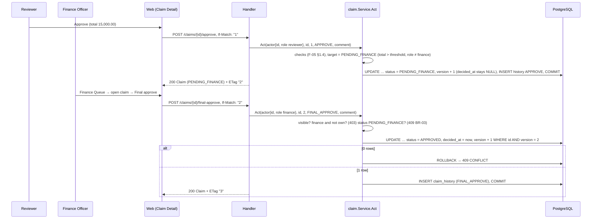

# F-08 Two-stage High-value Approval – Engineering Contract

- **Feature:** F-08 Two-stage high-value approval (`docs/features.md`)
- **Sprint:** 3 · **Issues:** #46 (F-08/01), #47 (F-08/02)
- **Requirements:** FR-12, FR-07, BR-01, BR-02, BR-03, BR-04, BR-09, BR-13, BR-16, NFR-02, NFR-06, NFR-08
- **Responsibilities verified here:** SR-01 (new endpoints, Finance visibility), SR-04 (`APPROVE` target, `FINAL_APPROVE`, `FINAL_REJECT` with the version check)
- **Depends on:** F-04 (decision flow), F-07 (`withdraw` rule), ADR-0001
- **Design baseline:** `docs/system-sds.md` v0.18 §2.3 high-value threshold; §3.2 `APPROVE`, `FINAL_APPROVE`, `FINAL_REJECT`; §4.3 `final-approve`, `final-reject`; §5.1 `finance:list`; §5.2; §5.3 `scope=finance`; §7.1 Finance Queue; §7.2 Pending finance badge
- **Version:** 0.2 · **Last updated:** 2026-11-26

---

## 1. Feature SDS

### 1.1 Behavior

- When the assigned reviewer approves a claim, `APPROVE` picks its target in one place. The target is `PENDING_FINANCE` if the claim total is more than 10,000.00 THB and the approver's role is not `finance`. Otherwise it is `APPROVED` (BR-09).
- A claim of exactly 10,000.00 THB needs one approval. A Finance Officer who is the assigned reviewer (the Department Head's claims) makes a final approval (ADR-0001, D-05).
- A `PENDING_FINANCE` claim is not decided yet: `decided_at` stays NULL, and the owner cannot withdraw it (BR-16, D-11).
- Any Finance Officer who is not the owner makes the final decision on a `PENDING_FINANCE` claim. Final approve has an optional comment and leads to `APPROVED`. Final reject needs a BR-04 reason and leads to `REJECTED`. There is no return from the final stage (D-12).
- The Finance Queue lists every `PENDING_FINANCE` claim, oldest first.
- From this feature on, a Finance Officer can see every claim that is not a `DRAFT` (SDS §5.2). Seeing a claim does not grant any action on it: approve, reject, and return still need the assigned reviewer.
- Both stages are in history: the reviewer's `APPROVE` row (to `PENDING_FINANCE`) and the Finance `FINAL_APPROVE` or `FINAL_REJECT` row.

### 1.2 Workflow

### 1.3 Lifecycle (changed and added by F-08)

| From | Action | To | Who | Data changed | History |
| --- | --- | --- | --- | --- | --- |
| `SUBMITTED` | `APPROVE` | `PENDING_FINANCE` | Assigned reviewer whose role is not `finance`, total > 10,000.00 | `version + 1`, `decided_at` stays NULL | `APPROVE`, comment or `null` |
| `SUBMITTED` | `APPROVE` | `APPROVED` | Assigned reviewer, total ≤ 10,000.00 or role `finance` | `version + 1`, `decided_at = now` (unchanged from F-04) | `APPROVE`, comment or `null` |
| `PENDING_FINANCE` | `FINAL_APPROVE` | `APPROVED` | Any `finance` user, not the owner | `version + 1`, `decided_at = now` | `FINAL_APPROVE`, comment or `null` |
| `PENDING_FINANCE` | `FINAL_REJECT` | `REJECTED` | Any `finance` user, not the owner | `version + 1`, `decided_at = now` | `FINAL_REJECT`, reason |

No other action starts from `PENDING_FINANCE`. `withdraw`, `edit`, `submit`, `delete`, `approve`, `reject`, and `return` on it get 409 `INVALID_TRANSITION` with the current version (BR-03, BR-10, or BR-16 as in §1.5), or 409 `CONFLICT` with a stale one.

### 1.4 Order of checks

F-05 §1.4. For `final-approve` and `final-reject`:

1. `If-Match` (428 missing, 400 malformed).
2. The claim exists (404).
3. The actor can see it (403).
4. The actor's role is `finance` (403, BR-02), and the actor is not the requester (403, BR-01).
5. The status is `PENDING_FINANCE` (409 `INVALID_TRANSITION`, BR-03; 409 `CONFLICT` if the version is stale).
6. The comment: optional and at most 500 characters for final approve; required, 10–500 characters after trimming, for final reject (422, BR-04).
7. The conditional `UPDATE` (409 `CONFLICT`).
8. The history insert (500, rolled back).

For `approve`, the order is unchanged (F-04 §1.4). The target status is chosen after step 6, from the stored total and the actor's role.

### 1.5 Invalid-transition rules and messages

Added to F-05 §1.5, F-06 §1.5, and F-07 §1.5:

| Action | Allowed from | Rule | Message |
| --- | --- | --- | --- |
| `final-approve`, `final-reject` | `PENDING_FINANCE` | BR-03 | "Only a claim pending finance can be finally approved or rejected." |

The existing messages do not change. `approve` or `reject` on a `PENDING_FINANCE` claim gets the F-04 message "Only a submitted claim can be approved or rejected." `withdraw` gets the F-07 message (BR-16).

### 1.6 Reason and comment

Final reject uses the same rule and constants as reject and return (BR-04, `MinReasonLength` 10 and `MaxCommentLength` 500 in `rules.go`), and the same messages as F-04 §1.5. Final approve uses the approve comment rule. Both bodies are `ClaimDecision`, so the 10–500 range lives in one place.

The F-08 feature spec (in Git history) gives the final-reject reason as 5–500 characters. SRS v0.3 (Lab 7 change L7/01, #99) raised the minimum to 10 for reject, return, and final reject. This contract follows the SRS.

### 1.7 Failure and boundary cases

| Case | Result |
| --- | --- |
| `rev.malee` approves `req.anan`'s claim of exactly 10,000.00 | 200, `APPROVED`, `decidedAt` set |
| `rev.malee` approves `req.anan`'s claim of 10,000.01 | 200, `PENDING_FINANCE`, `decidedAt` `null` |
| `fin.wanida` approves `rev.prasert`'s 40,000.00 claim (she is the assigned reviewer) | 200, `APPROVED` (ADR-0001) |
| `fin.wanida` final-approves a `PENDING_FINANCE` claim with no body | 200, `APPROVED`, history `FINAL_APPROVE` comment `null` |
| Final reject with a 9 / 10 / 500 / 501-character reason, or a blank one | 422 / 200 / 200 / 422 / 422, BR-04 |
| Final approve with a 501-character comment | 422, BR-04 |
| `rev.malee` (the assigned reviewer) or `req.anan` (the owner) final-approves | 403 (BR-02) |
| A Finance Officer final-approves a `PENDING_FINANCE` claim they submitted (data set up in a test; Finance cannot create claims) | 403 (BR-01) |
| Final approve or reject on a `SUBMITTED`, `APPROVED`, or `REJECTED` claim with the current version | 409 `INVALID_TRANSITION`, BR-03, §1.5 message |
| `req.anan` withdraws her `PENDING_FINANCE` claim | 409 `INVALID_TRANSITION`, BR-16 |
| `rev.malee` approves, rejects, or returns the claim again once it is `PENDING_FINANCE` | 409 `INVALID_TRANSITION`, BR-03 |
| `fin.wanida` approves, rejects, or returns a `SUBMITTED` claim assigned to `rev.malee` | 403 (she can see it but is not the assigned reviewer, BR-02) |
| `fin.wanida` opens `req.anan`'s `DRAFT` | 403, no claim data |
| Final decision with a stale version, without `If-Match`, with `If-Match: abc` | 409 `CONFLICT`, 428, 400 |
| Two final decisions on the same claim at the same time with the same version | One 200, one 409 `CONFLICT`; one new history row |
| History insert fails during the `APPROVE` to `PENDING_FINANCE` or a final decision | 500; status and `version` unchanged |

### 1.8 Permissions and policy

Added to the policy in `policy.go` (SDS §5.2):

| Action | Allowed when | Rule |
| --- | --- | --- |
| `final-approve`, `final-reject` | actor role `finance` **and not own**, status `PENDING_FINANCE` | BR-01, BR-02 |

**Visible** gains a third case: the actor's role is `finance` and the claim is not `DRAFT`.

`allowedActions`:

- For a Finance Officer on a `PENDING_FINANCE` claim, `["final-approve", "final-reject"]`.
- For a Finance Officer on a `SUBMITTED` claim assigned to her, `["approve", "reject", "return"]` (unchanged).
- For a Finance Officer on a `SUBMITTED` claim she is not assigned to, `[]`.
- For the assigned reviewer of a `PENDING_FINANCE` claim, `[]`.
- For the owner of a `PENDING_FINANCE` claim, `[]`.

The route permission `finance:list` (role `finance` only) gates `scope=finance`.

### 1.9 Code

- `Actor` gains `Role` (from the session user), and `Subject` gains `TotalSatang`. `Allowed(actor Actor, claim Subject)` takes the whole actor, because the policy now depends on the role.
- `rules.go` gains `HighValueThresholdSatang = 1_000_000` (10,000.00 THB). The comparison is `total > threshold`, in satang.
- One function picks the `APPROVE` target from the total and the role. Neither the handler nor the web derives it.
- `transitions` gains `ActionFinalApprove` (`final-approve`) and `ActionFinalReject` (`final-reject`) from `PENDING_FINANCE`, with history `FINAL_APPROVE` and `FINAL_REJECT`.
- `Query` gains `ScopeFinance`: status `PENDING_FINANCE`, ordered by `submitted_at`, then `id`.
- `transitionErrors` in `handler.go` gains the §1.5 entries.

## 2. UI spec

### 2.1 Finance Queue (`/finance`, `_auth/finance.tsx`)

| Element | Behavior |
| --- | --- |
| Table | Columns: Claim no., Requester, Title, Total, Submitted. Oldest first. A row opens Claim Detail. |
| Header link | "Finance Queue" when `finance:list` is in `permissions` (F-01). |
| Pagination | As My Claims (F-03 §2.1). |
| Loading / empty / 403 | 5 skeleton rows; "No claims waiting for a final decision."; "You don't have access to this page." for a reviewer or requester who opens `/finance` directly. |

The page lives in `features/finance`. It does not import `features/claims` or `features/reviews`.

### 2.2 Final-decision panel on Claim Detail

The route file `_auth/claims/$claimId.tsx` renders `FinalDecisionPanel` from `features/finance` when `allowedActions` contains `final-approve` or `final-reject`.

| Control | Behavior |
| --- | --- |
| **Final approve** | Confirmation dialog: "Approve claim CLM-… as the final decision?", optional comment with a `0/500` counter, **Approve** and **Cancel**. |
| **Final reject** | The F-04 reject dialog with the title "Reject claim CLM-… as the final decision?": required reason, `0/500` counter, disabled until the trimmed reason has 10 characters, 422 messages under the field. |
| No return | The panel has no Return button. |
| Success | Toast "Claim approved." or "Claim rejected."; Claim Detail and the Finance Queue are refetched; the panel disappears. |
| 409 / 403 | As F-04 §2.2. |

### 2.3 Pending finance state

| Element | Behavior |
| --- | --- |
| Badge | Purple **Pending finance** wherever a status badge is shown (My Claims, Review Queue, Finance Queue, Claim Detail). The badge already exists in `StatusBadge`. |
| Reviewer toast | When `approve` returns `PENDING_FINANCE`, the toast is "Claim approved. It now waits for a final decision by Finance." instead of "Claim approved." The web reads the status from the response; it does not compare the total itself. |
| Claim Detail notice | On a `PENDING_FINANCE` claim, the detail page shows "Waiting for a final decision by Finance." above the history. |

## 3. API spec

| Method | Path | Request | Success | Errors | Auth |
| --- | --- | --- | --- | --- | --- |
| POST | `/claims/{id}/approve` | Unchanged (F-04) | 200 `{ "data": Claim }` with `status` `APPROVED` or `PENDING_FINANCE` | Unchanged | session; policy `approve` |
| POST | `/claims/{id}/final-approve` | Header `If-Match`; optional body `ClaimDecision` | 200 `{ "data": Claim }` with `status = "APPROVED"`; new `ETag` | 400, 401, 403, 404, 409 `INVALID_TRANSITION` / `CONFLICT`, 422, 428 | session; policy `final-approve` |
| POST | `/claims/{id}/final-reject` | Header `If-Match`; body `ClaimDecision` with the reason | 200 `{ "data": Claim }` with `status = "REJECTED"`; new `ETag` | 400, 401, 403, 404, 409 `INVALID_TRANSITION` / `CONFLICT`, 422, 428 | session; policy `final-reject` |
| GET | `/claims?scope=finance&page=&pageSize=` | Query as F-03 | 200 `ClaimPage` | 400, 401, 403 (no `finance:list`) | session; `finance:list` |

Operation IDs `finalApproveClaim` and `finalRejectClaim`. They reuse the `ClaimId` and `IfMatch` parameters, the `ClaimDecision` body, and the `Decided` response. `ClaimDecision`'s description names the two new operations. The `scope` enum gains `finance` (`ListScopeFinance`). `ClaimStatus` and `ClaimAction` already have `PENDING_FINANCE`, `FINAL_APPROVE`, and `FINAL_REJECT`. The `approveClaim` summary drops "Sprint 1 always leads to `APPROVED`".

## 4. Data spec

- **Schema:** no migration. `PENDING_FINANCE`, `FINAL_APPROVE`, and `FINAL_REJECT` are in `00002_claims.sql`.
- **Queries (sqlc):**
  - `SendClaimToFinance`: `status = PENDING_FINANCE`, `version + 1`, `updated_at`; `decided_at` stays NULL; `WHERE id AND version`.
  - Final decisions reuse `DecideClaim`, which sets `decided_at`.
  - `ListFinanceClaims` and `CountFinanceClaims`: `WHERE status = 'PENDING_FINANCE' ORDER BY submitted_at, id`, paged.
  - `GetClaim` returns `total_satang` to the policy, as it does today.
- **Seed:** `bun run seed` adds one `PENDING_FINANCE` claim for `req.niran`, assigned to `rev.somchai`, total 15,000.00 (one `TRAVEL` line). Its history is `SUBMIT`, then `APPROVE` by `rev.somchai`. Idempotent by `claim_no`. It is a row of F-04 §4 (v0.10). The F-08/02 PR adds it and updates the F04-TEST-22 counts to 10 claims and 14 history rows.

## 5. Acceptance criteria

| ID | Requirement | Acceptance criterion |
| --- | --- | --- |
| F08-AC-01 | FR-12, BR-09 | The assigned reviewer whose role is not `finance` approves a `SUBMITTED` claim with total > 10,000.00 → 200: status `PENDING_FINANCE`, `version` + 1, `decidedAt` `null`, one `APPROVE` history row from `SUBMITTED` to `PENDING_FINANCE`. |
| F08-AC-02 | BR-09 | A claim of exactly 10,000.00 approved by its reviewer → `APPROVED` with `decidedAt` set. A claim of 10,000.01 → `PENDING_FINANCE`. The threshold is one named constant, and the comparison is in satang. |
| F08-AC-03 | BR-09, ADR-0001 | `fin.wanida` approves `rev.prasert`'s 40,000.00 claim as its assigned reviewer → `APPROVED` (no second stage). |
| F08-AC-04 | BR-16, D-11 | The owner withdraws a `PENDING_FINANCE` claim with the current version → 409 `INVALID_TRANSITION`, BR-16; the claim is unchanged. No action other than `final-approve` and `final-reject` succeeds from `PENDING_FINANCE`. |
| F08-AC-05 | FR-12, FR-07, NFR-06 | A Finance Officer final-approves a `PENDING_FINANCE` claim with the current `If-Match` → 200: `APPROVED`, `decidedAt` set, `version` + 1, one `FINAL_APPROVE` row with the optional comment or `null`. Final reject with a valid reason → `REJECTED`, one `FINAL_REJECT` row with the trimmed reason. The history shows both stages in order. |
| F08-AC-06 | BR-04, NFR-08 | Final reject needs a reason of 10–500 characters after trimming (blank, 9, or 501 → 422 BR-04; 10 and 500 → 200). Final approve accepts no comment, or up to 500 characters (501 → 422). |
| F08-AC-07 | BR-01, BR-02, NFR-02 | Final approve and final reject by a reviewer (including the assigned one) or a requester → 403. By a Finance Officer on their own claim → 403, even if the role and status allow it. |
| F08-AC-08 | BR-03, BR-13 | Final approve or reject on a claim that is not `PENDING_FINANCE`, with the current version → 409 `INVALID_TRANSITION`, BR-03, with the §1.5 message. With a stale version → 409 `CONFLICT`; without `If-Match` → 428; malformed → 400. Two concurrent final decisions with the same version → one 200, one 409 `CONFLICT`, one new history row. |
| F08-AC-09 | NFR-06 | If the history insert fails during an `APPROVE` to `PENDING_FINANCE`, a final approve, or a final reject, the response is 500 and status and `version` are unchanged. |
| F08-AC-10 | FR-12, NFR-02 | `GET /claims?scope=finance` as a Finance Officer lists every `PENDING_FINANCE` claim, oldest `submittedAt` first, with the F-03 pagination rules. A reviewer or requester → 403. |
| F08-AC-11 | NFR-02 | A Finance Officer can open any claim that is not `DRAFT`, and gets 403 with no claim data for a `DRAFT`. Seeing a claim grants no extra action: `approve`, `reject`, and `return` on a claim not assigned to her → 403. The policy matrix has a Finance row for every status. |
| F08-AC-12 | FR-12, NFR-08 | The web shows the purple **Pending finance** badge. A reviewer whose approval sends the claim to Finance sees the §2.3 toast, and Claim Detail shows the waiting notice. |
| F08-AC-13 | FR-12, NFR-08 | The Finance Queue (`/finance`) lists the claims with the §2.1 columns. The "Finance Queue" header link shows only with `finance:list`. Claim Detail shows **Final approve** and **Final reject** only from `allowedActions`, with no Return. The dialogs follow §2.2, and 409 and 422 are handled as in F-04. |
| F08-AC-14 | FR-12 | End to end: `req.anan` submits a 15,000.00 claim; `rev.malee` approves it and sees Pending finance; `fin.wanida` final-approves it from the Finance Queue; `req.anan` sees `Approved` with the `APPROVE` and `FINAL_APPROVE` entries in history. |

## 6. Software Test Specification

| Test | AC | Level | Precondition / input | Action | Expected result |
| --- | --- | --- | --- | --- | --- |
| F08-TEST-01 | F08-AC-01 | Integration | `req.anan`'s `SUBMITTED` 15,000.00 claim at version `v`, assigned to `rev.malee` | `POST …/approve` as `rev.malee` with `If-Match: "v"` | 200 `PENDING_FINANCE`, `ETag: "v+1"`, `decidedAt` `null`; history `APPROVE` from `SUBMITTED` to `PENDING_FINANCE` |
| F08-TEST-02 | F08-AC-02 | Unit | Totals 1,000,000 and 1,000,001 satang; roles `reviewer` and `finance` | Approve target function | `APPROVED`; `PENDING_FINANCE` for `reviewer`, `APPROVED` for `finance` |
| F08-TEST-03 | F08-AC-02 | Integration | `SUBMITTED` claims of 10,000.00 and 10,000.01, assigned to `rev.malee` | Approve each as `rev.malee` | `APPROVED` with `decidedAt` set; `PENDING_FINANCE` with `decidedAt` `null` |
| F08-TEST-04 | F08-AC-03 | Integration | Seed: `rev.prasert`'s 40,000.00 `SUBMITTED` claim | Approve as `fin.wanida` | 200, `APPROVED` |
| F08-TEST-05 | F08-AC-04 | Integration | `req.anan`'s `PENDING_FINANCE` claim at version `v` | As `req.anan`: withdraw, submit, `PUT`, `DELETE` with `"v"`; as `rev.malee`: approve, reject, return with `"v"` | 409 `INVALID_TRANSITION` with BR-16, BR-03, BR-10, BR-10; BR-03 ×3; claim and history unchanged |
| F08-TEST-06 | F08-AC-05 | Integration | Two `PENDING_FINANCE` claims at versions `v` and `w` | Final approve the first as `fin.wanida` with no body; final reject the second with `"  Budget code is wrong  "` | 200 `APPROVED`, `decidedAt` set, `ETag: "v+1"`, history `FINAL_APPROVE` comment `null`; 200 `REJECTED`, `ETag: "w+1"`, `FINAL_REJECT` "Budget code is wrong"; each history reads `SUBMIT`, `APPROVE`, final row |
| F08-TEST-07 | F08-AC-06 | Integration | `PENDING_FINANCE` claims | Final reject with blank, 9, 10, 500, 501 characters; final approve with 500 and 501 characters | 422 BR-04, 422, 200, 200, 422; 200, 422 |
| F08-TEST-08 | F08-AC-07 | Integration | `req.anan`'s `PENDING_FINANCE` claim, assigned to `rev.malee` | Final approve and final reject as `rev.malee`, `rev.somchai`, `req.anan` | 403 ×6; claim unchanged |
| F08-TEST-09 | F08-AC-07, F08-AC-11 | Unit | Policy matrix: actors owner, assigned reviewer, unrelated reviewer, Finance (not own), Finance (own), Finance (assigned) × every status, with totals below and above the threshold | `Allowed` | `final-approve` and `final-reject` only for Finance (not own) on `PENDING_FINANCE`; Finance visible on every non-`DRAFT` status and not on `DRAFT`; Finance gets `approve`, `reject`, `return` only when assigned; owner and reviewer get `[]` on `PENDING_FINANCE` |
| F08-TEST-10 | F08-AC-08 | Integration | `SUBMITTED`, `APPROVED`, `REJECTED` claims; a `PENDING_FINANCE` claim at version `v` | Final approve each of the first three with its current version; final approve the last with `"v+1"`, with no header, with `abc` | 409 `INVALID_TRANSITION` BR-03 "Only a claim pending finance can be finally approved or rejected." ×3; 409 `CONFLICT`; 428; 400 |
| F08-TEST-11 | F08-AC-08 | Integration (module) | `PENDING_FINANCE` claim at version `v`; two Finance actors | Two goroutines start together: `Act(FINAL_APPROVE, v)` and `Act(FINAL_REJECT, v)` | One success, one `ErrConflict`; one new history row matching the final status |
| F08-TEST-12 | F08-AC-09 | Integration (module) | Test-only trigger raising on `INSERT` into `claim_history` | `Act(APPROVE)` on a 15,000.00 claim; `Act(FINAL_APPROVE)`; `Act(FINAL_REJECT)` | Error ×3; status and `version` unchanged |
| F08-TEST-13 | F08-AC-10 | Integration | Three `PENDING_FINANCE` claims with different `submitted_at`; one `SUBMITTED` claim | `GET /claims?scope=finance` as `fin.wanida`; with `pageSize=2&page=2`; as `rev.malee` and `req.anan` | The three claims oldest first, `total` 3; one claim on page 2; 403 ×2 |
| F08-TEST-14 | F08-AC-11 | Integration | Seed data | `GET /claims/{id}` as `fin.wanida` for `req.ploy`'s `REJECTED` claim and `req.anan`'s `DRAFT`; approve `req.anan`'s `SUBMITTED` claim (assigned to `rev.malee`) as `fin.wanida` | 200 with `allowedActions = []`; 403 with no claim fields; 403, claim unchanged |
| F08-TEST-15 | F08-AC-12 | Component | MSW: approve returns `PENDING_FINANCE`; a `PENDING_FINANCE` claim | Approve in the decision panel; render Claim Detail of the pending claim | Toast "Claim approved. It now waits for a final decision by Finance."; purple **Pending finance** badge and the waiting notice |
| F08-TEST-16 | F08-AC-13 | Component | MSW: Finance Queue page with 2 claims, an empty page, a 403; a claim with `allowedActions` `[final-approve, final-reject]`; final reject 200 and 422; a claim with `[]` | Render `/finance`; render Claim Detail; open each dialog; type a 9-character reason | Rows oldest first; empty and 403 states; no Return button; **Reject** disabled under 10 characters; 422 message under the field; "Claim approved." after final approve; no panel for `[]` |
| F08-TEST-17 | F08-AC-13 | Component | `/auth/me` with and without `finance:list` | Render the header | "Finance Queue" link shown only with the permission |
| F08-TEST-18 | F08-AC-14 | E2E | Seeded database | §5 flow | Pending finance after the first approval; `Approved` for `req.anan` with `APPROVE` and `FINAL_APPROVE` in history; the claim leaves the Finance Queue |
| F08-TEST-19 | F04-AC-19 (seed) | Integration | Empty database | Run seed twice | The F-08 `PENDING_FINANCE` claim exists once with 2 history rows; the F04-TEST-22 counts are 10 claims and 14 history rows |

The route inventory test (F01-TEST-12) covers `finalApproveClaim` and `finalRejectClaim` with no new test code.

## 7. Feature Definition of Done

The Sprint 3 Product DoD applies. For F-08 the evidence is:

- [ ] All F08-TEST rows run: unit, integration, and component tests pass in CI on the merge commit; F08-TEST-18 passes on a local seeded stack with the tested commit recorded.
- [ ] TDD evidence for BR-09 (F08-TEST-02, F08-TEST-03), BR-02 for final decisions (F08-TEST-08), and BR-16 from `PENDING_FINANCE` (F08-TEST-05): red and green commit IDs in the PR.
- [ ] `openapi.yaml` has `finalApproveClaim`, `finalRejectClaim`, and `scope=finance`; both apps regenerate with no diff in CI.
- [ ] F01-TEST-12 is green with the new operations.
- [ ] F08-TEST-18 is part of the D2 candidate (`docs/sprints/plan.md` §2.3).
- [ ] `docs/traceability.md` lists the actual test names and results for the F-08 rows.

## 8. Revision history

| Version | Date | Change | Author |
| --- | --- | --- | --- |
| 0.1 | 2026-11-25 | Initial contract, from the F-08 feature spec and tickets #46 and #47 | beambeambeam |
| 0.2 | 2026-11-26 | Mermaid: commas replace the semicolons in the sequence diagram messages, which ended the statement and stopped GitHub drawing the diagram; no rule changes | Kiatisakk |
