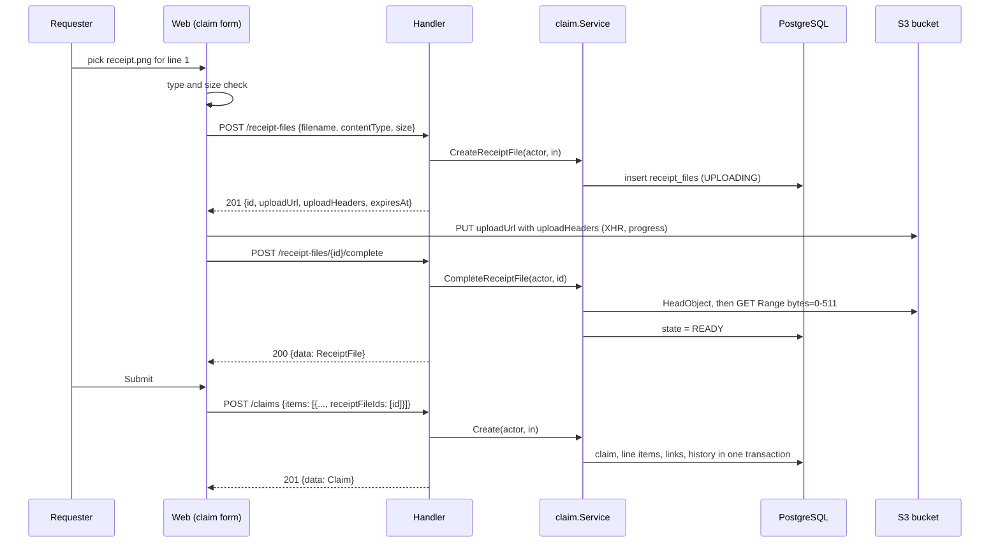
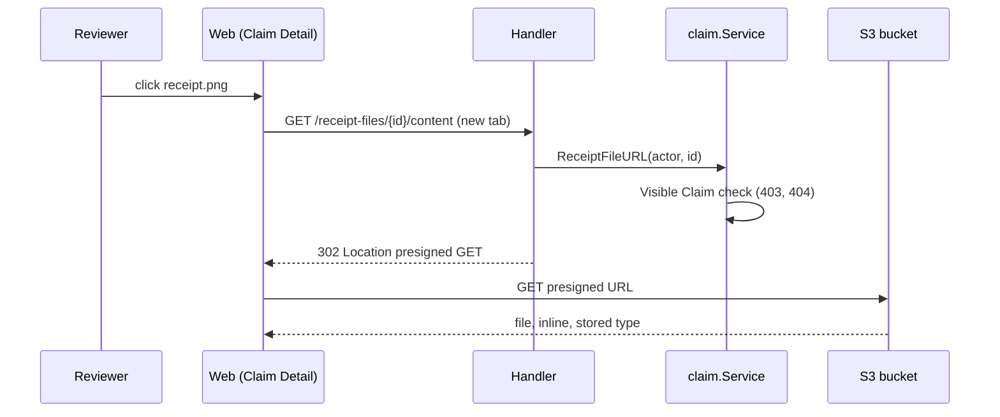

# F-11 Receipt Files – Engineering Contract

- **Feature:** F-11 Receipt Files (`docs/features.md`)
- **Sprint:** 3 · **Issues:** F-11/01 (this contract), F-11/02, F-11/03, F-11/04 · supersedes #61 (F-EXTRA-01)
- **Requirements:** FR-02, FR-07, FR-15, FR-16, FR-17, BR-03, BR-08, BR-10, BR-11, BR-18, NFR-02, NFR-04, NFR-06, NFR-08, NFR-10
- **Responsibilities verified here:** SR-01 (new endpoints), SR-02 (storage keys), SR-04 (links in the claim transaction), SR-07 (RustFS in the compose stack)
- **Depends on:** F-02 (claim create and submit), F-03 (Claim Detail), F-05 (drafts and the claim editor), F-06 (`RETURNED` editing)
- **Design baseline:** `docs/system-sds.md` v0.21 §1.1 storage path; §1.4.1 `internal/storage`, `receipt.go`, `sweep.go`; §2.2 `receipt_files`; §2.5 `deps:up`, `sweep`; §3.4; §4.2 413, 415; §4.3 `/receipt-files`; §5.1 `receipt:create`; §5.2; §5.3; §7.2 Receipt Files; §8; §9; SD-17, SD-18 · ADR-0002
- **Version:** 0.1 · **Last updated:** 2026-11-28

---

## 1. Feature SDS

### 1.1 Behavior

- A requester attaches Receipt Files to any line item while the claim is new (F-11/02), a `Draft`, or `Returned` (F-11/03). A Receipt File is a JPEG, PNG, WebP, or PDF of 1 byte to 10 MB. A line item holds at most 5 (BR-18).
- The receipt reference stays required on every line item. Receipt Files are optional, so a claim with none is still valid (FR-02).
- Picking a file starts its upload at once. The browser sends the bytes straight to the S3 bucket with a presigned `PUT`, then asks the API to complete the file. The API never carries file bytes (ADR-0002).
- Anyone who can see a claim opens its Receipt Files from Claim Detail (FR-16). An unattached Receipt File is visible only to its uploader.
- Once the claim is `SUBMITTED`, `PENDING_FINANCE`, `APPROVED`, `REJECTED`, or `WITHDRAWN`, its Receipt Files are fixed (BR-08, BR-18). A reviewer decides on exactly what the requester sent.
- Deleting a Draft deletes its Receipt Files (BR-10).
- An operator runs `bun run sweep` by hand to remove Receipt Files that were never attached, and stored objects without a record (FR-17).
- Locally the bucket is RustFS in the compose stack. In production it is an AWS S3 bucket that env vars point to (F-11/04).

### 1.2 Workflow

The download path:

### 1.3 Receipt File states

| State | Meaning | Next |
| --- | --- | --- |
| `UPLOADING` | Row created, presigned `PUT` issued. The object may not exist yet. Cannot be attached. | `READY` on a passing complete; row and object deleted on a failing one; swept after 24 hours |
| `READY` | The object exists with the declared size and type, and its first bytes match the type. | Attached to one line item, deleted by the uploader, or swept after 24 hours while unattached |

A Receipt File is **editable** while it is unattached, or attached to a `DRAFT` or `RETURNED` claim. Only its uploader can complete, attach, detach, or delete it.

### 1.4 Fields

`ReceiptFileInput` (create):

| Field | Rule |
| --- | --- |
| `filename` | Required, 1–255 characters after trimming. Shown in the UI and in the download's `Content-Disposition`. It is never part of the object key. |
| `contentType` | One of `image/jpeg`, `image/png`, `image/webp`, `application/pdf`. Anything else → 415, field `contentType`, rule BR-18. |
| `size` | Integer bytes, 1 to 10,485,760. 0 or larger → 413, field `size`, rule BR-18. |

`ReceiptUpload` (create response):

| Field | Rule |
| --- | --- |
| `id` | The Receipt File ID, UUIDv7. The object key is `receipts/<id>`. |
| `uploadUrl` | Presigned `PUT` for the key, signed for `S3_PUBLIC_ENDPOINT`, expiring after 5 minutes. `Content-Type` and `Content-Length` are signed. |
| `uploadHeaders` | The headers the browser must send with the `PUT`: `Content-Type` with the declared type. The browser sets `Content-Length` itself. |
| `expiresAt` | RFC 3339 time when `uploadUrl` stops working. |

`ReceiptFile` (complete response and line-item output): `id`, `filename`, `contentType`, `size`.

Line items:

- `LineItemInput` gains `receiptFileIds`: optional array of UUIDs, at most 5, unique. Omitted means none.
- `LineItem` gains `receiptFiles`: required array of `ReceiptFile`, in upload order (UUIDv7 order), possibly empty.

### 1.5 Attach rules

These run inside `Create`, `Edit`, and `Act(submit)` in the claim's transaction (NFR-06), after the existing line-item rules. Any failure is a 422 `VALIDATION_FAILED` with field `items[i].receiptFileIds` and rule BR-18, and nothing is saved.

| Check | Message |
| --- | --- |
| Every ID exists and was uploaded by the actor | "Receipt file not found." |
| Every file is `READY` | "Receipt file has not finished uploading." |
| No file is attached to another line item, of this or any other claim | "Receipt file is already attached to another line item." |
| The line item ends with at most 5 files | "A line item can have at most 5 receipt files." |

- An edit replaces the claim's line items, so the module moves each kept Receipt File to the new line-item row.
- An edit that omits an attached ID detaches it. The detached file becomes unattached and is swept later. The web deletes a removed file itself, so this happens only when a client sends a partial body.
- Attaching or detaching writes no history entry. Withdraw, reject, approve, and the final decisions keep the files.

### 1.6 Complete check

1. Load the row. Unknown → 404. Not the uploader → 403. Already `READY` → 200 with the same body (idempotent).
2. `HeadObject` on the key. No object → delete the row, 409 `CONFLICT`, "The upload did not finish. Try again."
3. The stored `Content-Length` must equal `size` and the stored `Content-Type` must equal `contentType`. Otherwise go to 5.
4. `GetObject` with `Range: bytes=0-511`, then `http.DetectContentType`. PDF needs the `%PDF-` prefix; the three image types need their own signatures. A match → `READY`, 200.
5. On a mismatch, delete the object and the row, then 415 `UNSUPPORTED_MEDIA_TYPE`, field `file`, rule BR-18, "This file's content does not match its type."

### 1.7 Access

| Operation | Rule | Failure |
| --- | --- | --- |
| `POST /receipt-files` | Route permission `receipt:create` (requester, reviewer) | 403 for `finance` |
| `POST /receipt-files/{id}/complete` | Uploader | 403; 404 unknown |
| `DELETE /receipt-files/{id}` | Uploader, and the file is editable (§1.3) | 403; 404 unknown; 409 `INVALID_TRANSITION` BR-03 when frozen |
| `GET /receipt-files/{id}/content` | Attached: its claim is visible to the actor (SDS §5.2). Unattached: the uploader. | 403 with no data; 404 unknown |

The download answers 302 rather than streaming the file, so the API never carries file bytes. The presigned `GET` expires after 5 minutes, sets `response-content-type` to the stored type, and sets `response-content-disposition` to `inline; filename="<filename>"` (RFC 6266 encoding for non-ASCII names). The bucket stays private with Block Public Access on, so a file is served from the bucket's origin, never the app's.

The API signs URLs for `S3_PUBLIC_ENDPOINT`, not `S3_ENDPOINT`: a signature covers the host, and inside compose the API reaches `rustfs:9000` while the browser reaches `localhost:9000`. In production both are unset and the SDK uses the regional AWS endpoint.

### 1.8 Failure and boundary cases

| Case | Result |
| --- | --- |
| Create `size` 0 / 1 / 10,485,760 / 10,485,761 | 413 / 201 / 201 / 413 |
| Create `contentType` `image/heic`, `image/gif`, `text/plain` | 415 |
| Create as `fin.wanida` | 403 |
| Complete before the `PUT` | 409, row deleted |
| Complete of a `.png` whose bytes are a ZIP | 415, object and row deleted |
| Complete as another member | 403 |
| Submit with an `UPLOADING` ID, another member's ID, an unknown ID, or an ID on another line item | 422 BR-18 on that line item, nothing saved |
| Submit with 5 files on one line item / 6 files | 201 / 422 BR-18 |
| Submit with no files | 201 |
| Delete an attached file of a `SUBMITTED` claim | 409 `INVALID_TRANSITION` BR-03 |
| Edit a `RETURNED` claim that removes one file and adds another | 200, history unchanged by the files |
| Delete a Draft with 2 files | 204, both rows and objects gone |
| `rev.somchai` opens a file of `req.anan`'s claim assigned to `rev.malee` | 403 |
| `fin.wanida` opens a file of a `SUBMITTED` claim / of a Draft | 302 / 403 |
| `req.ploy` opens `req.anan`'s unattached file | 403 |
| Object delete fails after the row is deleted | 204; the next sweep deletes the object |
| Bucket unreachable | `/ready` 503; `/health` 200 |

### 1.9 Module boundary

- Receipt File rules live in `internal/claim/receipt.go` behind the `claim.Service` methods in SDS §3.1, because visibility and editability depend on the claim (SD-18).
- `claim` defines a small `Store` interface for what it needs from the bucket. The shared `internal/storage` package implements it with `aws-sdk-go-v2` (`service/s3` and `s3.PresignClient`). `claim` never imports the AWS SDK.
- `system` readiness calls the same adapter's `HeadBucket` inside the existing readiness timeout.
- Both SDK clients set `RequestChecksumCalculation` and `ResponseChecksumValidation` to `WhenRequired`. Path-style addressing is on only when an endpoint is set.

### 1.10 Sweep (F-11/03)

- `bun run sweep` in `apps/api` runs the `sweep` subcommand of the one binary, next to `migrate` and `seed`, so it runs against the deployed database and bucket in the same way.
- It deletes, in order:
  1. Receipt Files unattached and older than 24 hours: row, then object.
  2. Objects under `receipts/` with no row, if the object is older than 24 hours (so an upload in flight is not removed).
  3. Rows whose object is missing, if they are `READY`, or `UPLOADING` and older than 24 hours.
- It prints the count of each kind and exits 0. A second run deletes nothing. It is not scheduled.

### 1.11 Infrastructure

**Local (F-11/02):**

- Compose adds `rustfs` (`rustfs/rustfs:1.0.7`, named volume, `/health` healthcheck, S3 port `127.0.0.1:9000`) and the one-shot `rustfs-init` (`amazon/aws-cli`). The init creates the bucket if missing and sets CORS: origins `http://localhost:3000` and `http://localhost:8080`, methods `PUT` and `GET`, header `content-type`, expose `ETag`. `app` waits for `rustfs-init` to finish.
- `bun run db:up` becomes `bun run deps:up` (`db`, `rustfs`, `rustfs-init`). There is no alias, and every reference is updated.
- RustFS root credentials come from `RUSTFS_ACCESS_KEY` and `RUSTFS_SECRET_KEY` in the root `.env`, with example values in `.env.example`.

**Production (F-11/04):**

- `deploy/aws-storage.sh` (aws cli, idempotent, `DRY_RUN=1` prints the plan only) creates:
  - the bucket in `ap-southeast-1` with Block Public Access, SSE-S3, and versioning off;
  - CORS for the Cloud Run URL (`PUT`, `GET`, header `content-type`, expose `ETag`);
  - a lifecycle rule that aborts incomplete multipart uploads after 1 day;
  - an IAM user whose policy allows only `s3:GetObject`, `s3:PutObject`, `s3:DeleteObject`, and `s3:ListBucket` on that bucket, and its access key.
- `deploy/setup.sh` stores the key pair in Secret Manager. The deploy workflow passes `S3_BUCKET`, `S3_REGION`, and the two secrets to the Cloud Run service and the migrate job.
- The production image contains no storage server.

## 2. UI spec

### 2.1 Receipt File picker (New Claim and Edit Claim, each line-item row)

The picker lives in `features/claims`.

| Element | Behavior |
| --- | --- |
| **Add receipt file** | A file button and drop zone with `accept="image/jpeg,image/png,image/webp,application/pdf"`. On a phone the camera is offered. Hidden once the line item has 5 files. |
| Client checks | Before any request: a wrong type shows "File must be a JPEG, PNG, WebP, or PDF."; an empty or too-large file shows "File must be 10 MB or smaller and not empty."; a sixth file shows "A line item can have at most 5 receipt files." |
| File row | The filename, its size (`2.4 MB`), and a progress bar while uploading. **Cancel** aborts a running upload. **Remove** deletes a finished file (`DELETE /receipt-files/{id}`). |
| Server error | A 413, 415, or 409 from create or complete shows its message under the file row, and the row offers **Remove**. |
| Submit | Only `READY` IDs go into `receiptFileIds`. **Submit** and **Save draft** are disabled while any file is uploading. |
| Rule error | After a 422, uploaded files stay on the form, and a BR-18 error shows under the line item's picker. |

The upload uses `XMLHttpRequest`, because `fetch` reports no upload progress. Type and size checks in the browser are for fast feedback only; the server checks again.

### 2.2 Claim Detail

| Element | Behavior |
| --- | --- |
| Line item | Under each line item, a list of its Receipt Files: an icon for image or PDF, the filename, and the size. Nothing shows when it has none. |
| Open | Each filename is a link to `/api/v1/receipt-files/{id}/content` with `target="_blank"` and `rel="noopener"`. |

### 2.3 Edit Claim (F-11/03)

The picker of §2.1 shows the line item's attached files as finished rows. **Remove** deletes the file at once, so a removed file never returns on reload. Adding files works as on New Claim.

## 3. API spec

| Method | Path | Request | Success | Errors | Auth |
| --- | --- | --- | --- | --- | --- |
| POST | `/receipt-files` | `ReceiptFileInput` | 201 `{ "data": ReceiptUpload }` | 400, 401, 403, 413, 415 | session; `receipt:create` |
| POST | `/receipt-files/{id}/complete` | – | 200 `{ "data": ReceiptFile }` | 401, 403, 404, 409, 415 | session; uploader |
| DELETE | `/receipt-files/{id}` | – | 204 | 401, 403, 404, 409 | session; uploader |
| GET | `/receipt-files/{id}/content` | – | 302, `Location` presigned `GET` | 401, 403, 404 | session; policy |
| POST | `/claims`, PUT `/claims/{id}`, POST `/claims/{id}/submit` | `items[].receiptFileIds` | as before; `items[].receiptFiles` in the claim | adds 422 BR-18 | as before |
| GET | `/claims/{id}` | – | `items[].receiptFiles` | as before | as before |
| GET | `/ready` | – | 200 when the database and the bucket answer | 503 | none |

Operation IDs `createReceiptFile`, `completeReceiptFile`, `deleteReceiptFile`, `getReceiptFileContent`, tag `receipt-files`. New schemas: `ReceiptFileInput`, `ReceiptUpload`, `ReceiptFile`, and their envelopes. `ProblemCode` gains `FILE_TOO_LARGE` and `UNSUPPORTED_MEDIA_TYPE`.

`apps/api/routes.go` maps `createReceiptFile` to `receipt:create` in `operationPermissions`. The other three are session-only at the route; the claim module checks the rest.

## 4. Data spec

- **Migration (F-11/02):** `receipt_files` as SDS §2.2, with the enum `receipt_file_state` (`UPLOADING`, `READY`), the CHECKs, and the indexes.
- **Queries (sqlc, `internal/claim/queries.sql`):** insert, get by ID, mark ready, delete, list by line items of a claim, attach to a line item, detach the line items of a claim, list unattached older than a time, list all keys for the sweep.
- **Config (`apps/api/.env.schema`, `.env.example`):** `S3_BUCKET`, `S3_REGION`, `S3_ENDPOINT`, `S3_PUBLIC_ENDPOINT` (defaults to `S3_ENDPOINT`), `AWS_ACCESS_KEY_ID` (`@sensitive`), `AWS_SECRET_ACCESS_KEY` (`@sensitive`).
- **Seed:** creates no Receipt Files.

## 5. Acceptance criteria

| ID | Requirement | Ticket | Acceptance criterion |
| --- | --- | --- | --- |
| F11-AC-01 | NFR-10 | F-11/02 | `bun run deps:up` and `docker compose up --build` start RustFS with the bucket and its CORS ready, and `app` starts only after `rustfs-init`. `db:up` no longer exists. |
| F11-AC-02 | NFR-10 | F-11/02 | `/ready` returns 503 when the bucket cannot be reached and 200 when both the database and the bucket answer. `/health` does not check the bucket. |
| F11-AC-03 | FR-15, BR-18, NFR-08 | F-11/02 | Create rejects a type outside the four with 415 and a size outside 1 B–10 MB with 413, each with a field message. Otherwise it returns a presigned `PUT` for `receipts/<uuidv7>` with `Content-Type` and `Content-Length` signed and a 5-minute expiry. `fin.wanida` gets 403. |
| F11-AC-04 | FR-15, BR-18 | F-11/02 | Complete marks the file `READY` only when the stored size, type, and first bytes match. A missing object gives 409, and a mismatch gives 415; both delete the object and the row. Only the uploader can complete. |
| F11-AC-05 | FR-02, FR-15, BR-18, NFR-06, NFR-08 | F-11/02 | `POST /claims` attaches `READY` Receipt Files per line item in the claim's transaction. Each §1.5 failure gives a 422 BR-18 field error on that line item, and nothing is saved. A line item with no files is valid, and the receipt reference is still required. |
| F11-AC-06 | FR-16 | F-11/02 | `GET /claims/{id}` returns `receiptFiles` on each line item. |
| F11-AC-07 | FR-15 | F-11/02 | The uploader deletes an unattached Receipt File: 204, and the row and object are gone. Another member gets 403; an unknown ID gets 404. |
| F11-AC-08 | FR-16 | F-11/02 | The download answers 302 to a presigned `GET` that expires after 5 minutes, with the stored type and `inline` with the original filename. |
| F11-AC-09 | FR-16, NFR-02 | F-11/02 | Download access follows §1.7 for the requester, the assigned reviewer, an unrelated reviewer, and the Finance Officer, on attached and unattached files. A 403 has no file data. The route inventory covers the four operations. |
| F11-AC-10 | FR-15, NFR-08 | F-11/02 | New Claim has the §2.1 picker: client checks, progress, cancel, remove, only `READY` IDs in the body, submit disabled while uploading, and files kept after a 422. |
| F11-AC-11 | FR-16 | F-11/02 | Claim Detail lists each line item's Receipt Files, and each opens the download endpoint in a new tab. |
| F11-AC-12 | FR-15, FR-16 | F-11/02 | On the seeded compose stack, a requester attaches a PNG and a PDF, submits, and the assigned reviewer opens both through the real presigned URLs and bucket CORS. |
| F11-AC-13 | NFR-04 | F-11/02 | The `S3_*` and `AWS_*` variables are in `.env.schema` and `.env.example`, the two keys are `@sensitive`, and no real key is in Git. |
| F11-AC-14 | FR-15, BR-08, BR-18, NFR-06 | F-11/03 | Save-draft, edit, and submit or resubmit attach and detach Receipt Files with the §1.5 rules, on `DRAFT` and `RETURNED` claims. Kept files move to the new line-item rows. |
| F11-AC-15 | BR-03, BR-08, BR-18 | F-11/03 | Deleting or detaching a Receipt File of a `SUBMITTED`, `PENDING_FINANCE`, `APPROVED`, `REJECTED`, or `WITHDRAWN` claim gives 409 `INVALID_TRANSITION` BR-03, and nothing changes. |
| F11-AC-16 | BR-10 | F-11/03 | Deleting a Draft deletes its Receipt Files: the rows in the transaction and the objects after the commit. |
| F11-AC-17 | NFR-02 | F-11/03 | A Draft's Receipt Files can be opened only by its requester. |
| F11-AC-18 | BR-11, FR-07 | F-11/03 | Attaching or removing Receipt Files writes no history entry. Withdraw, reject, approve, and the final decisions keep the files. |
| F11-AC-19 | FR-15, NFR-08 | F-11/03 | Edit Claim shows the attached files and lets the requester add or remove them on a Draft or `Returned` claim (§2.3). |
| F11-AC-20 | FR-17 | F-11/03 | `sweep` deletes the three §1.10 kinds and prints their counts. A second run deletes nothing, and a file still uploading is kept. |
| F11-AC-21 | NFR-10 | F-11/04 | `deploy/aws-storage.sh` creates the §1.11 bucket, CORS, lifecycle rule, and scoped IAM user. A second run changes nothing, and `DRY_RUN=1` changes nothing. |
| F11-AC-22 | NFR-04 | F-11/04 | The AWS key pair is in Secret Manager only, and the deploy passes the env to the service and the migrate job. |
| F11-AC-23 | FR-15, FR-16, NFR-10 | F-11/04 | On the deployed URL, `/ready` is 200, a requester uploads a Receipt File, and the assigned reviewer opens it. |

## 6. Software Test Specification

Go tests use the real `internal/storage` adapter against an in-process `gofakes3` server with a real PostgreSQL from `pgtest`. `gofakes3` does not check presigned signatures, so tests check the issued URL, headers, and expiry, then write the object directly in place of the browser's `PUT`. CI has no Playwright job (#96), so the RustFS presign and CORS path is proven only by F11-TEST-15, run locally before release.

| Test | AC | Ticket | Level | Precondition / input | Action | Expected result |
| --- | --- | --- | --- | --- | --- | --- |
| F11-TEST-01 | F11-AC-01 | F-11/02 | Manual | Fresh clone, no volumes | `bun run deps:up`; `docker compose up --build`; `aws s3api get-bucket-cors` against RustFS | Both start; the bucket exists with the §1.11 CORS; `app` starts after `rustfs-init` |
| F11-TEST-02 | F11-AC-02 | F-11/02 | Integration | Router with `gofakes3`; then with the server stopped | `GET /ready`; `GET /health` | 200; then 503 for `/ready` and 200 for `/health` |
| F11-TEST-03 | F11-AC-03 | F-11/02 | Integration | Seed users | Create as `req.anan` with sizes 0, 1, 10,485,760, 10,485,761 and types `image/png`, `application/pdf`, `image/heic`, `text/plain`; as `fin.wanida` | 413, 201, 201, 413; 201, 201, 415, 415 with field messages; key `receipts/<id>`, signed `content-length` and `content-type`, expiry 5 min; 403 |
| F11-TEST-04 | F11-AC-04 | F-11/02 | Integration | Created files; objects written directly | Complete with a matching PNG; with no object; with a wrong size; with ZIP bytes as `image/png`; as `req.ploy`; twice | 200 `READY`; 409; 415; 415, each with row and object gone; 403; second call 200 |
| F11-TEST-05 | F11-AC-05 | F-11/02 | Integration | `READY` files of `req.anan`, one `UPLOADING`, one of `req.ploy`, one attached | `POST /claims` with each bad ID; with 5 and 6 on one line item; with none; with a missing receipt reference | 422 BR-18 at `items[i].receiptFileIds` and no claim, line item, or link saved; 201 and 422; 201; 422 |
| F11-TEST-06 | F11-AC-06 | F-11/02 | Integration | Claim with 2 files on line 1 | `GET /claims/{id}` | `items[0].receiptFiles` has both in upload order; `items[1].receiptFiles` is `[]` |
| F11-TEST-07 | F11-AC-07 | F-11/02 | Integration | Unattached `READY` file of `req.anan` | `DELETE` as `req.ploy`; as `req.anan`; again | 403; 204 and the object is gone; 404 |
| F11-TEST-08 | F11-AC-08 | F-11/02 | Integration | Attached PDF named `ใบเสร็จ.pdf` | `GET /receipt-files/{id}/content` as `req.anan` | 302; `Location` has `X-Amz-Expires=300`, `response-content-type=application/pdf`, and an `inline` disposition with the encoded filename |
| F11-TEST-09 | F11-AC-09 | F-11/02 | Integration | `req.anan`'s `SUBMITTED` claim assigned to `rev.malee` with a file; an unattached file of `req.anan` | Download as `req.anan`, `rev.malee`, `rev.somchai`, `fin.wanida`, `req.ploy`; the unattached file as `req.ploy`; an unknown ID; no session on each operation | 302, 302, 403, 302, 403; 403; 404; 401 from the route inventory |
| F11-TEST-10 | F11-AC-10 | F-11/02 | Component | MSW for the API; a mocked `XMLHttpRequest` | Pick a `.gif`, a 0-byte file, and an 11 MB file; pick a PNG and advance progress; cancel one; remove one; submit; answer 422 | The three client messages and no request; progress bar; abort called; `DELETE` sent; body has only `READY` IDs; submit disabled while uploading; files kept after the 422 with the BR-18 message |
| F11-TEST-11 | F11-AC-11 | F-11/02 | Component | MSW claim with files on line 1 | Render Claim Detail | Filenames and sizes under line 1; links to the content endpoint with `target="_blank"`; nothing under line 2 |
| F11-TEST-12 | F11-AC-13 | F-11/02 | Manual | `apps/api` | Read `.env.schema` and `.env.example`; run the repository secret scan | Six variables, two `@sensitive`; no real key found |
| F11-TEST-13 | F11-AC-03, F11-AC-04 | F-11/02 | Unit | Table of byte prefixes | Content sniffing for the four types | JPEG, PNG, WebP, and PDF match their own type only; ZIP, HTML, and empty input match none |
| F11-TEST-14 | F11-AC-09 | F-11/02 | Unit | `apps/api/internal/auth` | `roles` and the route inventory | `receipt:create` for `requester` and `reviewer` only; the four operations are in the inventory |
| F11-TEST-15 | F11-AC-12 | F-11/02 | E2E | Seeded compose stack with RustFS | `apps/web/e2e/f11-receipt-files.spec.ts`: `req.anan` attaches a PNG and a PDF, submits; `rev.malee` opens both | Both upload with progress; both open in a new tab with the right type |
| F11-TEST-16 | F11-AC-14 | F-11/03 | Integration | `req.anan`'s Draft and `RETURNED` claims with files | Save a draft with files; edit adding one and dropping one; submit; resubmit; each §1.5 failure on edit | Links follow the body, kept files on the new line-item rows; 422 BR-18 and nothing saved on each failure |
| F11-TEST-17 | F11-AC-15 | F-11/03 | Integration | One claim with a file in each frozen status | `DELETE` the file; `PUT` the claim without it | 409 `INVALID_TRANSITION` BR-03; file and links unchanged |
| F11-TEST-18 | F11-AC-16 | F-11/03 | Integration | Draft with 2 files; then the object delete forced to fail | `DELETE /claims/{id}` | 204; rows and objects gone; on the forced failure, rows gone and the objects left for the sweep |
| F11-TEST-19 | F11-AC-17 | F-11/03 | Integration | `req.anan`'s Draft with a file | Download as `req.anan`, `rev.malee`, `fin.wanida` | 302, 403, 403 |
| F11-TEST-20 | F11-AC-18 | F-11/03 | Integration | `RETURNED` claim with files | Edit adding and removing files; withdraw; on other claims approve, reject, final approve | History has no entry for the edit's files; files kept on every decided claim |
| F11-TEST-21 | F11-AC-19 | F-11/03 | Component | MSW Draft with 2 files | Render Edit Claim; remove one; add one; save | Two finished rows; `DELETE` sent at once; body has the kept and the new ID |
| F11-TEST-22 | F11-AC-20 | F-11/03 | Integration | Fixed clock; unattached files 25 h and 1 h old; an object with no row 25 h old and one 1 h old; a `READY` row with no object; an `UPLOADING` row 1 h old with no object | Run `sweep` twice | First run deletes the 25 h file, the 25 h object, and the `READY` row, and prints 1, 1, 1; the rest kept; second run prints 0, 0, 0 |
| F11-TEST-23 | F11-AC-21 | F-11/04 | Manual | AWS account, `aws` cli | `DRY_RUN=1 deploy/aws-storage.sh`; run it twice; read the bucket's public access block, encryption, CORS, lifecycle, and the user's policy | Dry run changes nothing; second run reports no changes; each setting as §1.11 |
| F11-TEST-24 | F11-AC-22 | F-11/04 | Manual | Deploy workflow | Read the Cloud Run service and migrate job env; run the repository secret scan | Keys come from Secret Manager; no key in Git |
| F11-TEST-25 | F11-AC-23 | F-11/04 | Manual | Deployed release | `/ready`; `req.anan` uploads a PNG and submits; `rev.malee` opens it | 200; the file opens; commit ID recorded |

## 7. Feature Definition of Done

The Sprint 3 Product DoD (`docs/sprints/sprint-3/definition-of-done.md`) applies to each F-11 implementation ticket. For F-11 the evidence is:

- [ ] All automated F11-TEST rows of the ticket run: unit, integration, and component tests pass in CI on the merge commit; F11-TEST-15 passes on a local seeded stack with the tested commit recorded.
- [ ] TDD evidence for the complete check (F11-TEST-04), the attach rules (F11-TEST-05, F11-TEST-16), and the sweep (F11-TEST-22): red and green commit IDs in the PR.
- [ ] `openapi.yaml` has the four operations and their schemas; both apps regenerate with no diff in CI. F01-TEST-12 is green with the new operations.
- [ ] The Go API keeps 100% coverage with the storage adapter covered through `gofakes3`; `// coverage-ignore` only marks glue that cannot run in a test.
- [ ] The manual rows of the ticket (F11-TEST-01, F11-TEST-12, F11-TEST-23 to F11-TEST-25) are recorded with the commit ID.
- [ ] `docs/traceability.md` lists the actual test names and results for the F-11 rows.

## 8. Revision history

| Version | Date | Change | Author |
| --- | --- | --- | --- |
| 0.1 | 2026-11-28 | Initial contract (F-11/01), from the F-11 spec and ADR-0002 | beambeambeam |
