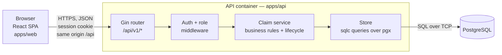
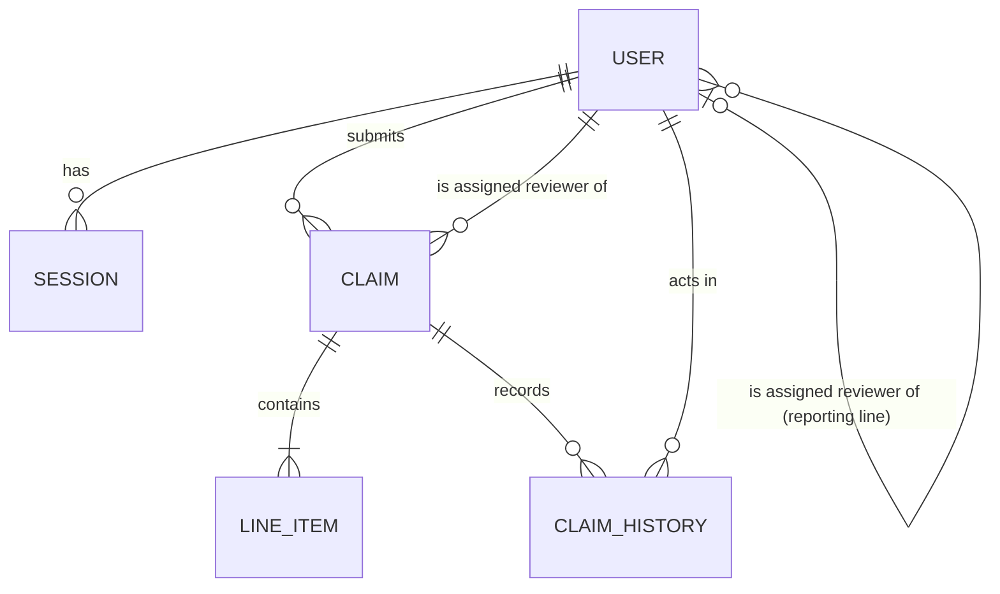
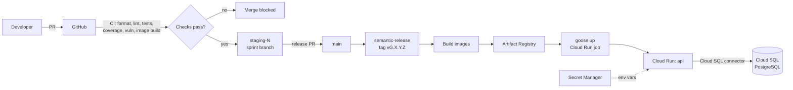

# System-Level Software Design Specification (SDS)

- **Product:** ClaimFlow — Department Expense Reimbursement System (repository: `beambeambeam/claimflow`)
- **Team:** 1005, 1045
- **Version:** 0.4 (draft for Deliverable 1)
- **Last updated:** 2026-11-02
- **Baseline:** `docs/srs.md` v0.2 · Glossary: `GLOSSARY.md` · Decisions: `docs/adr/`

This document defines the system-wide design: architecture, data model, UI/API conventions, roles and access, authentication, configuration, and deployment. Each feature contract in `docs/sprints/` refines it with exact endpoints, screens, and schema changes.

---

## 1. Architecture

### 1.1 Overview

ClaimFlow is a **modular monolith** with three logical layers. It lives in a Bun workspace monorepo: `apps/web` is the UI and `apps/api` is the API/application layer.



- **Local:** the web dev server (`:3000`) proxies `/api` to the API (`:8080`), so the browser stays on one origin. This proxy already exists in the repo.
- **Production:** web and API are also served under one origin (Section 9), so cookies work without any CORS setup.

### 1.2 Technology stack

| Layer | Choice | Status | Reason |
| --- | --- | --- | --- |
| Monorepo/tooling | Bun workspaces, Vite+ (`vp`) for lint/format/test, semantic-release | in repo | Existing team setup |
| UI | React 19 + TypeScript, TanStack Router (file routes), Tailwind CSS 4 | in repo | Existing team setup; typed routes |
| UI server state | TanStack Query | to add | Caching, plus built-in loading/error states for every API call |
| API | Go + Gin | in repo | Existing team setup; single static binary |
| Validation | Gin binding (`go-playground/validator`) for request shape; rule checks in the claim service | in repo | Shape errors and business-rule errors stay separate |
| Database | PostgreSQL 16 | to add | Relational constraints and transactions; Cloud SQL on GCP |
| DB driver / queries | `pgx/v5` + `sqlc` (SQL → type-safe Go) | to add | Plain SQL with compile-time types, no ORM |
| Migrations | `goose` (SQL files), pinned in `tools.mod` | to add | Versioned migrations, runnable as a `go tool` |
| Password hashing | `golang.org/x/crypto/bcrypt`, cost 12 | to add | Meets NFR-01 |
| Configuration | varlock (`.env.schema`, generated `env/env.go`) | in repo | Typed, validated environment with sensitive-value handling |
| Tests | Go `testing` + `gotestsum`; `testcontainers-go` (PostgreSQL) for integration; Vitest via `vp test` (web); Playwright (E2E) | partly in repo | Covers all three test levels the course requires |
| Packaging | Docker (API image already builds in CI) | in repo | Lab 5 |

### 1.3 Component responsibilities

| Component | Responsibility | Does **not** |
| --- | --- | --- |
| React SPA (`apps/web`) | Screens, navigation, client-side form validation for quick feedback, showing server errors. | Decide permissions. Hidden buttons are only for UX. |
| Gin handlers | Bind and validate requests, call the service, map results and errors to HTTP. | Contain business rules. |
| Auth middleware | Resolve the session cookie to the current user (401 if none); role guards reject the wrong role (403). | Check ownership or assignment, which depend on data. |
| Claim service | **All business rules** (BR-01 to BR-17), ownership/assignment checks, the lifecycle, total calculation, transactions. | Know about HTTP or Gin. |
| Store (sqlc) | Queries and transactions. | Make permission decisions. |
| PostgreSQL | Durable storage. Constraints are the last line of defence: FKs, CHECKs, unique indexes. | — |

**Where rules are enforced:** in the claim service, backed up by database constraints. Lifecycle and rule functions are pure Go, so unit tests can reach 100% coverage without a database.

### 1.4 API package layout

The current flat `main` package (`main.go`, `server.go`, `config.go`) stays as the entry point. Domain code goes under `internal/`:

```
apps/api/
  main.go  server.go  config.go      # existing: startup, router, config
  env/                                # varlock-generated (excluded from coverage)
  internal/
    auth/       # login/logout/me handlers, session store, middleware, role guards
    claim/      # Claim + LineItem types, rules.go (BR checks), lifecycle.go (transition table),
                # service.go (use cases + transactions), handler.go (Gin routes)
    report/     # decision summaries (Sprint 3)
    store/      # sqlc-generated code + queries/*.sql
    httperr/    # one error type and the JSON error format (Section 4.2)
  migrations/   # goose SQL migrations: 0001_users.sql, ...
  seed/         # seed data, run with `bun run seed`
```

## 2. Data model

### 2.1 Entity–relationship diagram



### 2.2 Entities

**`users`**

| Field | Type | Constraints |
| --- | --- | --- |
| id | UUID | PK |
| username | VARCHAR(50) | UNIQUE, NOT NULL |
| display_name | VARCHAR(100) | NOT NULL |
| password_hash | VARCHAR(100) | NOT NULL (bcrypt) |
| role | ENUM `REQUESTER`, `REVIEWER`, `FINANCE` | NOT NULL. All three exist from Sprint 1. |
| position | VARCHAR(50) | Display label only, e.g. "Section Head A" |
| reviewer_id | UUID | FK → users.id. The member's **assigned reviewer** (reporting line). NULL means the member cannot create claims (BR-15); in seed data only `FINANCE` users have NULL. CHECK `reviewer_id <> id` (AS-03). |
| is_active | BOOLEAN | NOT NULL, default true |
| created_at | TIMESTAMPTZ | NOT NULL |

**`sessions`**

| Field | Type | Constraints |
| --- | --- | --- |
| id | UUID | PK |
| user_id | UUID | FK → users.id, ON DELETE CASCADE |
| token_hash | BYTEA | UNIQUE, NOT NULL. SHA-256 of the cookie token; the raw token is never stored. |
| expires_at | TIMESTAMPTZ | NOT NULL, created_at + 8 h (NFR-03) |
| created_at | TIMESTAMPTZ | NOT NULL |

**`claims`**

| Field | Type | Constraints |
| --- | --- | --- |
| id | UUID | PK |
| claim_no | VARCHAR(20) | UNIQUE, human-readable, e.g. `CLM-2026-000123` |
| requester_id | UUID | FK → users.id, NOT NULL. The **owner**. |
| assigned_reviewer_id | UUID | FK → users.id. NULL while `DRAFT`. Copied from `users.reviewer_id` at **first** submission and never changed afterwards (BR-17). CHECK `assigned_reviewer_id <> requester_id` (BR-01). CHECK `status = 'DRAFT' OR assigned_reviewer_id IS NOT NULL`. |
| title | VARCHAR(120) | NOT NULL |
| purpose | TEXT | NOT NULL, 1–1000 chars |
| status | ENUM `DRAFT`, `SUBMITTED`, `RETURNED`, `PENDING_FINANCE`, `APPROVED`, `REJECTED`, `WITHDRAWN` | NOT NULL |
| total_satang | BIGINT | NOT NULL, CHECK `> 0 AND <= 5000000` (BR-06). Calculated on the server (BR-08). |
| return_count | SMALLINT | NOT NULL, default 0, CHECK `BETWEEN 0 AND 3` (BR-14) |
| version | INTEGER | NOT NULL, default 0. Used for optimistic locking (BR-13). |
| first_submitted_at | TIMESTAMPTZ | NULL while `DRAFT`. Set once at first submission; used for the 90-day window (BR-07). |
| submitted_at | TIMESTAMPTZ | Latest submission time. NULL while `DRAFT`. |
| decided_at | TIMESTAMPTZ | NULL until terminal |
| created_at, updated_at | TIMESTAMPTZ | NOT NULL |

Indexes: `(requester_id, status)` and `(assigned_reviewer_id, status)`.

**`line_items`**

| Field | Type | Constraints |
| --- | --- | --- |
| id | UUID | PK |
| claim_id | UUID | FK → claims.id, ON DELETE CASCADE |
| line_no | SMALLINT | NOT NULL, UNIQUE per claim, 1–20 (BR-05) |
| category | ENUM `TRAVEL`, `ACCOMMODATION`, `MEALS`, `SUPPLIES`, `TRAINING`, `OTHER` | NOT NULL (BR-12) |
| description | VARCHAR(200) | NOT NULL |
| expense_date | DATE | NOT NULL. The date window (BR-07) is checked in the service on every submit/resubmit. |
| amount_satang | BIGINT | NOT NULL, CHECK `> 0 AND <= 2000000` (BR-05) |
| receipt_ref | VARCHAR(50) | NOT NULL (D-09) |

**`claim_history`** — append-only (BR-11)

| Field | Type | Constraints |
| --- | --- | --- |
| id | BIGSERIAL | PK |
| claim_id | UUID | FK → claims.id, NOT NULL |
| actor_id | UUID | FK → users.id, NOT NULL |
| action | ENUM `SUBMIT`, `APPROVE`, `REJECT`, `RETURN`, `RESUBMIT`, `WITHDRAW`, `FINAL_APPROVE`, `FINAL_REJECT` | NOT NULL |
| from_status | claim status ENUM | NULL for a claim submitted directly (no draft) |
| to_status | claim status ENUM | NOT NULL |
| comment | VARCHAR(500) | NULL. Required for REJECT, RETURN, and FINAL_REJECT (BR-04), checked in the service. |
| created_at | TIMESTAMPTZ | NOT NULL, default now() |

- There are no `UPDATE` or `DELETE` queries for `claim_history` in `store/queries`.
- Drafts have no history; history starts at the first `SUBMIT`.
- Deleting a draft (BR-10) deletes the claim and its line items.

### 2.3 Money handling

- Amounts are stored and processed as **integer satang** (1 THB = 100 satang) in `BIGINT` columns and Go `int64`. Floats are never used.
- The API sends amounts as decimal **strings** with 2 places, e.g. `"1250.00"`. The handler parses them, rejecting more than 2 decimals (BR-05), and formats them back.
- The service recomputes `total_satang = Σ line_items.amount_satang` on every create or edit and ignores any client total (BR-08).

### 2.4 Migrations and seed data

| Command (in `apps/api`) | Purpose |
| --- | --- |
| `bun run db:up` | `docker compose up -d postgres` for local development |
| `bun run migrate` | `goose up` with the committed migrations in `migrations/` |
| `bun run sqlc` | Regenerate `internal/store` from `queries/*.sql`; generated code is committed |
| `bun run seed` | Load the base demo dataset. Idempotent: upserts by username/claim_no. |
| `bun run seed:load` | Add ~200 extra claims for NFR-07 (Sprint 3) |

**Base seed accounts.** All share the password in `SEED_USER_PASSWORD` (sensitive, from the environment, never committed — NFR-04). They form the reporting line `Staff → Section Head → Department Head → Finance Officer`:

| Username | Role | Position | Assigned reviewer | Used to test |
| --- | --- | --- | --- | --- |
| `req.anan` | REQUESTER | Staff, Section A | `rev.malee` | Normal journey |
| `req.ploy` | REQUESTER | Staff, Section A | `rev.malee` | Cross-requester access (another user's claim) |
| `req.niran` | REQUESTER | Staff, Section B | `rev.somchai` | Unrelated reviewer access |
| `rev.malee` | REVIEWER | Section Head A | `rev.prasert` | Reviewing; her own claim goes up the line; self-approval attempt |
| `rev.somchai` | REVIEWER | Section Head B | `rev.prasert` | Unrelated reviewer (Section A claims) |
| `rev.prasert` | REVIEWER | Department Head | `fin.wanida` | Top of the reviewer line; his claims go to Finance (ADR-0001) |
| `fin.wanida` | FINANCE | Finance Officer | — (NULL) | Reviews the Department Head's claims; cannot create claims (BR-15); final decisions in Sprint 3 |

The seed also creates sample claims in every Sprint 1 status (`SUBMITTED`, `APPROVED`, `REJECTED`), each with history.

## 3. Claim lifecycle

The transition table lives once in `internal/claim/lifecycle.go`. It is a pure function of (current status, action, actor, claim), so it can be unit-tested exhaustively.

| From | Action | To | Who / guard | Sprint |
| --- | --- | --- | --- | --- |
| — | SUBMIT | SUBMITTED | Owner with an assigned reviewer (BR-15) | 1 |
| SUBMITTED | APPROVE | APPROVED | Assigned reviewer, not the owner | 1 |
| SUBMITTED | REJECT | REJECTED | Assigned reviewer, not the owner; reason required | 1 |
| — | SAVE_DRAFT | DRAFT | Owner with an assigned reviewer (BR-15) | 2 |
| DRAFT | SUBMIT | SUBMITTED | Owner | 2 |
| DRAFT | DELETE | (row removed) | Owner | 2 |
| SUBMITTED | RETURN | RETURNED, `return_count + 1` | Assigned reviewer, not the owner; `return_count < 3` (BR-14) | 2 |
| RETURNED | RESUBMIT | SUBMITTED | Owner; same assigned reviewer (BR-17) | 2 |
| SUBMITTED, RETURNED | WITHDRAW | WITHDRAWN | Owner (BR-16) | 2 |
| SUBMITTED | APPROVE | PENDING_FINANCE | Assigned reviewer whose role is not `FINANCE`; total > 10,000 THB (BR-09) | 3 |
| PENDING_FINANCE | FINAL_APPROVE / FINAL_REJECT | APPROVED / REJECTED | Any `FINANCE` user, not the owner | 3 |

`APPROVE` picks its target: `PENDING_FINANCE` if the total is above `HIGH_VALUE_THRESHOLD_SATANG` and the approver is not a Finance Officer, otherwise `APPROVED`. Before Sprint 3 it always goes to `APPROVED`.

**Each transition runs in one transaction (`pgx.BeginFunc`, NFR-06, BR-13):**

1. Load the claim, then check the actor's permission (BR-01, BR-02) and that the transition is allowed (BR-03, BR-14, BR-16).
2. Run `UPDATE claims SET status = $to, version = version + 1, ... WHERE id = $id AND status = $from AND version = $v`.
3. If 0 rows are updated, another request changed the claim first. Return **409 CONFLICT** and roll back.
4. Insert the `claim_history` row and commit.

## 4. API conventions

### 4.1 General

- **Paths:** base path `/api/v1`. Resources are nouns (`/claims`), and state changes use action sub-resources (`POST /claims/:id/approve`), so each transition has its own permission check and test.
- **Format:** JSON bodies, `Content-Type: application/json`. Field names are camelCase.
- **Identity:** taken **only** from the session, never from a user ID or role in the request.
- **Lists:** `?page=1&pageSize=20` (max 100) → `{ "data": [...], "page": 1, "pageSize": 20, "total": 57 }`.
- **Single item:** `{ "data": { ... } }`.

### 4.2 Error format

Every error uses one shape, produced by `internal/httperr`. Responses never include stack traces, SQL, or Go error strings.

```json
{
  "error": {
    "code": "VALIDATION_FAILED",
    "message": "Some fields are invalid.",
    "details": [
      {
        "field": "items[1].expenseDate",
        "rule": "BR-07",
        "message": "Expense date cannot be in the future."
      }
    ]
  }
}
```

| HTTP | `code` | When |
| --- | --- | --- |
| 400 | `BAD_REQUEST` | Malformed JSON or wrong types |
| 401 | `UNAUTHENTICATED` | No session, or the session is invalid or expired |
| 403 | `FORBIDDEN` | Wrong role, not the owner, not the assigned reviewer, self-approval (BR-01, BR-02), or no assigned reviewer (BR-15) |
| 404 | `NOT_FOUND` | Claim does not exist |
| 409 | `INVALID_TRANSITION` | Action not allowed from the current status (BR-03, BR-10, BR-16), or return limit reached (BR-14). `details[0].rule` names the rule. |
| 409 | `CONFLICT` | Concurrent modification (BR-13) |
| 422 | `VALIDATION_FAILED` | Business-rule validation failed (BR-04 to BR-07, BR-12) |
| 500 | `INTERNAL` | Unexpected error. Details are logged with `slog` only. |

A 403 response never includes the claim's data.

### 4.3 Endpoint overview

Exact request/response shapes are in the feature contracts.

| Method | Path | Purpose | Sprint |
| --- | --- | --- | --- |
| POST | `/auth/login` | Log in, set session cookie | 1 |
| POST | `/auth/logout` | Delete session, clear cookie | 1 |
| GET | `/auth/me` | Current user `{ id, username, displayName, role, canCreateClaims }` | 1 |
| POST | `/claims` | Create and submit a claim (Sprint 2: `?draft=true` saves a draft) | 1 |
| GET | `/claims/mine` | Own claims | 1 |
| GET | `/claims/:id` | Claim detail + line items + history | 1 |
| GET | `/reviews/queue` | `SUBMITTED` claims whose assigned reviewer is the current user (Reviewer or Finance) | 1 |
| POST | `/claims/:id/approve` | Approve `{ comment? }` | 1 |
| POST | `/claims/:id/reject` | Reject `{ comment }` | 1 |
| PUT | `/claims/:id` | Edit a DRAFT/RETURNED claim | 2 |
| DELETE | `/claims/:id` | Delete a DRAFT claim | 2 |
| POST | `/claims/:id/submit` | Submit a draft or resubmit a returned claim | 2 |
| POST | `/claims/:id/return` | Return `{ comment }` (max 3 per claim) | 2 |
| POST | `/claims/:id/withdraw` | Withdraw a SUBMITTED/RETURNED claim | 2 |
| GET | `/finance/queue` | PENDING_FINANCE claims | 3 |
| POST | `/claims/:id/final-approve`, `/final-reject` | Finance final decision | 3 |
| GET | `/claims?status=&category=&from=&to=&q=` | Filter/search visible claims | 3 |
| GET | `/reports/summary?from=&to=` | Decision summary (scope depends on role) | 3 |
| GET | `/health` | Liveness check, no auth: `{ status, version }` | 1 |

## 5. Roles, ownership, and permissions

"Own" means `claims.requester_id = currentUser.id`. "Assigned" means `claims.assigned_reviewer_id = currentUser.id`. Anonymous requests to any endpoint except `/auth/login` and `/health` get **401**.

| Operation | REQUESTER | REVIEWER | FINANCE | Enforced by |
| --- | --- | --- | --- | --- |
| Login / logout / me | ✓ | ✓ | ✓ | auth middleware |
| Create claim / save draft | ✓ own | ✓ own | ✗ 403 (BR-15) | service: `reviewer_id IS NOT NULL` |
| List own claims | ✓ | ✓ | ✗ 403 | role guard + query scoped to user |
| View claim detail | own only | own **or** assigned | assigned, PENDING_FINANCE (S3), any for reports (S3) | service ownership/assignment check |
| Edit / resubmit / withdraw / delete draft | own, allowed status | own, allowed status | ✗ | service: owner + BR-10/BR-16 + BR-03 |
| Review queue | ✗ 403 | assigned only | assigned only (Department Head's claims) | role guard + query scoped to user |
| Approve / reject / return | ✗ 403 | assigned **and** not own | assigned **and** not own | role guard + service (BR-01, BR-02, BR-14) |
| Final approve / reject (S3) | ✗ 403 | ✗ 403 | PENDING_FINANCE only, not own | role guard + service |
| Decision summary (S3) | ✗ 403 | assigned claims | whole department | role guard + query scope |

**Required access tests (Sprint 1, API integration level):**

- Anonymous request to `/claims/mine` → 401.
- `req.ploy` requests `req.anan`'s claim → 403, no claim data in the body.
- `req.anan` calls `/claims/:id/approve` → 403.
- `rev.somchai` approves `req.anan`'s claim, which is assigned to `rev.malee` → 403 (unrelated reviewer).
- `rev.malee` approves her own claim, which is assigned to `rev.prasert` → 403. With the assignment data corrupted to point to herself, the response is still 403 (BR-01).
- `fin.wanida` creates a claim → 403 (BR-15).
- `fin.wanida` approves `rev.prasert`'s claim → 200 (Finance acting as assigned reviewer).

## 6. Authentication and sessions

| Aspect | Design |
| --- | --- |
| Credentials | Username + password, checked with `bcrypt.CompareHashAndPassword` (cost 12). |
| Failed login | 401 with the generic message "Invalid username or password." Inactive users get the same response. To limit timing differences, an unknown username is still compared against a dummy hash. |
| Session creation | 32 bytes from `crypto/rand`, base64url-encoded, becomes the cookie value. Its SHA-256 is stored in `sessions` with `expires_at = now + SESSION_TTL`. |
| Cookie | `sid=<token>`; `HttpOnly`; `SameSite=Lax`; `Secure` when `COOKIE_SECURE=true`; `Path=/`; `Max-Age=28800`. |
| Request handling | Gin middleware hashes the cookie, loads an unexpired session and user, and stores `currentUser` in the Gin context. Missing, unknown, or expired → 401. |
| Current user | `GET /auth/me`. The SPA calls it in the root route loader to choose the navigation and to redirect anonymous users to `/login`. |
| Logout | Delete the session row and clear the cookie. Reusing the old token afterwards → 401 (NFR-03). |
| Expiry | Fixed lifetime, no sliding renewal. Expired rows are deleted at login. |
| CSRF | `SameSite=Lax`, state changes only through POST/PUT/DELETE, and the API rejects state-changing requests that are not `application/json`. |
| Why server-side sessions | Logout takes effect immediately, which a stateless JWT cannot do. |

## 7. UI design

### 7.1 Screens and navigation

TanStack Router file routes live in `apps/web/src/routes/`. Routes under `_auth` require a session.

| Screen | Route file → path | Roles | Sprint |
| --- | --- | --- | --- |
| Login | `login.tsx` → `/login` | Anonymous | 1 |
| My Claims (list) | `_auth/claims/index.tsx` → `/claims` | Requester, Reviewer | 1 |
| New Claim (form with line-item rows) | `_auth/claims/new.tsx` → `/claims/new` | Requester, Reviewer | 1 |
| Claim Detail (line items, total, status, history timeline, decision buttons when allowed) | `_auth/claims/$claimId.tsx` → `/claims/:id` | Owner / assigned reviewer / finance | 1 |
| Review Queue | `_auth/reviews.tsx` → `/reviews` | Reviewer, Finance | 1 |
| Edit Claim | `_auth/claims/$claimId.edit.tsx` | Owner (DRAFT/RETURNED) | 2 |
| Finance Queue (final decisions) | `_auth/finance.tsx` → `/finance` | Finance | 3 |
| Summary / Reports | `_auth/reports.tsx` → `/reports` | Reviewer, Finance | 3 |

- **Header:** display name, role, the links allowed for that role, and **Log out**.
- **After login:** Requesters go to `/claims`; Reviewers and Finance go to `/reviews`.
- **Finance users:** no "My Claims" or "New Claim" links (BR-15).

### 7.2 Shared UI behaviour

| State | Behaviour |
| --- | --- |
| Loading | Skeleton rows for lists; disabled button with spinner while submitting (prevents double submit). |
| Empty | Friendly message plus next action, e.g. "No claims yet — Create claim". |
| Validation | Field-level message under each input from `error.details` (NFR-08); the client pre-checks required fields and number format. |
| 401 | Clear the query cache and redirect to `/login?redirect=<path>`. |
| 403 / 404 | Inline "You don't have access to this claim" / "Claim not found" page, with no data shown. |
| 409 | Toast "This claim was changed by someone else — reloaded", then refetch. |
| Decisions | Reject/Return open a dialog with a required reason field. Approve asks for confirmation. The Return button shows "Returned 2 / 3" and is disabled at 3; the server still enforces BR-14. |
| Status badges | Draft (grey), Submitted (blue), Returned (amber), Pending finance (purple), Approved (green), Rejected (red), Withdrawn (grey, struck through). |
| Money / dates | `฿1,250.00`; `31 Oct 2026` in Asia/Bangkok (AS-06). |

## 8. Configuration and secrets

Configuration is declared in each app's varlock `.env.schema`:

- `bun run codegen` regenerates `apps/api/env/env.go`.
- The API validates its config at startup (`config.go`) and refuses to start if a value is missing or invalid.
- Sensitive values are marked `@sensitive`, so varlock redacts them in logs.
- `.env` files are git-ignored.

| Variable (apps/api) | Example | Required | Sensitive |
| --- | --- | --- | --- |
| `GIN_MODE` | `release` | existing | no |
| `PORT` | `8080` | existing | no |
| `DATABASE_URL` | `postgres://app:<password>@localhost:5432/claimflow` | yes | **yes** |
| `SESSION_TTL` | `8h` | default `8h` | no |
| `COOKIE_SECURE` | `true` in production | default `false` | no |
| `BCRYPT_COST` | `12` | default `12` | no |
| `HIGH_VALUE_THRESHOLD_SATANG` | `1000000` | default `1000000` | no |
| `SEED_USER_PASSWORD` | — | seed only | **yes** |
| `APP_VERSION` | git SHA / release tag, set at build | no | no |

`apps/web` keeps its existing `API_URL` for the dev proxy. The web bundle contains no secrets.

On GCP, sensitive values live in **Secret Manager** and are injected into Cloud Run as environment variables (Lab 5).

## 9. Deployment design (implemented in Lab 5)



| Concern | Design |
| --- | --- |
| API image | Existing multi-stage `apps/api/Dockerfile`: Go build → Alpine runtime with varlock, running as `nobody`, port 8080. Migrations are added to the image as a `migrate` subcommand. |
| Web delivery | **Planned:** build `apps/web` to static files and serve them from the same Cloud Run service (the Gin router serves `dist/` for non-`/api` paths). This keeps one origin, so the session cookie works without CORS. The final choice is made in Lab 5 and recorded as an ADR. |
| Local | `docker compose up` runs `postgres:16` (named volume, so data survives restarts — NFR-05) and the API image (NFR-10). |
| Cloud runtime | **Cloud Run** (stateless) + **Cloud SQL for PostgreSQL** (durable). Sessions are stored in the DB, so instance restarts do not log users out. |
| Migrations | `goose up` runs as a Cloud Run job before the new revision gets traffic. The app never changes the schema on startup. |
| Release identity | Images are tagged with the semantic-release tag `vG.X.Y.Z` and the git SHA. `/health` returns `version`. |
| CI gate | The existing `CI` workflow already runs format, lint, web tests, Go tests with **100% coverage**, govulncheck, and the API image build on every PR. Branch protection makes these required checks. Before Lab 5, test results are recorded against the submitted commit. |
| Branches | Repo convention: `<type>/<short-kebab-name>` (e.g. `feat/claim-submission`). Each sprint has a **staging branch** (`staging-1`, `staging-2`, `staging-3`). Feature PRs target the current sprint's staging branch; at the end of the sprint one release PR merges it into `main`, which triggers semantic-release. This still needs to be added to `CONTRIBUTING.md`. |

## 10. Test strategy (system level)

| Level | Tool | Covers | Example |
| --- | --- | --- | --- |
| Unit (Go) | `testing`, table-driven | `claim/rules.go` and `lifecycle.go`: every transition × actor; amount/date/category limits; total calculation; money parsing | BR-05 boundaries: `"0.00"`, `"0.01"`, `"20000.00"`, `"20000.01"`, `"1.005"` |
| API/DB integration (Go) | `httptest` + Gin router + `testcontainers-go` PostgreSQL, migrations + seed per suite | Persistence, transactions, 401/403/409/422, history writes | Self-approval → 403; status and history unchanged |
| Concurrency | Integration test, two goroutines approve/reject the same claim | BR-13 | Exactly one 200, one 409, one history row |
| Unit/component (web) | Vitest via `vp test`, Testing Library | Form validation, money formatting, role-based navigation | Finance user sees no "New Claim" link |
| E2E | Playwright against `docker compose` | Critical journeys | Requester submits → reviewer approves → requester sees Approved with history |

The Go API requires **100% coverage** (`.testcoverage.yml`); only generated code (`env/`, `internal/store/`) is excluded. The mapping from AC to test IDs is in each feature's STS and in `docs/traceability.md`.

## 11. Design decisions

| ID | Decision | Alternatives considered | Reason |
| --- | --- | --- | --- |
| SD-01 | Modular monolith: one Go API and one SPA | Microservices | Enough for the scope; a simple deployment. |
| SD-02 | Server-side sessions in the DB with an HttpOnly cookie | JWT in localStorage | Logout takes effect immediately (NFR-03), and scripts cannot read the token. |
| SD-03 | Action endpoints (`/approve`, `/reject`, …) | Generic `PATCH status` | Each transition has its own permission check and test. |
| SD-04 | Copy the assigned reviewer onto the claim at first submission | Look it up live every time | Later reporting-line changes do not move claims already in review (BR-17). |
| SD-05 | Optimistic locking with `version` | `SELECT … FOR UPDATE` | Simple, and gives a clear 409 for BR-13. |
| SD-06 | Integer satang in DB/Go, decimal strings in JSON | NUMERIC + a decimal library; floats | No rounding errors and no extra dependency. |
| SD-07 | Reporting line stored as `users.reviewer_id` | Org-unit/position tables | Covers the 4-level line with one column. |
| SD-08 | Finance Officer reviews the Department Head; that approval is final | — | ADR-0001 |
| SD-09 | `sqlc` + `pgx` instead of an ORM | GORM, ent | Explicit SQL for the conditional-update transitions; generated, type-safe code. |

## 12. Revision history

| Version | Date | Change | Author |
| --- | --- | --- | --- |
| 0.1 | 2026-10-31 | Initial system design draft | 1005, 1045 |
| 0.2 | 2026-10-31 | Aligned with SRS v0.2: reporting-line seed data, FINANCE role from Sprint 1, WITHDRAWN, `return_count`, `first_submitted_at`, draft delete | 1005, 1045 |
| 0.3 | 2026-10-31 | Adopted the repo stack: Go/Gin, React 19 + TanStack Router, Bun monorepo, varlock, existing CI; integer-satang money; sqlc/pgx/goose; 100% Go coverage | 1005, 1045 |
| 0.4 | 2026-11-02 | Repo renamed to `claimflow` (#19); sprint staging branches `staging-1`–`staging-3` in the deployment flow | 1005, 1045 |
