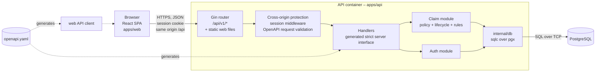
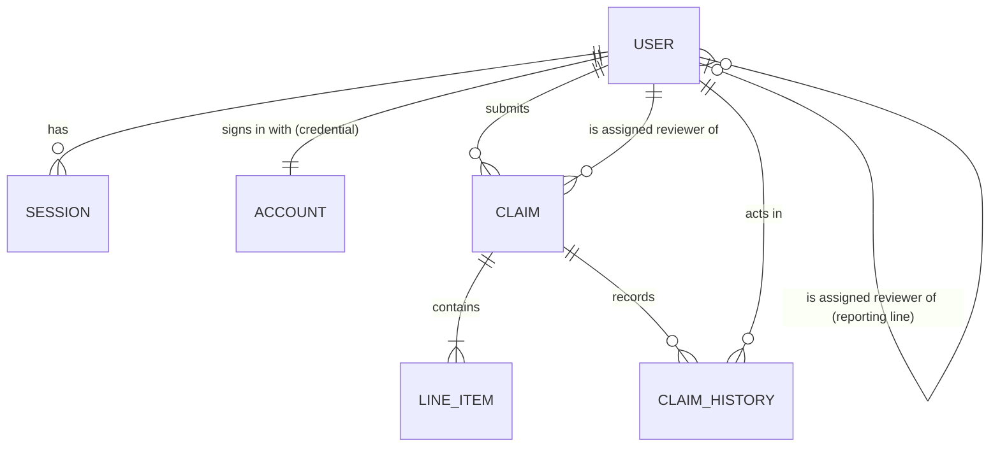
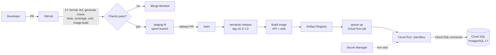

# System-Level Software Design Specification (SDS)

- **Product:** ClaimFlow – Department Expense Reimbursement System (repository: `beambeambeam/claimflow`)
- **Team:** 1005, 1045
- **Version:** 0.7 (draft for Deliverable 1)
- **Last updated:** 2026-11-04
- **Baseline:** `docs/srs.md` v0.2 · Glossary: `GLOSSARY.md` · Decisions: `docs/adr/`

This document defines the system-wide design: architecture, data model, the API contract and its conventions, roles and access, authentication, configuration, and deployment. Each feature contract in `docs/sprints/` refines it with exact operations in `apps/api/openapi.yaml`, screens, and schema changes.

---

## 1. Architecture

### 1.1 Overview

ClaimFlow is a **modular monolith**. It lives in a Bun workspace monorepo: `apps/web` is the UI, `apps/api` is the API and application logic, and one OpenAPI contract (`apps/api/openapi.yaml`) defines the interface between them.



- **Local:** the web dev server (`:3000`) proxies `/api` to the API (`:8080`), so the browser stays on one origin. This proxy already exists in the repo.
- **Production:** the API container also serves the built web files (Section 9), so there is one origin and cookies work without any CORS setup.

### 1.2 Technology stack

| Layer | Choice | Status | Reason |
| --- | --- | --- | --- |
| Monorepo/tooling | Bun workspaces, Vite+ (`vp`) for lint/format/test, semantic-release | in repo | Existing team setup |
| UI | React 19 + TypeScript, TanStack Router (file routes), Tailwind CSS 4 | in repo | Existing team setup; typed routes |
| UI server state | TanStack Query | to add | Caching, plus built-in loading/error states for every API call |
| UI forms | TanStack Form with the Zod schemas generated from the contract | to add | Client checks use the same limits as the server |
| API contract | OpenAPI 3.0.3, written by hand in `apps/api/openapi.yaml` | to add | One source for both apps; it is the feature contract for each sprint |
| API code generation | `oapi-codegen` (Gin strict server + types), pinned in `tools.mod` | to add | Handlers implement a generated interface, so the code cannot drift from the contract |
| Web code generation | `@hey-api/openapi-ts` (fetch client, TanStack Query options, Zod schemas) | to add | Typed calls and query keys with no hand-written fetch code |
| API | Go + Gin | in repo | Existing team setup; single static binary |
| Validation | Request shape: OpenAPI request validator middleware (`oapi-codegen/gin-middleware`). Business rules: the claim module. | to add | Shape errors and business-rule errors stay separate |
| Database | PostgreSQL 17 | to add | Relational constraints and transactions; Cloud SQL on GCP |
| DB driver / queries | `pgx/v5` + `sqlc` (SQL → type-safe Go) | to add | Plain SQL with compile-time types, no ORM |
| Migrations | `goose` (SQL files), pinned in `tools.mod` | to add | Versioned migrations, runnable as a `go tool` |
| IDs | UUIDv7, generated in Go (`google/uuid` `NewV7`) | to add | Time-ordered keys keep index inserts local; works on any PostgreSQL version |
| Auth schema | Better Auth core schema + admin and username plugin fields, implemented in Go (Section 2.2) | to add | A known, documented schema; can move to Better Auth later without reshaping data |
| Password hashing | `golang.org/x/crypto/bcrypt`, cost 12 | to add | Meets NFR-01 |
| CSRF | `net/http.CrossOriginProtection` (Go 1.25+) | to add | Standard library check that uses the browser's Fetch metadata; no tokens |
| Logging | `log/slog` JSON with request ID | to add | One log line per request that can be found from an error response |
| Configuration | varlock (`.env.schema`, generated `env/env.go`) + committed `.env.example` | in repo | Typed, validated environment with sensitive-value handling; `.env.example` documents it (NFR-04) |
| Tests | Go `testing` + `gotestsum`; `testcontainers-go` (PostgreSQL) for integration; Vitest via `vp test` + Testing Library + MSW (web); Playwright (E2E) | partly in repo | Covers all three test levels the course requires |
| Packaging | Docker (API image already builds in CI); the image also contains the web build | in repo | Lab 5 |

### 1.3 Module responsibilities

| Module | Responsibility | Does **not** |
| --- | --- | --- |
| React SPA (`apps/web`) | Screens, navigation, quick client-side checks from the generated schemas, showing server errors. Shows decision and edit buttons from the claim's `allowedActions`. | Decide permissions or re-derive business rules. |
| Middleware | Cross-origin protection, session → current user (401), OpenAPI request validation (400), route-level permission (403, Section 5.1). | Check ownership or assignment, which depend on claim data. |
| Handlers | Implement the generated strict server interface: map typed requests to module calls, and module errors to problem responses (Section 4.2). | Contain business rules. |
| Claim module (`internal/claim`) | **All claim business rules** (BR-01 to BR-17): the claim policy, the lifecycle, totals, the conditional update, history, transactions. | Know about HTTP or Gin. |
| Auth module (`internal/auth`) | Login, logout, sessions, bans, route-level permissions. | Know about claims. |
| `internal/db` (sqlc) | Generated queries and row types. | Make permission decisions. |
| PostgreSQL | Durable storage. Constraints and triggers are the last line of defence: FKs, CHECKs, unique indexes, the append-only history trigger. | – |

**Where rules are enforced:** in the claim module, backed up by database constraints. Tests call the claim module's interface (Section 3.1) against a real PostgreSQL, so they cover how the rules are called, not only the rules alone.

### 1.4 Code organization

Both apps are organized **by feature**: code for one feature lives in one folder, and only a small, named set of shared packages sits outside the features. A sprint's feature contract then maps to one folder per app. Both apps follow the same three rules:

1. **One direction.** Entry/routes → features → shared. Shared code never imports a feature.
2. **No imports between features**, except the `auth` feature, which every feature may use for the current user and permission checks. When two features need the same code, it moves to shared. Features are combined only at the entry point (API) or in a route file (web).
3. **Lint enforces the rules**, so a review does not have to find a broken boundary.

The API and the web split features differently. The API splits by domain aggregate: everything that changes a claim's status goes through one claim module (Section 3), so review and finance actions live in `claim`. The web splits by user journey, so each screen group (Section 7.1) gets a feature.

#### 1.4.1 API (`apps/api`)

This follows the Go guide [Organizing a Go module](https://go.dev/doc/modules/layout), section "Server project": server logic goes in `internal/`, grouped by responsibility. There is only one binary (`migrate` is a subcommand of it), so the existing root `main` package stays and no `cmd/` folder is added.

```
apps/api/
  main.go  server.go  config.go   # entry: startup, config, router; composes the feature handlers
  openapi.yaml                     # the API contract (Section 4)
  oapi-codegen.yaml  sqlc.yaml     # code generation config
  env/                             # varlock-generated (excluded from coverage)
  internal/
    api/                           # shared, generated by oapi-codegen: types + StrictServerInterface
    db/                            # shared, generated by sqlc from every feature's queries.sql
    auth/                          # feature: login/logout/me, sessions, bans, route permissions
      handler.go                   #   implements the auth operations of the strict server interface
      service.go                   #   login, logout, session lookup, ban check
      access.go                    #   statement, roles, RequirePermission (Section 5.1)
      queries.sql  *_test.go
    claim/                         # feature: claims, line items, lifecycle, review and finance actions
      handler.go                   #   implements the claim operations
      service.go                   #   the claim module interface (Section 3.1)
      policy.go                    #   who may see a claim and which actions they may take (Section 5.2)
      lifecycle.go                 #   transition table
      rules.go                     #   BR field checks
      model.go  queries.sql  *_test.go
    report/                        # feature: decision summaries (Sprint 3)
      handler.go  service.go  queries.sql  *_test.go
    httperr/                       # shared: RFC 9457 problem responses (Section 4.2)
    money/                         # shared: the money.Satang type (Section 2.3)
    pgtest/                        # shared, tests only: testcontainers PostgreSQL + migrations + seed
  migrations/                      # goose SQL migrations (one schema for all features)
  seed/                            # seed data, run with `bun run seed`
```

- **Inside a feature, files split by responsibility.** `handler.go` maps the generated request and response types. `service.go` is the feature's interface and owns transactions. `policy.go`, `lifecycle.go`, and `rules.go` are pure functions behind it.
- **Each feature owns its queries, and one package holds the generated code.** sqlc reads every feature's `queries.sql` and generates a single `internal/db` package. Enum types (claim status, action, category) exist once, so features need no conversion code. A feature may read any table in its own queries. For example, `report` reads `claims` directly instead of importing `claim`.
- **One generated server interface.** `oapi-codegen` generates `api.StrictServerInterface` from `openapi.yaml`. `server.go` builds one struct that embeds `auth.Handler`, `claim.Handler`, and `report.Handler`, so each feature implements only its own operations, and the compiler reports any operation that is missing.
- **Names.** Packages are short singular nouns. Following [Package names](https://go.dev/blog/package-names), there are no `util`, `common`, or `models` packages, and type names do not repeat the package name (`claim.Service`, not `claim.ClaimService`).
- **Enforcement.** `depguard` rules in `.golangci.yml`:
  - `internal/report/**` must not import `internal/claim`, and the reverse.
  - Shared packages (`api`, `db`, `httperr`, `money`, `pgtest`) must not import a feature.
  - Only `_test.go` files may import `pgtest`.

#### 1.4.2 Web (`apps/web`)

This follows the `features/` model in [bulletproof-react](https://github.com/alan2207/bulletproof-react/blob/master/docs/project-structure.md). The difference: routes stay in `src/routes/`, where TanStack Router's file-based routing generates the route tree. Bulletproof uses `src/app/routes/` instead.

```
apps/web/src/
  main.tsx  router.tsx  styles.css     # entry, router + QueryClient setup (router context holds both)
  routes/                              # thin route files (Section 7.1): path, beforeLoad guard, loader,
                                       #   search params; render feature components and nothing else
  features/
    auth/                              # login form, useCurrentUser, can(resource, action)
    claims/                            # claims list, claim form + line-item rows, claim detail
      components/claim-form.tsx
      __test__/claim-form.test.tsx     #   tests for this feature (Vitest runs only __test__ folders)
    reviews/                           # decision panel, approve/reject/return dialogs
    finance/                           # final decisions (Sprint 3)
    reports/                           # decision summary (Sprint 3)
  components/ui/                       # shared: buttons, dialog, table, skeleton, toast
  components/                          # shared, claim-aware but feature-free: StatusBadge, Money, DateText
  lib/
    api/                               # shared: generated client, query options, Zod schemas (@hey-api/openapi-ts)
    problem.ts                         # shared: reads RFC 9457 errors into field messages
    format.ts                          # shared: money and date formatting (Asia/Bangkok)
  __test__/                            # app-level tests (router, routes) and shared test helpers:
                                       #   render helpers, MSW handlers, seed users
```

- **Folders inside a feature are optional.** Add `components/`, `hooks/`, or `api/` only when the feature needs them. Most data access uses the generated query options from `#/lib/api` directly, so a feature's `api/` folder holds only custom hooks.
- **Route files combine features.** For example, `_auth/claims/$claimId.tsx` renders `ClaimDetail` from `claims` and, when `allowedActions` has a decision, `DecisionPanel` from `reviews`. Neither feature imports the other.
- **Imports.** Use the existing `#/` alias, for example `#/features/claims/components/claim-form`. The current `import/no-relative-parent-imports` rule already blocks `../`. Import files directly. There are no barrel `index.ts` files, because they slow down Vite and hide where code comes from.
- **Tests live in `__test__/` folders.** Each feature or shared folder that has tests gets its own `__test__/` folder, for example `features/claims/__test__/claim-form.test.tsx`. Tests for routes and the router, and the shared test helpers, go in `src/__test__/`. `apps/web/vite.config.ts` already sets this: Vitest runs only `src/**/__test__/**/*.test.{ts,tsx}`, and coverage (100% required) excludes `__test__` folders, so test helpers do not count as app code. The Go API keeps Go's own rule instead (Section 10).
- **Enforcement.** `no-restricted-imports` overrides in `apps/web/check.config.ts`:
  - Each `features/<name>/**` may import only `#/features/auth/**` and shared paths.
  - `components/**` and `lib/**` must not import `#/features/**` or `#/routes/**`.

## 2. Data model

### 2.1 Entity–relationship diagram



### 2.2 Entities

All `UUID` primary keys are **UUIDv7**, generated in Go with `uuid.NewV7()`.

The auth tables (`user`, `session`, `account`) follow the [Better Auth core schema](https://better-auth.com/docs/concepts/database#core-schema), with fields added by the [admin plugin](https://better-auth.com/docs/plugins/admin#schema) (`role`, `banned`, `banReason`, `banExpires`) and the [username plugin](https://better-auth.com/docs/plugins/username) (`username`, `displayUsername`). The Go API implements this schema itself; it does not run Better Auth. Column names are the Better Auth field names in snake_case (`emailVerified` → `email_verified`). `user` is a reserved word in PostgreSQL, so queries quote it as `"user"`.

Not used:

- The `verification` table, because there is no email verification or password reset (EX-04).
- The admin plugin's `session.impersonatedBy` field, because there is no account administration (EX-08).

App-specific fields on `user` (`position`, `reviewer_id`) are Better Auth–style _additional fields_.

**`user`**

| Field | Type | Source | Constraints |
| --- | --- | --- | --- |
| id | UUID | core | PK |
| name | VARCHAR(100) | core | NOT NULL. Display name, e.g. "Anan K." |
| email | VARCHAR(255) | core | UNIQUE, NOT NULL. Seed users get `<username>@claimflow.test`; it is not used for login. |
| email_verified | BOOLEAN | core | NOT NULL, default false. Always true in seed data; it is not checked (EX-04). |
| image | TEXT | core | NULL. Not used in the UI yet. |
| username | VARCHAR(50) | username plugin | UNIQUE, NOT NULL. Stored lowercase; the login identifier (FR-01). |
| display_username | VARCHAR(50) | username plugin | NOT NULL. Username as the user typed it. |
| role | VARCHAR(20) | admin plugin | NOT NULL, default `requester`. CHECK `role IN ('requester', 'reviewer', 'finance')`. Exactly one role per account (D-02), so the plugin's comma-separated multi-role form is not used. Its permissions are in Section 5.1. |
| banned | BOOLEAN | admin plugin | NOT NULL, default false. A banned user cannot log in and has no valid sessions. This is how an account is deactivated. |
| ban_reason | VARCHAR(200) | admin plugin | NULL |
| ban_expires | TIMESTAMPTZ | admin plugin | NULL means the ban does not expire. When it is in the past, the user is treated as not banned. |
| position | VARCHAR(50) | additional | Display label only, e.g. "Section Head A" |
| reviewer_id | UUID | additional | FK → user.id. The member's **assigned reviewer** (reporting line). NULL means the member cannot create claims (BR-15); in seed data only `finance` users have NULL. CHECK `reviewer_id <> id` (AS-03). |
| created_at, updated_at | TIMESTAMPTZ | core | NOT NULL |

**`account`** – one row per sign-in method. Only the `credential` provider (username + password) is used.

| Field | Type | Source | Constraints |
| --- | --- | --- | --- |
| id | UUID | core | PK |
| user_id | UUID | core | FK → user.id, ON DELETE CASCADE, NOT NULL |
| provider_id | VARCHAR(50) | core | NOT NULL. Always `credential`. |
| account_id | VARCHAR(255) | core | NOT NULL. For `credential`, the user's `id` (Better Auth convention). UNIQUE `(provider_id, account_id)`. |
| password | VARCHAR(100) | core | bcrypt hash, cost 12 (NFR-01). NOT NULL for `credential` rows (CHECK). |
| access_token, refresh_token, id_token, access_token_expires_at, refresh_token_expires_at, scope | – | core | Left out. They exist only for OAuth providers, which are not in scope. |
| created_at, updated_at | TIMESTAMPTZ | core | NOT NULL |

**`session`**

| Field | Type | Source | Constraints |
| --- | --- | --- | --- |
| id | UUID | core | PK |
| user_id | UUID | core | FK → user.id, ON DELETE CASCADE, NOT NULL |
| token | BYTEA | core | UNIQUE, NOT NULL. **SHA-256 of the cookie token**; the raw token is never stored. Better Auth stores the raw token, and this design differs on purpose so a database leak exposes no usable sessions. |
| expires_at | TIMESTAMPTZ | core | NOT NULL, created_at + 8 h (NFR-03) |
| ip_address | VARCHAR(45) | core | NULL. Client IP at login, for audit. |
| user_agent | TEXT | core | NULL. Client user agent at login, for audit. |
| created_at, updated_at | TIMESTAMPTZ | core | NOT NULL |

**`claims`**

| Field | Type | Constraints |
| --- | --- | --- |
| id | UUID | PK |
| claim_no | VARCHAR(20) | UNIQUE, NOT NULL. Set at creation from the sequence `claim_no_seq`: `CLM-<year of creation in Asia/Bangkok>-<nextval, 6 digits>`, e.g. `CLM-2026-000123`. The sequence never resets, so numbers are unique even across years. |
| requester_id | UUID | FK → user.id, NOT NULL. The **owner**. |
| assigned_reviewer_id | UUID | FK → user.id. NULL while `DRAFT`. Copied from `user.reviewer_id` at **first** submission and never changed afterwards (BR-17). CHECK `assigned_reviewer_id <> requester_id` (BR-01). CHECK `status = 'DRAFT' OR assigned_reviewer_id IS NOT NULL`. |
| title | VARCHAR(120) | NOT NULL |
| purpose | TEXT | NOT NULL, 1–1000 chars |
| status | ENUM `DRAFT`, `SUBMITTED`, `RETURNED`, `PENDING_FINANCE`, `APPROVED`, `REJECTED`, `WITHDRAWN` | NOT NULL |
| total_satang | BIGINT | NOT NULL, CHECK `> 0 AND <= 5000000` (BR-06). Calculated on the server (BR-08). |
| return_count | SMALLINT | NOT NULL, default 0, CHECK `BETWEEN 0 AND 3` (BR-14) |
| version | INTEGER | NOT NULL, default 0. Incremented on every change; the client sends it back in `If-Match` (Section 3.3, BR-13). |
| first_submitted_at | TIMESTAMPTZ | NULL while `DRAFT`. Set once at first submission; used for the 90-day window (BR-07). |
| submitted_at | TIMESTAMPTZ | Latest submission time. NULL while `DRAFT`. |
| decided_at | TIMESTAMPTZ | NULL until `APPROVED` or `REJECTED` |
| created_at, updated_at | TIMESTAMPTZ | NOT NULL |

Indexes: `(requester_id, status)` and `(assigned_reviewer_id, status)`.

**`line_items`**

| Field | Type | Constraints |
| --- | --- | --- |
| id | UUID | PK |
| claim_id | UUID | FK → claims.id, ON DELETE CASCADE |
| line_no | SMALLINT | NOT NULL, UNIQUE per claim, 1–20 (BR-05) |
| category | ENUM `TRAVEL`, `ACCOMMODATION`, `MEALS`, `SUPPLIES`, `TRAINING`, `OTHER` | NOT NULL (BR-12) |
| description | VARCHAR(200) | NOT NULL |
| expense_date | DATE | NOT NULL. The date window (BR-07) is checked by the claim module on every submit/resubmit. |
| amount_satang | BIGINT | NOT NULL, CHECK `> 0 AND <= 2000000` (BR-05). CHECK `category <> 'MEALS' OR amount_satang <= 150000` (BR-12). |
| receipt_ref | VARCHAR(50) | NOT NULL (D-09) |

**`claim_history`** – append-only (BR-11)

| Field | Type | Constraints |
| --- | --- | --- |
| id | BIGINT | PK, `GENERATED ALWAYS AS IDENTITY`. Gives the order of entries. |
| claim_id | UUID | FK → claims.id, NOT NULL (no cascade) |
| actor_id | UUID | FK → user.id, NOT NULL |
| action | ENUM `SUBMIT`, `APPROVE`, `REJECT`, `RETURN`, `RESUBMIT`, `WITHDRAW`, `FINAL_APPROVE`, `FINAL_REJECT` | NOT NULL |
| from_status | claim status ENUM | NULL for a claim submitted directly (no draft) |
| to_status | claim status ENUM | NOT NULL |
| comment | VARCHAR(500) | NULL. Required (5–500 non-blank chars) for REJECT, RETURN, and FINAL_REJECT (BR-04), checked by the claim module. |
| created_at | TIMESTAMPTZ | NOT NULL, default now() |

- A `BEFORE UPDATE OR DELETE` trigger on `claim_history` raises an error, so no code path can change history (BR-11). An integration test checks this.
- Drafts have no history; history starts at the first `SUBMIT`.
- Deleting a draft (BR-10) deletes the claim and its line items. A claim with history can never be deleted, because the trigger and the FK block it.

### 2.3 Money

- Amounts are **integer satang** (1 THB = 100 satang) in `BIGINT` columns. In Go they use the type `money.Satang` (an `int64`), and floats are never used.
- `money.Satang` implements JSON marshalling as a decimal **string** with exactly 2 places, e.g. `"1250.00"`. Decoding rejects anything else, including `"1.005"` (BR-05), so no handler parses money. A sqlc override maps the `*_satang` columns to `money.Satang`.
- The contract describes money as `type: string, pattern: '^\d{1,6}\.\d{2}$'`, so the generated web schema checks the format before sending.
- Limits are named constants in `internal/claim/rules.go`: item 20,000.00 (BR-05), Meals item 1,500.00 (BR-12), total 50,000.00 (BR-06), high-value threshold 10,000.00 (BR-09). They are fixed by the SRS, so they are not configuration.
- The claim module recomputes `total_satang = Σ line_items.amount_satang` on every create or edit and ignores any client total (BR-08).

### 2.4 Time

- The claim and auth modules take the current time from an injected `clock` (`func() time.Time`), never from `time.Now()` directly. Tests use a fixed clock.
- "Today" means the calendar date in **Asia/Bangkok** (AS-06). BR-07: `expense_date <= today` and `expense_date >= date(first_submitted_at in Asia/Bangkok) − 90 days`. On first submission, `first_submitted_at` is the current time.
- Timestamps are stored as `TIMESTAMPTZ` (UTC) and converted to Asia/Bangkok only for dates and display.

### 2.5 Migrations and seed data

| Command (in `apps/api`) | Purpose |
| --- | --- |
| `bun run db:up` | `docker compose up -d postgres` for local development |
| `bun run migrate` | `goose up` with the committed migrations in `migrations/` |
| `bun run generate` | Regenerate `internal/db` (sqlc) and `internal/api` (oapi-codegen); generated code is committed, and CI fails if regenerating changes it |
| `bun run seed` | Load the base demo dataset. Idempotent: upserts by username/claim_no. |
| `bun run seed:load` | Add ~200 extra claims for NFR-07 (Sprint 3) |

In `apps/web`, `bun run generate` regenerates `src/lib/api` from `../api/openapi.yaml`, with the same CI check.

**Base seed accounts.** Each seed user gets a `user` row and a `credential` `account` row. All share the password in `SEED_USER_PASSWORD` (sensitive, from the environment, never committed – NFR-04). They form the reporting line `Staff → Section Head → Department Head → Finance Officer`:

| Username | Role | Position | Assigned reviewer | Used to test |
| --- | --- | --- | --- | --- |
| `req.anan` | `requester` | Staff, Section A | `rev.malee` | Normal journey |
| `req.ploy` | `requester` | Staff, Section A | `rev.malee` | Cross-requester access (another user's claim) |
| `req.niran` | `requester` | Staff, Section B | `rev.somchai` | Unrelated reviewer access |
| `rev.malee` | `reviewer` | Section Head A | `rev.prasert` | Reviewing; her own claim goes up the line; self-approval attempt |
| `rev.somchai` | `reviewer` | Section Head B | `rev.prasert` | Unrelated reviewer (Section A claims) |
| `rev.prasert` | `reviewer` | Department Head | `fin.wanida` | Top of the reviewer line; his claims go to Finance (ADR-0001) |
| `fin.wanida` | `finance` | Finance Officer | – (NULL) | Reviews the Department Head's claims; cannot create claims (BR-15); final decisions in Sprint 3 |

The seed also creates sample claims in every Sprint 1 status (`SUBMITTED`, `APPROVED`, `REJECTED`), each with history. `pgtest` (Go integration tests), MSW handlers (web tests), and Playwright (E2E) use the same seed users.

## 3. Claim module and lifecycle

### 3.1 Interface

Every claim operation goes through one module, `claim.Service`. Its interface is small, and all claim rules sit behind it:

```go
func (s *Service) Get(ctx context.Context, actor Actor, id uuid.UUID) (Claim, error)
func (s *Service) List(ctx context.Context, actor Actor, q Query) (Page, error)
func (s *Service) Create(ctx context.Context, actor Actor, in Input, submit bool) (Claim, error)
func (s *Service) Edit(ctx context.Context, actor Actor, id uuid.UUID, version int, in Input) (Claim, error)
func (s *Service) Delete(ctx context.Context, actor Actor, id uuid.UUID, version int) error
func (s *Service) Act(ctx context.Context, actor Actor, id uuid.UUID, version int, a Action, comment string) (Claim, error)
```

- `Claim` includes `AllowedActions`, the actions this actor may take on this claim right now (Section 5.2).
- Errors are typed: `ErrNotFound`, `ErrForbidden`, `ErrInvalidTransition{Rule}`, `ErrConflict`, and `ValidationError{Fields}`. The handler maps each one to a problem response (Section 4.2).
- Each submit-type action (`submit`, `approve`, `reject`, `return`, `withdraw`, `final-approve`, `final-reject`) is a call to `Act`. Every action endpoint becomes a short handler that makes one call.

### 3.2 Lifecycle table

The transition table lives once, in `internal/claim/lifecycle.go`. Who may take each action comes from the claim policy (Section 5.2).

| From | Action | To | Who / guard | Sprint |
| --- | --- | --- | --- | --- |
| – | SUBMIT | SUBMITTED | Owner with an assigned reviewer (BR-15) | 1 |
| SUBMITTED | APPROVE | APPROVED | Assigned reviewer, not the owner | 1 |
| SUBMITTED | REJECT | REJECTED | Assigned reviewer, not the owner; reason required | 1 |
| – | SAVE_DRAFT | DRAFT | Owner with an assigned reviewer (BR-15) | 2 |
| DRAFT | SUBMIT | SUBMITTED | Owner | 2 |
| DRAFT | DELETE | (row removed) | Owner | 2 |
| SUBMITTED | RETURN | RETURNED, `return_count + 1` | Assigned reviewer, not the owner; `return_count < 3` (BR-14) | 2 |
| RETURNED | RESUBMIT | SUBMITTED | Owner; same assigned reviewer (BR-17) | 2 |
| SUBMITTED, RETURNED | WITHDRAW | WITHDRAWN | Owner (BR-16) | 2 |
| SUBMITTED | APPROVE | PENDING_FINANCE | Assigned reviewer whose role is not `finance`; total > 10,000.00 THB (BR-09) | 3 |
| PENDING_FINANCE | FINAL_APPROVE / FINAL_REJECT | APPROVED / REJECTED | Any `finance` user, not the owner | 3 |

`APPROVE` picks its target: `PENDING_FINANCE` if the total is above the high-value threshold and the approver is not a Finance Officer, otherwise `APPROVED`. Before Sprint 3 it always goes to `APPROVED`. The `submit` endpoint records `SUBMIT` for a draft and `RESUBMIT` for a returned claim.

### 3.3 Inside `Act`, `Edit`, and `Delete`

Each call runs in one transaction (`pgx.BeginFunc`, NFR-06):

1. Load the claim. If it does not exist → `ErrNotFound`. If the policy says the actor may not see it → `ErrForbidden`.
2. If the action is not in the policy's allowed actions for this actor → `ErrForbidden` (BR-01, BR-02, BR-15) or `ErrInvalidTransition` (BR-03, BR-10, BR-14, BR-16), with the rule ID.
3. Run the field rules (BR-04 to BR-07, BR-12) → `ValidationError` with one entry per field.
4. Run `UPDATE claims SET status = $to, version = version + 1, ... WHERE id = $id AND version = $expected`, where `$expected` is the version the **client** sent in `If-Match`.
5. If 0 rows are updated, the claim changed after the client loaded it, or another request won a race → `ErrConflict` (409) and roll back. This covers both concurrent decisions (BR-13) and a decision made on an out-of-date screen.
6. Insert the `claim_history` row and commit.

## 4. API contract and conventions

### 4.1 General

- **Contract first.** `apps/api/openapi.yaml` (OpenAPI 3.0.3) is the source of truth for every operation, request, response, and error. A feature contract in `docs/sprints/` adds its operations to this file first. Then both apps regenerate their code from it.
- **Paths:** base path `/api/v1`. Resources are nouns (`/claims`), and state changes use action sub-resources (`POST /claims/{id}/approve`), so each transition has its own operation, permission check, and test.
- **Format:** JSON bodies, `Content-Type: application/json`. Field names are camelCase. Money is a 2-decimal string (Section 2.3). Dates are `YYYY-MM-DD`; timestamps are RFC 3339.
- **Identity:** taken **only** from the session, never from a user ID or role in the request.
- **Lists:** `?page=1&pageSize=20` (max 100) → `{ "data": [...], "page": 1, "pageSize": 20, "total": 57 }`.
- **Single item:** `{ "data": { ... } }`.
- **Versions:** claim responses include `version` and the header `ETag: "<version>"`. Every request that changes an existing claim (`PUT`, `DELETE`, and the actions) must send `If-Match: "<version>"`. A missing header → 428; a version that no longer matches → 409 `CONFLICT`. The SRS asks for a conflict error (BR-13), so a stale version also returns 409, not HTTP's usual 412.

### 4.2 Error format

Errors use **RFC 9457 Problem Details** (`Content-Type: application/problem+json`), produced only by `internal/httperr` and defined once in the contract as the `Problem` schema. Responses never include stack traces, SQL, or Go error strings. Two extension members are added: `code` (stable, for the client) and `errors` (one entry per field).

```json
{
  "type": "https://claimflow.dev/problems/validation-failed",
  "title": "Some fields are invalid.",
  "status": 422,
  "code": "VALIDATION_FAILED",
  "instance": "/api/v1/claims",
  "requestId": "01JC3Z8Q2W5Y7X9V4T6R8P0N2M",
  "errors": [
    {
      "field": "items[1].expenseDate",
      "rule": "BR-07",
      "message": "Expense date cannot be in the future."
    }
  ]
}
```

| HTTP | `code` | When |
| --- | --- | --- |
| 400 | `BAD_REQUEST` | Malformed JSON, or the request does not match the contract (wrong types, missing fields, bad money format) |
| 401 | `UNAUTHENTICATED` | No session, or the session is invalid or expired, or the user is banned |
| 403 | `FORBIDDEN` | Wrong role for the route, not the owner, not the assigned reviewer, self-approval (BR-01, BR-02), no assigned reviewer (BR-15), or a cross-origin state change |
| 404 | `NOT_FOUND` | Claim does not exist |
| 409 | `INVALID_TRANSITION` | Action not allowed from the current status (BR-03, BR-10, BR-16), or return limit reached (BR-14). `errors[0].rule` names the rule. |
| 409 | `CONFLICT` | The claim changed since the client loaded it, or a concurrent change won (BR-13) |
| 422 | `VALIDATION_FAILED` | Business-rule validation failed (BR-04 to BR-07, BR-12) |
| 428 | `PRECONDITION_REQUIRED` | A change to an existing claim without `If-Match` |
| 500 | `INTERNAL` | Unexpected error. Details are logged with `slog` only, under the same `requestId`. |

A 403 response never includes the claim's data.

### 4.3 Operations

The contract holds the exact shapes. All paths are under `/api/v1`.

| Method | Path | Purpose | Route permission (5.1) | Sprint |
| --- | --- | --- | --- | --- |
| POST | `/auth/login` | Log in, set session cookie | none (anonymous) | 1 |
| POST | `/auth/logout` | Delete session, clear cookie | session | 1 |
| GET | `/auth/me` | Current user `{ id, username, name, role, permissions }`. `permissions` is the role's map from Section 5.1, so the SPA shows only allowed links. | session | 1 |
| POST | `/claims` | Create and submit a claim (Sprint 2: `?draft=true` saves a draft) | `claim:create` | 1 |
| GET | `/claims?scope=…` | List claims in a scope (Section 5.3), with `status`, `category`, `from`, `to`, `q` filters from Sprint 3 | depends on scope | 1 |
| GET | `/claims/{id}` | Claim detail + line items + history + `allowedActions` | session; policy | 1 |
| POST | `/claims/{id}/approve` | Approve `{ comment? }` | session; policy | 1 |
| POST | `/claims/{id}/reject` | Reject `{ comment }` | session; policy | 1 |
| PUT | `/claims/{id}` | Edit a DRAFT/RETURNED claim | session; policy | 2 |
| DELETE | `/claims/{id}` | Delete a DRAFT claim | session; policy | 2 |
| POST | `/claims/{id}/submit` | Submit a draft or resubmit a returned claim | session; policy | 2 |
| POST | `/claims/{id}/return` | Return `{ comment }` (max 3 per claim) | session; policy | 2 |
| POST | `/claims/{id}/withdraw` | Withdraw a SUBMITTED/RETURNED claim | session; policy | 2 |
| POST | `/claims/{id}/final-approve`, `/final-reject` | Finance final decision | session; policy | 3 |
| GET | `/reports/summary?from=&to=` | Decision summary (Section 4.4) | `report:read` | 3 |
| GET | `/health` | Liveness, no auth, no DB: `{ status, version }` | none | 1 |
| GET | `/ready` | Readiness, no auth: pings the database; 503 if it cannot reach it | none | 1 |

**Filters (FR-13, Sprint 3):** `status` and `category` match exactly (a claim matches `category` if any line item has it). `from`/`to` are inclusive Asia/Bangkok dates on the first submission date, or on the creation date for drafts. `q` is a case-insensitive substring match on the title.

### 4.4 Decision summary (FR-14, Sprint 3)

`GET /reports/summary?from=&to=` covers claims whose decision (`decided_at`, Asia/Bangkok date) falls in the range. The scope is the claims assigned to a `reviewer`, or every claim for `finance`.

```json
{
  "data": {
    "countsByStatus": {
      "SUBMITTED": 4,
      "RETURNED": 1,
      "PENDING_FINANCE": 2,
      "APPROVED": 12,
      "REJECTED": 3,
      "WITHDRAWN": 1
    },
    "approvedTotals": [
      { "month": "2026-10", "category": "TRAVEL", "total": "18250.00" }
    ],
    "averageDecisionHours": 26.4
  }
}
```

- `countsByStatus` counts every claim in the scope that is not a draft, by current status. The date range does not apply to this field.
- `approvedTotals` sums line-item amounts of `APPROVED` claims, grouped by the month of `decided_at` and by category.
- `averageDecisionHours` is the mean of `decided_at − first_submitted_at` for `APPROVED` and `REJECTED` claims in the range.

## 5. Roles, ownership, and permissions

Access is checked at two levels:

- **Route permissions (5.1)** depend only on the role. They gate operations that are not about one claim.
- **The claim policy (5.2)** depends on the actor and the claim's data. It decides everything about one claim.

### 5.1 Route permissions

Route permissions follow the Better Auth admin plugin's [access control](https://better-auth.com/docs/plugins/admin#access-control) model, written in Go in `internal/auth/access.go`. A **statement** lists the resources and actions, and each **role** gets a subset. Middleware `auth.RequirePermission(resource, action)` returns **403** when `user.role` does not grant the action. Code checks permissions, never role names.

```go
var statement = Statement{
    "claim":   {"create", "list"}, // create claims; list own claims
    "review":  {"list"},           // list the review queue
    "finance": {"list"},           // list the finance queue (Sprint 3)
    "report":  {"read"},           // decision summary (Sprint 3)
}

var roles = map[Role]Permissions{
    RoleRequester: {"claim": {"create", "list"}},
    RoleReviewer:  {"claim": {"create", "list"}, "review": {"list"}, "report": {"read"}},
    RoleFinance:   {"review": {"list"}, "finance": {"list"}, "report": {"read"}},
}
```

`/auth/me` returns the actor's permissions, so the web shows only allowed navigation. The admin plugin's own `user` and `session` admin permissions are not used, because there is no admin UI (EX-08).

### 5.2 Claim policy

`internal/claim/policy.go` is a pure function: `Allowed(actor, claim) → (visible bool, actions []Action)`. `Get`, `List`, `Act`, `Edit`, and `Delete` all use it, and `Get` returns its actions to the web as `allowedActions`. "Own" means `requester_id = actor.id`. "Assigned" means `assigned_reviewer_id = actor.id`.

**Visible** if any of these is true:

- own;
- assigned (not `DRAFT`, since drafts have no assigned reviewer);
- from Sprint 3, the actor is `finance` and the claim is not `DRAFT` (department-wide view, FR-13, FR-14).

**Allowed actions** (only for a visible claim, and only if the lifecycle table allows the action from the current status):

| Action | Allowed when | Rule |
| --- | --- | --- |
| `edit` | own, status `DRAFT` or `RETURNED` | BR-08, BR-10 |
| `delete` | own, status `DRAFT` | BR-10 |
| `submit` | own, status `DRAFT` or `RETURNED`, owner has an assigned reviewer (drafts only) | BR-15, BR-17 |
| `withdraw` | own, status `SUBMITTED` or `RETURNED` | BR-16 |
| `approve`, `reject` | assigned **and not own**, status `SUBMITTED` | BR-01, BR-02 |
| `return` | as `approve`, and `return_count < 3` | BR-14 |
| `final-approve`, `final-reject` | actor is `finance` **and not own**, status `PENDING_FINANCE` | BR-01, BR-02 |

The "not own" check uses `requester_id` directly, so self-approval is blocked even if the assignment data is wrong (BR-01).

### 5.3 List scopes and permission matrix

`GET /claims?scope=` selects one of these scopes. Each scope is the visible set from 5.2, narrowed further:

| Scope | Claims | Route permission | Sprint |
| --- | --- | --- | --- |
| `mine` | own claims, all statuses | `claim:list` | 1 |
| `review` | assigned, status `SUBMITTED` (FR-05) | `review:list` | 1 |
| `finance` | status `PENDING_FINANCE` | `finance:list` | 3 |
| `all` | every visible claim, with filters (FR-13) | session | 3 |

| Operation | `requester` | `reviewer` | `finance` | Enforced by |
| --- | --- | --- | --- | --- |
| Login / logout / me | ✓ | ✓ | ✓ | session middleware |
| Create claim / save draft | ✓ | ✓ | ✗ 403 (BR-15) | `claim:create` + claim module: `reviewer_id IS NOT NULL` |
| List own claims (`scope=mine`) | ✓ | ✓ | ✗ 403 | `claim:list` |
| Review queue (`scope=review`) | ✗ 403 | assigned only | assigned only (Department Head's claims) | `review:list` + scope |
| View claim detail | own | own **or** assigned | assigned; any non-draft from S3 | policy |
| Edit / submit / withdraw / delete | own, allowed status | own, allowed status | ✗ 403 | policy |
| Approve / reject / return | ✗ 403 | assigned **and** not own | assigned **and** not own | policy |
| Final approve / reject (S3) | ✗ 403 | ✗ 403 | PENDING_FINANCE, not own | policy |
| Decision summary (S3) | ✗ 403 | assigned claims | whole department | `report:read` + scope |

**Required access tests (Sprint 1, API integration level):**

- **Route inventory (NFR-02):** a test walks every operation in `openapi.yaml`. Each one except `/auth/login`, `/health`, and `/ready` returns 401 without a session. A new operation is covered without writing a new test.
- `req.anan` logs in with the right password → 200 and a session cookie. With a wrong password, or as an unknown user → 401 with the same generic message.
- `req.ploy` requests `req.anan`'s claim → 403, no claim data in the body.
- `req.anan` calls `/claims/{id}/approve` → 403.
- `rev.somchai` approves `req.anan`'s claim, which is assigned to `rev.malee` → 403 (unrelated reviewer).
- `rev.malee` approves her own claim, which is assigned to `rev.prasert` → 403. With the assignment data corrupted to point to herself, the response is still 403 (BR-01).
- `fin.wanida` creates a claim → 403 (BR-15).
- A banned user logs in → 401 with the generic message; a session created before the ban → 401.
- `fin.wanida` approves `rev.prasert`'s claim → 200 (Finance acting as assigned reviewer).
- A state change with a foreign `Origin` → 403 (cross-origin protection).

## 6. Authentication and sessions

| Aspect | Design |
| --- | --- |
| Credentials | Username + password. The username is lowercased, then the `user` row and its `credential` `account` row are loaded. The password is checked against `account.password` with `bcrypt.CompareHashAndPassword`. |
| Failed login | 401 with the generic message "Invalid username or password." A banned user (`banned = true` and `ban_expires` NULL or in the future) gets the same response, so the response does not show which accounts exist or are banned. To limit timing differences, an unknown username is still compared against a dummy hash. |
| Session creation | 32 bytes from `crypto/rand`, base64url-encoded, becomes the cookie value. Its SHA-256 is stored in `session.token` with `expires_at = now + 8h`, `ip_address`, and `user_agent`. The 8-hour lifetime is a constant, not configuration (NFR-03). |
| Cookie | `__Host-sid=<token>`; `HttpOnly`; `Secure`; `SameSite=Lax`; `Path=/`; no `Domain`; `Max-Age=28800`. The `__Host-` prefix makes the browser enforce `Secure`, `Path=/`, and no `Domain`. Local development over plain HTTP (`COOKIE_SECURE=false`) uses the name `sid` without `Secure`. |
| Request handling | Gin middleware hashes the cookie, loads an unexpired session and its user, and stores the actor (`id`, `role`, `reviewer_id`) in the request context. A missing, unknown, or expired session, or a banned user → 401. |
| Current user | `GET /auth/me`. The `_auth` route's `beforeLoad` calls `queryClient.ensureQueryData` for it, puts the user in router context, and redirects anonymous users to `/login?redirect=<path>` before any protected screen renders. |
| Logout | Delete the session row and clear the cookie. Reusing the old token afterwards → 401 (NFR-03). |
| Expiry | Fixed lifetime, no sliding renewal. Expired rows are deleted at login. |
| Ban | Setting `banned = true` (through seed data or a migration; there is no admin UI, EX-08) also deletes all of the user's `session` rows, as the admin plugin's `banUser` does. |
| CSRF | `http.CrossOriginProtection` wraps the router. It rejects non-safe cross-origin browser requests using `Sec-Fetch-Site`, falling back to `Origin`. `SameSite=Lax` is a second layer. |
| Why server-side sessions | Logout takes effect immediately, which a stateless JWT cannot do. |

## 7. UI design

### 7.1 Screens and navigation

TanStack Router file routes live in `apps/web/src/routes/`. Routes under `_auth` require a session (Section 6). Loaders call `queryClient.ensureQueryData` with the generated query options, so data starts loading with navigation instead of after the first render.

| Screen | Route file → path | Roles | Sprint |
| --- | --- | --- | --- |
| Login | `login.tsx` → `/login` | Anonymous | 1 |
| My Claims (list) | `_auth/claims/index.tsx` → `/claims` | Requester, Reviewer | 1 |
| New Claim (form with line-item rows) | `_auth/claims/new.tsx` → `/claims/new` | Requester, Reviewer | 1 |
| Claim Detail (line items, total, status, history timeline, action buttons from `allowedActions`) | `_auth/claims/$claimId.tsx` → `/claims/:id` | Anyone the policy lets see the claim | 1 |
| Review Queue | `_auth/reviews.tsx` → `/reviews` | Reviewer, Finance | 1 |
| Edit Claim | `_auth/claims/$claimId.edit.tsx` | Owner (DRAFT/RETURNED) | 2 |
| Finance Queue (final decisions) | `_auth/finance.tsx` → `/finance` | Finance | 3 |
| Summary / Reports | `_auth/reports.tsx` → `/reports` | Reviewer, Finance | 3 |

- **Header:** display name, role, the links that `permissions` allows, and **Log out**.
- **After login:** Requesters go to `/claims`; Reviewers and Finance go to `/reviews`.
- **Finance users:** no "My Claims" or "New Claim" links, because their role has no `claim` permissions (BR-15).
- **Buttons come from the server.** The web shows an action button only if it is in the claim's `allowedActions`. It never re-derives status or ownership rules.

### 7.2 Shared UI behaviour

| State | Behaviour |
| --- | --- |
| Loading | Skeleton rows for lists; disabled button with spinner while submitting (prevents double submit). |
| Empty | Friendly message plus next action, e.g. "No claims yet – Create claim". |
| Validation | Field-level message under each input from the problem's `errors` (NFR-08). The client first checks fields with the generated Zod schemas. |
| 401 | Clear the query cache and redirect to `/login?redirect=<path>`. |
| 403 / 404 | Inline "You don't have access to this claim" / "Claim not found" page, with no data shown. |
| 409 | Toast "This claim was changed by someone else – reloaded", then refetch. |
| 5xx / network error | Inline error with **Try again**, which retries the query. Mutations are not retried automatically. The `requestId` is shown in small text for support. |
| Decisions | Reject/Return open a dialog with a required reason field. Approve asks for confirmation. The Return button shows "Returned 2 / 3" from `returnCount`; it is shown only when `return` is in `allowedActions`. |
| Status badges | Draft (grey), Submitted (blue), Returned (amber), Pending finance (purple), Approved (green), Rejected (red), Withdrawn (grey, struck through). |
| Money / dates | `฿1,250.00`; `31 Oct 2026` in Asia/Bangkok (AS-06). |

## 8. Configuration and secrets

Configuration is declared in each app's varlock `.env.schema`:

- `bun run codegen` regenerates `apps/api/env/env.go`.
- The API validates its config at startup (`config.go`) and refuses to start if a value is missing or invalid.
- Sensitive values are marked `@sensitive`, so varlock redacts them in logs.
- `.env` files are git-ignored. Each app commits a `.env.example` that lists every variable with a safe example value (NFR-04, NFR-10). `apps/api/.env.example` is still to be added.

| Variable (apps/api) | Example | Required | Sensitive |
| --- | --- | --- | --- |
| `GIN_MODE` | `release` | existing | no |
| `PORT` | `8080` | existing | no |
| `DATABASE_URL` | `postgres://app:<password>@localhost:5432/claimflow` | yes | **yes** |
| `COOKIE_SECURE` | `true` in production | default `true`; `false` only for local HTTP | no |
| `BCRYPT_COST` | `12` | default `12`; must be ≥ 10 (NFR-01). Tests may lower it to 10 for speed. | no |
| `LOG_LEVEL` | `info` | default `info` | no |
| `SEED_USER_PASSWORD` | – | seed only | **yes** |
| `APP_VERSION` | git SHA / release tag, set at build | no | no |

Business limits (amount caps, the high-value threshold, the 8-hour session lifetime, the return limit) come from the SRS, so they are constants in code and not configuration.

`apps/web` keeps its existing `API_URL` for the dev proxy. The web bundle contains no secrets.

On GCP, sensitive values live in **Secret Manager** and are injected into Cloud Run as environment variables (Lab 5).

## 9. Deployment design (implemented in Lab 5)



| Concern | Design |
| --- | --- |
| Image | One image. The existing multi-stage `apps/api/Dockerfile` gets a web build stage (`vp build`). The Go stage builds the API, and the Alpine runtime (varlock, runs as `nobody`, port 8080) contains the binary and the web `dist/`. Migrations are a `migrate` subcommand of the same binary. |
| Web delivery | The Gin router serves `dist/` for every path outside `/api`, falling back to `index.html` for client-side routes. Hashed assets get `Cache-Control: public, max-age=31536000, immutable`, and `index.html` gets `no-cache`. One origin means the session cookie works without CORS. |
| Local | `docker compose up` runs `postgres:17` (named volume, so data survives restarts – NFR-05) and the image (NFR-10). |
| Cloud runtime | **Cloud Run** (stateless) + **Cloud SQL for PostgreSQL 17** (durable). Sessions are stored in the DB, so instance restarts do not log users out. The startup probe calls `/ready`, so a revision gets traffic only once it can reach the database. |
| Migrations | `goose up` runs as a Cloud Run job before the new revision gets traffic. The app never changes the schema on startup. |
| Logs | `slog` JSON on stdout with Cloud Logging field names (`severity`, `message`), one line per request with `requestId`, method, route, status, and latency. Sensitive values are never logged. |
| Release identity | Images are tagged with the semantic-release tag `vG.X.Y.Z` (G = generation, from `release.config.js`) and the git SHA. `/health` returns `version`. |
| CI gate | The existing `CI` workflow runs format, lint, web tests, Go tests with **100% coverage**, govulncheck, and the image build on every PR. It also checks that the generated code is up to date: it runs `generate` and fails on any diff. GitHub rulesets `main` and `staging` (Section 9.1) make the `code_quality`, `test`, `api`, and `build` jobs required checks. The `api_image` job is not required yet; add it to both rulesets before Lab 5. |
| Branches | Repo convention: `<type>/<short-kebab-name>` (e.g. `feat/claim-submission`). Each sprint has a **staging branch** (`staging-1`, `staging-2`, `staging-3`). Feature PRs target the current sprint's staging branch and are squash-merged; at the end of the sprint one release PR merges it into `main` with a merge commit, which triggers semantic-release. `CONTRIBUTING.md` documents the flow. |

### 9.1 Branch rulesets

Both rulesets are active on GitHub and have no bypass actors.

| Rule | `main` ruleset (`main`) | `staging` ruleset (`staging-*`) |
| --- | --- | --- |
| Branch deletion | Blocked | Blocked |
| Force push | Blocked | Blocked |
| Pull request | Required, 0 approvals | Required, 0 approvals |
| Merge method | Merge commit only | Squash only |
| Linear history | – | Required |
| Required checks | `code_quality`, `test`, `api`, `build` | `code_quality`, `test`, `api`, `build` |

- Squash merges into staging make each PR title one commit subject. The merge commit into `main` keeps those subjects, so semantic-release reads one release signal per feature.
- A PR needs 0 approvals, so the team can merge alone. The required checks are the gate.

## 10. Test strategy (system level)

Tests go through each module's interface. They test behaviour, not internals, so a refactor inside a module does not break them.

| Level | Tool | Covers | Example |
| --- | --- | --- | --- |
| Policy matrix (Go) | `testing`, table-driven, in-process | `claim.Allowed`: every role × ownership/assignment × status → visible and allowed actions | `rev.malee` on her own `SUBMITTED` claim → no `approve` |
| Value types (Go) | `testing`, table-driven | `money.Satang` JSON decoding, clock-based date window | BR-05 boundaries: `"0.00"`, `"0.01"`, `"20000.00"`, `"20000.01"`, `"1.005"`; BR-07 at Bangkok midnight |
| Claim module (Go) | `claim.Service` against `pgtest` PostgreSQL, fixed clock | Every BR through `Create`/`Edit`/`Act`; transactions; history rows; the history trigger | Self-approval → `ErrForbidden`; status and history unchanged |
| HTTP (Go) | `httptest` + full router + `pgtest` | Contract validation, problem responses, cookies, cross-origin protection, the route inventory and access tests (5.3) | Anonymous request to every operation → 401 |
| Concurrency (Go) | Two goroutines `Act` on the same claim with the same version | BR-13 | Exactly one success, one `ErrConflict`, one history row |
| Unit/component (web) | Vitest via `vp test`, Testing Library, MSW handlers typed from the generated client | Forms, problem → field messages, `allowedActions` → buttons, navigation by permission | Finance user sees no "New Claim" link |
| E2E | Playwright against `docker compose` | Critical journeys | Requester submits → reviewer approves → requester sees Approved with history |

Test files follow each language's standard layout:

- **Go:** `_test.go` files sit in the same folder as the code they test. The Go toolchain requires this: `go test` finds tests only in the package folder, and only a test file in that folder can test unexported code. Shared test helpers live in `internal/pgtest`.
- **Web:** `*.test.ts(x)` files sit in a `__test__/` folder (Section 1.4.2).

Both apps require **100% coverage**: the API through `.testcoverage.yml`, the web through `test.coverage.thresholds` in `apps/web/vite.config.ts`. Only generated code is excluded. For the API that is `env/`, `internal/api/`, and `internal/db/`. When sqlc and oapi-codegen are added, `.testcoverage.yml` gets the last two paths, because today it excludes only `^env/`. The mapping from AC to test IDs is in each feature's STS and in `docs/traceability.md`.

## 11. Design decisions

| ID | Decision | Alternatives considered | Reason |
| --- | --- | --- | --- |
| SD-01 | Modular monolith: one Go API and one SPA | Microservices | Enough for the scope; a simple deployment. |
| SD-02 | Server-side sessions in the DB with an HttpOnly cookie | JWT in localStorage | Logout takes effect immediately (NFR-03), and scripts cannot read the token. |
| SD-03 | Action endpoints (`/approve`, `/reject`, …), each one call to `claim.Service.Act` | Generic `PATCH status` | Each transition has its own operation and test; the rules still live in one module. |
| SD-04 | Copy the assigned reviewer onto the claim at first submission | Look it up live every time | Later reporting-line changes do not move claims already in review (BR-17). |
| SD-05 | Optimistic locking with `version`, sent by the client in `If-Match` | `SELECT … FOR UPDATE`; version read inside the transaction | One check covers concurrent decisions and out-of-date screens, with a clear 409 (BR-13). |
| SD-06 | Integer satang in DB/Go (`money.Satang`), decimal strings in JSON | NUMERIC + a decimal library; floats | No rounding errors, no extra dependency, and no handler parses money. |
| SD-07 | Reporting line stored as `user.reviewer_id` | Org-unit/position tables | Covers the 4-level line with one column. |
| SD-08 | Finance Officer reviews the Department Head; that approval is final | – | ADR-0001 |
| SD-09 | `sqlc` + `pgx` instead of an ORM, one generated `internal/db` package | GORM, ent; one sqlc package per feature | Explicit SQL for the conditional update; enum types generated once. |
| SD-10 | Auth tables follow the Better Auth schema (core + admin and username plugins), implemented in Go | Run Better Auth as a separate Bun auth service; custom `users`/`sessions` tables | Gives a documented schema and role model without adding a second runtime. Deviations: the session token is hashed, and `verification`, OAuth columns, and impersonation are left out. |
| SD-11 | Two access levels: role permissions for routes, a claim policy for each claim | Role permissions for every action; checks spread over handlers | Assignment and ownership already decide claim actions. One policy answers both "may I?" and "which buttons?". |
| SD-12 | Feature-based folders in both apps, with boundaries enforced by lint (Section 1.4) | Layer folders at the top level (`handlers/`, `services/`, `components/`, `hooks/`) | A sprint feature changes one folder per app, and the boundaries stay visible as the app grows. |
| SD-13 | Contract first: a hand-written OpenAPI file, with code generated for both apps | Code-first (Huma, swag); hand-written types in both apps | The spec is the feature contract the course asks for, and drift becomes a compile or CI error. |
| SD-14 | RFC 9457 problem details with `code` and `errors` extensions | Custom error envelope | A standard format that HTTP tools understand, defined once in the contract. |
| SD-15 | One image: the API serves the web build | Cloud Storage + CDN; a separate web service | One origin for the cookie, one deploy, no CORS. |
| SD-16 | Server-computed `allowedActions` on every claim | Web derives buttons from role and status | Rules live only in the claim policy; the web cannot drift from them. |

## 12. Revision history

| Version | Date | Change | Author |
| --- | --- | --- | --- |
| 0.1 | 2026-10-31 | Initial system design draft | 1005, 1045 |
| 0.2 | 2026-10-31 | Aligned with SRS v0.2: reporting-line seed data, FINANCE role from Sprint 1, WITHDRAWN, `return_count`, `first_submitted_at`, draft delete | 1005, 1045 |
| 0.3 | 2026-10-31 | Adopted the repo stack: Go/Gin, React 19 + TanStack Router, Bun monorepo, varlock, existing CI; integer-satang money; sqlc/pgx/goose; 100% Go coverage | 1005, 1045 |
| 0.4 | 2026-11-02 | Repo renamed to `claimflow` (#19); sprint staging branches `staging-1`–`staging-3` in the deployment flow | 1005, 1045 |
| 0.5 | 2026-11-04 | Auth tables follow the Better Auth schema (`user`, `account`, `session`) with admin plugin roles/bans and username plugin fields; lowercase role values; permission-based access control (5.1); SD-10, SD-11 | 1005, 1045 |
| 0.6 | 2026-11-04 | Feature-based code organization for API and web (1.4); sqlc output per feature; SD-12 | 1005, 1045 |
| 0.7 | 2026-11-04 | Architecture review: claim module interface (3.1) and claim policy with `allowedActions` (5.2); list scopes (5.3); OpenAPI contract with generated server and client; RFC 9457 errors; `If-Match` versions; `money.Satang`; injected clock and Asia/Bangkok dates; one sqlc package; UUIDv7; `__Host-` cookie and `CrossOriginProtection`; `/ready`; web served by the API. Fixed SRS gaps: BR-12 Meals cap, BR-11 history trigger, fixed 8 h session and high-value threshold, claim number format, FR-13 filters, FR-14 summary shape, route-inventory and login tests, 5xx UI state. SD-13 to SD-16. Documented the existing branch rulesets (9.1). Web tests live in `__test__` folders, matching `apps/web/vite.config.ts`. | 1005, 1045 |
